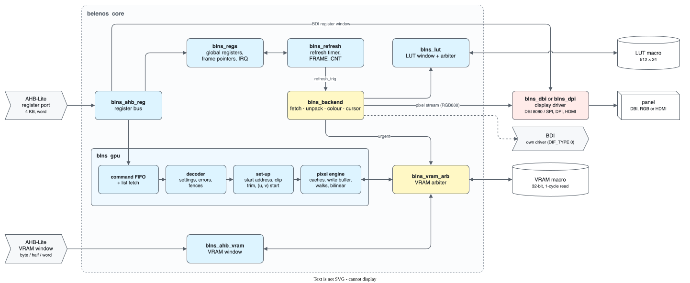

<p align="center">
  
</p>

# Belenos

*The graphic controller of the aRVern ecosystem.*

---

## What is Belenos?

Belenos is a 32-bit frame-buffer graphic controller for
[aRVern](https://github.com/Arvern-Silicon/arvern)-based systems, built around AHB-Lite
and derived from the openGFX430 controller. It has two AHB-Lite ports (a 4 KB register
port and a VRAM window), keeps its frame buffers in a single-port video memory, draws
through the window or with an optional 2D GPU, and drives the display with a built-in
driver (MIPI-DBI over 8080 or SPI, MIPI-DPI with scaling, HDMI with audio) or through an
exported interface for any other display. This documentation describes version 0.1.0-preview.

Companion repositories: [`arvern-ips`](https://github.com/Arvern-Silicon/arvern-ips)
(the `arv_primitives` cells the RTL is built from) and
[`arvern-soc`](https://github.com/Arvern-Silicon/arvern-soc) (the board builds and the
regressions of the applications).

<p align="center">
  
</p>

## What it supports

- 1, 2, 4, 8 and 16 bits per pixel, hardware palettes and a programmable RGB888 LUT;
- one, two or four frame pointers, eight scan orientations, timer or manual refresh;
- drawing through a direct AHB window, or with a 2D GPU
  (fill, copy, transparent copy, sixteen raster operations, text expansion, textured spans,
  command lists, fences, a FIFO low-water interrupt with a programmable threshold, the
  discard of a command cut by its pusher, a wait for the end of a frame;
  optionally x/y coordinates with clipping, affine blits, gradient fills, alpha blending,
  triangles, palette remap, a mask plane on copies, an immediate source of CPU pixels,
  solid, dashed and anti-aliased lines, RGB565A8 per-pixel alpha and bilinear texture
  sampling);
- a 32 × 32 hardware cursor, laid over the frame on its way to the display;
- five personas, from a display controller to a GPU for games, so that the hardware scales
  with the CPU time a design wants to save ([cost by persona](#cost-by-persona));
- a built-in MIPI-DBI driver for ILI9341-class panels over an 8080-16 bus or SPI, a
  built-in MIPI-DPI driver for parallel RGB panels (programmable timing, nearest-neighbour
  or bilinear scaling, its own pixel clock), the same driver with a TMDS encoder for HDMI
  (DVI signalling, or HDMI mode with InfoFrames, stereo audio from I2S and the DDC lines
  for the EDID), or an exported pixel-stream interface for any other display;
- clock-gating request, debug freeze of refresh and GPU, optional user-mode check;
- a bare-metal C driver library with panel drivers, and an LVGL v9 display driver with a
  GPU draw unit.

## Maturity

- **Directed regression**: directed tests in six groups (registers, GPU, backend, DBI, DPI
  and HDMI, smoke), run across a sweep of shared and simulation-only configurations in
  four tiers, with always-on AHB-Lite contract, macro-port and output monitors and
  reference models of the GPU, the backend and the panels
  ([tests](doc/verification_guide.md#12-tests),
  [configurations and tiers](doc/simulation_guide.md#4-configurations-and-tiers)).
- **Random command stream**: a seeded constrained-random GPU command stream with error,
  abort and freeze injections, checked against the reference model
  ([random command stream](doc/verification_guide.md#13-random-command-stream)).
- **Coverage**: functional-coverage bins, mandatory for the full sweep; Verilator line,
  branch and toggle coverage, with every waiver argued in
  [`sim/rtl_sim/run/waivers_cov.md`](sim/rtl_sim/run/waivers_cov.md): 100 % line, branch and
  toggle after waivers
  ([coverage and waivers](doc/verification_guide.md#2-coverage-and-waivers)).
- **Formal proofs**: the VRAM arbiter, the FIFOs, the VRAM window (read-ahead buffer,
  posted writes, registered response), the register port and the DPI clock-domain
  crossings, with free tools ([formal proofs](doc/verification_guide.md#4-formal-proofs)).
- **Lint**: Verilator lint and VC Static sign-off lint on every shared configuration, and
  a structural clock-domain-crossing check ([lint](doc/verification_guide.md#5-lint)).
- **Synthesis**: Design Compiler sweep with scan insertion, the 9.0 ns period met in every
  configuration ([synthesis guide](doc/synthesis_guide.md#11-sweep-conditions)).
- **Performance**: LVGL v9.6's own benchmark, unmodified, run in simulation on an aRVern
  core for every persona, per scene and in cycles per frame, with its conditions; and the
  GPU's cycles per pixel, checked by a test ([performance](doc/performance.md)).
- **Software**: driver host tests against a model of the hardware, under AddressSanitizer
  and UBSan, and an LVGL host test compared pixel for pixel with LVGL's software renderer
  (the draw unit's opt-in approximate draws within their bound);
  board-level regressions of the applications in arvern-soc
  ([driver host tests](doc/verification_guide.md#3-driver-host-tests)).

## Release notes

Latest release: **0.1.0-preview** (Nov 14, 2026), the first public release: a preview for
evaluation and feedback.

What changed in each release: [`CHANGELOG.md`](CHANGELOG.md).

## Cost by persona

Five ready-made feature sets, each a step in what the hardware can draw for the CPU; the
full parameter vectors are in the
[integration guide](doc/integration_guide.md#21-personas). Area in NAND2-equivalent
kGates, without the VRAM, LUT and line-buffer macros and without a display driver
([area results](doc/synthesis_guide.md#1-area-results)); a built-in driver adds 4 to 30
kGates ([display drivers](doc/synthesis_guide.md#14-display-drivers)).

| Persona | **light** | **essential** | **classic** | **performance** | **ultra** |
|---|---|---|---|---|---|
| Hardware | display controller, no GPU | 2D GPU core (fills, copies, text, textured spans, command lists) | + x/y and clipping, affine blits, gradients, lines, palette remap, mask plane, immediate source, hardware cursor | + alpha blending at 16 bpp, run-ahead, bilinear sampling, 16-word command FIFO | + triangles, 32-word command FIFO |
| Uses | small panels driven by an MCU | simple user interfaces, text consoles | 8-bit-per-pixel user interfaces, 2D games — **the parameter defaults** | 16-bit user interfaces | games and 3D effects |
| Area, kGates ↓ | 14.0 | 38.6 | 67.3 | 94.5 | 122.8 |

> **Any other configuration** is equally supported: every feature is one parameter, and
> what each costs, one feature added at a time from `light` to `ultra`, is in the
> [feature cost](doc/synthesis_guide.md#13-feature-cost) table.

## Try it in ten minutes

The RTL uses the `arv_primitives` cells of `arvern-ips`, checked out **next to** this
repository. Prerequisites are Python 3 and Icarus Verilog (the default simulator) or
Verilator ([`doc/simulation_guide.md` §1](doc/simulation_guide.md#1-prerequisites)).

```bash
git clone https://github.com/Arvern-Silicon/arvern-belenos.git
git clone https://github.com/Arvern-Silicon/arvern-ips.git
cd arvern-belenos/sim/rtl_sim/run
./run smoke_gpu            # one test
./run_all -fast -j 8       # T1: the default build and the Tang HDMI build
./run_all -rtl_sweep -j 8  # every configuration
./run_lint                 # Verilator lint
```

A test passes with a PASSED banner and no `ERROR:` line in its log. The commands are
described in the [simulation guide](doc/simulation_guide.md#3-running); a first program
with the driver is its [quick start](doc/driver_guide.md#31-quick-start).

## Where to go next

| Reader | Documents |
|---|---|
| **SoC integrator** — putting Belenos in a chip or an FPGA | [`doc/integration_guide.md`](doc/integration_guide.md) — overview and [personas](doc/integration_guide.md#21-personas) to choose a build, with [`doc/performance.md`](doc/performance.md) for what each one draws faster, [the short version](doc/integration_guide.md#4-integrating-belenos--the-short-version) of the integration steps, ports and tie-offs, clocks, timing constraints, reset, interrupt, debug, privilege · [`doc/memory_and_ahb.md`](doc/memory_and_ahb.md) — the register port, the VRAM window, the VRAM, LUT and line-buffer macros, bandwidth · [`doc/synthesis_guide.md`](doc/synthesis_guide.md) — area per persona, block and feature, the Design Compiler flow · [`doc/display_interface.md`](doc/display_interface.md) — the BDI contract, for a display driver of your own (`DIF_TYPE = 0`) · then check the build with the [simulation guide](doc/simulation_guide.md#3-running) |
| **Firmware / driver developer** — bare-metal code on Belenos | [`doc/driver_guide.md`](doc/driver_guide.md) — the C driver: [build](doc/driver_guide.md#1-build), [porting](doc/driver_guide.md#2-porting), [quick start](doc/driver_guide.md#31-quick-start), the [bring-up](doc/driver_guide.md#8-bring-up) of each display, [conventions](doc/driver_guide.md#4-conventions), [concurrency](doc/driver_guide.md#5-concurrency) and [recovery](doc/driver_guide.md#6-recovery) before using the GPU from more than one context · [`doc/programming_model.md`](doc/programming_model.md) — identification, pixels and frame buffers, refresh, colour, interrupts, debug freeze, the DBI, DPI and HDMI drivers · [`doc/register_map.md`](doc/register_map.md) — address windows, access rules, versions, global registers · [`doc/gpu_commands.md`](doc/gpu_commands.md) — the GPU: [command stream](doc/gpu_commands.md#3-command-stream), [quick reference](doc/gpu_commands.md#32-command-quick-reference), [errors, abort and flush](doc/gpu_commands.md#6-errors-abort-and-flush), every command and feature, performance · [`sw/README.md`](sw/README.md) — the driver's files |
| **LVGL user** — an LVGL v9 user interface on Belenos | [`doc/lvgl_guide.md`](doc/lvgl_guide.md) — the display driver, its flush modes, the GPU draw unit, faults, build · [`doc/performance.md`](doc/performance.md) — what each persona gains on LVGL's benchmark · [`doc/driver_guide.md`](doc/driver_guide.md) — setting Belenos up first ([bring-up](doc/driver_guide.md#8-bring-up)) · [`sw/lvgl/README.md`](sw/lvgl/README.md) — the driver's files |
| **Verification contributor** — writing or running tests | [`doc/simulation_guide.md`](doc/simulation_guide.md) — prerequisites, repository layout, the run scripts, configurations and tiers, coverage runs · [`doc/verification_guide.md`](doc/verification_guide.md) — the bench, tests, the random command stream, coverage and waivers, driver host tests, formal proofs, lint, and the [documentation checks](doc/verification_guide.md#6-documentation-checks) after a documentation change · [`doc/slipstream_trace_format.md`](doc/slipstream_trace_format.md) — the GPU trace of a simulation and the CPU + GPU profiler · [`lint/vc_static/README.md`](lint/vc_static/README.md) — the VC Static sign-off lint flow · [`formal/README.md`](formal/README.md) — the formal proofs |
| **Designer / reviewer** — changing or auditing the RTL | [`doc/integration_guide.md`](doc/integration_guide.md) — [block structure](doc/integration_guide.md#12-block-structure) and VRAM arbitration, [module hierarchy](doc/integration_guide.md#3-module-hierarchy), [separate pixel clock](doc/integration_guide.md#62-separate-pixel-clock) crossings · [`doc/gpu_commands.md`](doc/gpu_commands.md) — the specification the GPU and its reference model follow, [performance](doc/gpu_commands.md#24-performance) · [`doc/verification_guide.md`](doc/verification_guide.md) — what each change must keep passing · [`doc/synthesis_guide.md`](doc/synthesis_guide.md) — the area of each block and feature |

Release notes for everyone: [`CHANGELOG.md`](CHANGELOG.md).

## License

BSD 3-Clause — see [`LICENSE`](LICENSE).
