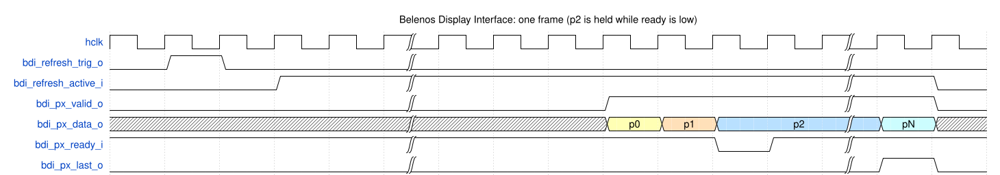
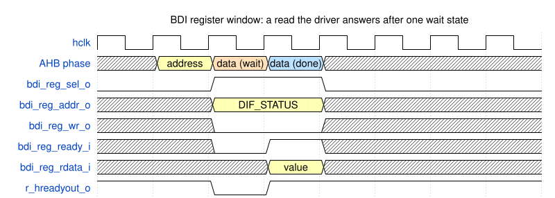

<p align="center">
  
</p>

# Belenos display interface (BDI)

*For authors of a custom display driver: the Belenos Display Interface (BDI) between the
controller and a display driver — its signals, clock, the pixel stream, the register
window, interrupt and busy, and the software side — and how the built-in drivers sit on
it. The built-in DBI and DPI drivers are described in the
[programming model](programming_model.md#9-the-built-in-dbi-driver), their pins and
macros in the [integration guide](integration_guide.md#52-dpi-and-hdmi-ports).*

---

## Table of Contents

1. [Overview](#1-overview)
2. [The Belenos Display Interface (BDI)](#2-the-belenos-display-interface-bdi)
    - [2.1 Signals](#21-signals)
    - [2.2 Clock and reset](#22-clock-and-reset)
    - [2.3 Pixel stream](#23-pixel-stream)
    - [2.4 Register window](#24-register-window)
    - [2.5 Interrupt and busy](#25-interrupt-and-busy)
    - [2.6 Writing your own driver](#26-writing-your-own-driver)
    - [2.7 Software](#27-software)
3. [The built-in drivers](#3-the-built-in-drivers)
- [See Also](#see-also)

---

## 1. Overview

The Belenos core produces a stream of RGB888 pixels, one frame per refresh, and owns a
register window of two 32-word pages at `0x180`–`0x27C` of the register port that it
forwards to the display driver. Everything panel-specific lives in the driver, chosen by
`DIF_TYPE`, in order of increasing size:

| `DIF_TYPE` | Name | Display driver |
|---|---|---|
| 0 | `BDI` | none: the BDI is exported and an integrator connects their own driver (an LED-matrix scanner, a serial link...) without touching the controller |
| 1 | `DBI_SPI` | [MIPI-DBI](programming_model.md#9-the-built-in-dbi-driver) over SPI (DBI type C), for panels with their own frame memory |
| 2 | `DBI_PAR` | MIPI-DBI over the 16-bit parallel bus (DBI type B, "8080") |
| 3 | `DBI_PAR_SPI` | both DBI buses, chosen at run time (`DIF_CFG.PHY_SEL`) |
| 4 | `DPI` | [MIPI-DPI](programming_model.md#10-the-built-in-dpi-driver): parallel RGB with pixel clock, syncs and data enable, for panels without frame memory |
| 5 | `HDMI` | [the DPI driver followed by a TMDS encoder](programming_model.md#11-hdmi): three 10-bit TMDS symbols per pixel for a serialiser, DVI signalling, or HDMI with data islands |

Software keeps the same register map and drawing engines; only the window at `0x180`
changes meaning. `BLNS_CFG.DIF_TYPE` ([15:13]) tells software which driver a build has.

---

## 2. The Belenos Display Interface (BDI)

### 2.1 Signals

Directions are seen from Belenos (`belenos` ports).

| Signal | Dir | Width | Meaning |
|---|---|---|---|
| `bdi_refresh_trig_o` | out | 1 | one-cycle request for a frame (refresh timer or manual `START`) |
| `bdi_refresh_active_i` | in | 1 | the driver is taking a frame |
| `bdi_px_valid_o` | out | 1 | a pixel is offered |
| `bdi_px_data_o` | out | 24 | pixel, RGB888: [23:16] red, [15:8] green, [7:0] blue |
| `bdi_px_last_o` | out | 1 | the offered pixel is the last of the frame |
| `bdi_px_ready_i` | in | 1 | the driver takes the pixel (transfer on `valid & ready`) |
| `bdi_width_o` | out | `DIM_W` | `DISP_SIZE` width, live (see [Pixel stream](#23-pixel-stream)) |
| `bdi_height_o` | out | `DIM_W` | `DISP_SIZE` height, live |
| `bdi_reg_sel_o` | out | 1 | a register access to the window is pending |
| `bdi_reg_addr_o` | out | 6 | word index: [4:0] within a page, [5] the page: 0 at `0x180` (`0x180 + 4 · index`), 1 at `0x200` (`0x200 + 4 · (index − 32)`) |
| `bdi_reg_wr_o` | out | 1 | 1 = write |
| `bdi_reg_wdata_o` | out | 32 | write data |
| `bdi_reg_rdata_i` | in | 32 | read data, valid with `ready` |
| `bdi_reg_ready_i` | in | 1 | the access completes |
| `bdi_irq_i` | in | 1 | driver interrupt (level), visible as `IRQ_FLAG.DIF` |
| `bdi_busy_i` | in | 1 | the driver needs the clock; visible as `STATUS.DIF_BUSY` |

With `DIF_TYPE` 1 to 5 the built-in driver sits on these signals inside Belenos: the
`bdi_*` outputs then show its stream (for observation) and the `bdi_*` inputs are
ignored. Tie the inputs off in any build that leaves them unconnected
([Writing your own driver](#26-writing-your-own-driver)).

### 2.2 Clock and reset

Every BDI signal is synchronous to `hclk_i` and reset by `hresetn_i`, as the rest of the
core: the stream runs at up to one pixel per `hclk_i` cycle, and a driver whose panel
needs another clock crosses into it on its own side (a FIFO, as the built-in DPI
driver's line buffers do).

With clock gating ([integration guide](integration_guide.md#61-clock-gating)), `hclk_i`
runs only while `hclk_en_o` asks for it: during bus accesses, while the GPU or the
refresh works, while the refresh timer runs, during a frame (`bdi_refresh_active_i`)
and while the driver holds `bdi_busy_i`. A driver that waits for anything on its own (an
external event, a transfer it started) holds `bdi_busy_i`, or the clock may stop under
it.

### 2.3 Pixel stream



1. Belenos pulses `bdi_refresh_trig_o` when a frame is requested. The driver decides
   when to take it (at the earliest in the next cycle, at the next sync, after a command
   it is sending).
2. The driver raises `bdi_refresh_active_i`. Belenos samples the refresh configuration
   in the last cycle before that edge and keeps it until `bdi_refresh_active_i` falls:
   the frame pointer `FRAME_SEL` selects (read back as `FRAME_SEL.LATCHED`), `GFX_MODE`,
   `DISP_CFG` (orientation, pixel doubling), `DISP_SIZE`, `REFR_PITCH`, the hardware
   palette, `LUT_CFG` (`SW_LUT_EN`, `REFR_BANK`) and `LUT_ROT`.
3. The first pixel is offered within `DIM_W` + 4 cycles plus the VRAM read latency
   (`VRAM_RD_LAT` + `VRAM_RD_REG_EN`: 15 cycles by default), 2 more when the
   [hardware cursor](programming_model.md#44-hardware-cursor) covers it. A pixel transfers in each cycle with
   `valid & ready`; while `ready` is low the pixel and `last` are held. With `ready` high
   and no VRAM contention the stream has no bubble: one pixel per cycle (a register-port
   LUT access in indexed modes takes one cycle of it after waiting 4: see the
   [LUT macro](memory_and_ahb.md#5-lut-macro)).
4. Exactly `width × height` pixels of the sampled `DISP_SIZE` are offered (a 0 counts as
   1), in the scan order of `DISP_CFG`; the last one has `bdi_px_last_o = 1`. The
   hardware cursor, when shown, is already in them: a driver has nothing to add.
5. The driver drops `bdi_refresh_active_i` after taking the last pixel; `bdi_px_valid_o`
   falls in the same cycle. Belenos raises `REFR_DONE` on that edge and `REFR_START` on
   the rising one.

`bdi_width_o` and `bdi_height_o` follow `DISP_SIZE` as stored, also during a frame (a 0
written to a field is stored as 1, so they are never 0): a driver that needs the size of the frame it
takes (a window command, a line length) latches them when it raises
`bdi_refresh_active_i`, or counts on `bdi_px_last_o`. (The built-in DBI driver gets
them held from the start of its refresh to its first pixel.)

Dropping `bdi_refresh_active_i` before the last pixel abandons the frame: the backend
flushes and waits for the next frame. `REFR_DONE` is raised all the same, and
`STATUS.REFR_ABANDONED` tells software that the frame ended early
([refresh](programming_model.md#3-refresh)). At most the VRAM read latency + 4 pixels
(5 to 8) are in flight between the VRAM and the driver.

### 2.4 Register window

Register-port accesses to `0x180`–`0x27C` are forwarded on the `bdi_reg_*` signals in the
AHB data phase:



- `bdi_reg_sel_o` rises in the data phase and stays high, with address, `wr` and write
  data stable, until the driver returns `bdi_reg_ready_i = 1`; the access completes in
  that cycle (zero wait states if the driver answers at once).
- Read data must be valid in the `ready` cycle.
- Every side effect of the access (a write, a pop, a write-1-to-clear) must happen once,
  in the cycle `sel & ready`.
- The driver decodes `bdi_reg_addr_o[5]`: a driver with one page answers page 1 with
  read data 0 and ignores writes there, so that `0x200`–`0x27C` does not alias onto its
  registers.
- While `ready` is low the CPU, and every other manager of the bus, waits: a driver
  bounds its wait states and never makes an access wait for a panel event. (The
  built-in DBI driver answers every access at once: a parameter write to its full FIFO
  is dropped and sets `PARAM_OVFL`, see
  [commands and parameters](programming_model.md#92-commands-and-parameters).)

Only word accesses reach the window: others, and user-mode accesses with
`PRIV_CHECK_EN = 1`, get an AHB ERROR from the register port and are not forwarded.

### 2.5 Interrupt and busy

`bdi_irq_i` is a level that Belenos shows as `IRQ_FLAG.DIF` (enabled by `IRQ_EN.DIF`);
writing `IRQ_FLAG` does not clear it (it is not write-1-to-clear): software clears the
event in the driver's own registers, and the flag falls with the level. `bdi_busy_i`
keeps `hclk_en_o` high ([clock and reset](#22-clock-and-reset)) and reads as
`STATUS.DIF_BUSY`: a driver asserts it while it has anything to do on its own (a
transfer in progress, a pending request, an armed external event).

### 2.6 Writing your own driver

A minimal driver:

- latches `bdi_refresh_trig_o` (one deep is enough) and starts a frame when it can;
- raises `bdi_refresh_active_i`, latches `bdi_width_o` / `bdi_height_o` if it needs
  them, takes `width × height` pixels with `bdi_px_ready_i`, drops
  `bdi_refresh_active_i` after `bdi_px_last_o`;
- implements whatever registers it needs in the window, answering every access with
  `bdi_reg_ready_i` within a bounded time, and page 1 with 0 when it has no second page;
- drives `bdi_busy_i` while it works and `bdi_irq_i` for its events.

Every `bdi_*` input comes from a flop of the driver, `bdi_refresh_active_i` in
particular: it reaches `bdi_px_valid_o` in the same cycle (step 5 above), and with
`bdi_px_valid_o` and `bdi_px_last_o` also combinational from Belenos flops, a
`bdi_refresh_active_i` decoded from them would close a combinational loop.
`bdi_reg_ready_i` and `bdi_reg_rdata_i` reach the register port's HREADYOUT and HRDATA in
the same cycle, `bdi_busy_i` the clock-gate enable
([timing constraints](integration_guide.md#7-timing-constraints)). Belenos' VRAM and LUT
requests follow `bdi_refresh_active_i` through a flop, so the bus ready never depends on
it; with `LUT_EN = 0`, `bdi_px_data_o` is the hardware colour of the backend's FIFO head,
decoded after its flops in the same cycle (a few gate levels more than with the LUT,
where it comes from the output queue).

It is connected to a `DIF_TYPE = 0` build. There every built-in panel pin is inactive:
`lcd_on_o` is constant 0 and `lcd_reset_n_o` constant 1, so a driver that powers or
resets its panel drives its own pins from its registers. Unused inputs tie off as:
`bdi_reg_ready_i = 1`, `bdi_reg_rdata_i = 0`, `bdi_px_ready_i = 1`, the others 0
([display interface selection](integration_guide.md#56-display-interface-selection)).

### 2.7 Software

On a `DIF_TYPE = 0` build `blns_t.caps.dif_type` is `BLNS_DIF_BDI`, the `blns_dbi_*` and
`blns_dpi_*` calls return `BLNS_ERR_ABSENT`, and the rest of the driver library works
unchanged: the refresh timer (`blns_refresh_rate`, `blns_refresh_once`) requests the
frames, and the frame waits and flips follow them (`FRAME_NUM`, `FRAME_SEL.LATCHED`).
The driver's registers are the window of the register overlay, `BLNS_TypeDef` at `0x180`:

```c
#include "belenos.h"

/* A driver with an enable at 0x180 and a write-1-to-clear event flag at 0x184 */
#define MY_CTRL     0u                               /* word indices in the window */
#define MY_EVENT    1u

static volatile uint32_t *my_regs(const blns_t *dev)
{
    return (volatile uint32_t *) &dev->regs->DIF;    /* 0x180; page 1 (0x200) at index 32 */
}

blns_status_t my_display_start(blns_t *dev)
{
    if (dev->caps.dif_type != BLNS_DIF_BDI)
        return BLNS_ERR_ABSENT;
    my_regs(dev)[MY_CTRL] = 1u;                      /* the driver's own enable */
    blns_status_t st = blns_irq_enable(dev, BLNS_IRQ_DIF_Msk);   /* its interrupt: IRQ_FLAG.DIF */
    if (st == BLNS_OK)
        st = blns_refresh_rate(dev, 60);             /* the refresh timer requests the frames */
    return st;
}

void my_irq_handler(blns_t *dev)                     /* on irq_o, with IRQ_FLAG.DIF set */
{
    my_regs(dev)[MY_EVENT] = 1u;                     /* clears the event: bdi_irq_i falls */
}
```

The display driver's software goes next to the panel drivers of `sw/panel/`
([adding a panel driver](driver_guide.md#11-adding-a-panel-driver)).

---

## 3. The built-in drivers

The built-in drivers (`DIF_TYPE` 1 to 5) sit on the same interface inside Belenos. Their
registers and behaviour are in the programming model:
[the DBI driver](programming_model.md#9-the-built-in-dbi-driver),
[the DPI driver](programming_model.md#10-the-built-in-dpi-driver) and
[HDMI](programming_model.md#11-hdmi); their pins and macros in the
[integration guide](integration_guide.md#52-dpi-and-hdmi-ports), and their C API in the
[driver library](driver_guide.md#8-bring-up). A driver of your own takes their place with
`DIF_TYPE = 0`: its ports and tie-offs are in the
[integration guide](integration_guide.md#56-display-interface-selection).

The hardware cursor is part of the frame each driver takes. The DPI driver scales it with
the image. A DBI panel keeps what it was sent, so the cursor moves with the next refresh;
a windowed refresh (`HW_WINDOW_EN = 0` on a sub-rectangle) places it relative to the
sub-frame sent ([hardware cursor](programming_model.md#44-hardware-cursor)).

---

## See Also

- [integration_guide.md](integration_guide.md) — display interface selection, ports and tie-offs, BDI timing constraints
- [programming_model.md](programming_model.md) — the built-in DBI, DPI and HDMI drivers at register level
- [driver_guide.md](driver_guide.md) — adding a panel driver to the C library
- `bench/verilog/bk_bdi_model.v` — the bench's BDI driver model
