<p align="center">
  
</p>

# Belenos GPU command set

*The 2D GPU of the Belenos graphic controller at register level, for firmware and driver
writers: its registers, the command stream, raster operations, errors, every command and
feature, and performance. The rest of the register map is in
[register_map.md](register_map.md) and the [programming model](programming_model.md);
the C driver in [driver_guide.md](driver_guide.md).*

---

## Table of Contents

1. [Overview](#1-overview)
2. [GPU registers](#2-gpu-registers)
3. [Command stream](#3-command-stream)
    - [3.1 Pushing](#31-pushing)
    - [3.2 Command quick reference](#32-command-quick-reference)
    - [3.3 GPU settings](#33-gpu-settings)
4. [Raster operations](#4-raster-operations)
5. [Transparency](#5-transparency)
6. [Errors, abort and flush](#6-errors-abort-and-flush)
7. [Commands](#7-commands)
8. [Rectangle walks](#8-rectangle-walks)
9. [Source and destination formats](#9-source-and-destination-formats)
10. [Coordinates and clipping](#10-coordinates-and-clipping)
11. [Colour expansion](#11-colour-expansion)
12. [Textured spans](#12-textured-spans)
13. [Affine blits](#13-affine-blits)
14. [Gradient fills](#14-gradient-fills)
15. [Triangles](#15-triangles)
    - [15.1 Textured triangles](#151-textured-triangles)
16. [Blending](#16-blending)
17. [Palette remap](#17-palette-remap)
18. [Mask plane](#18-mask-plane)
19. [Immediate source](#19-immediate-source)
20. [Command lists](#20-command-lists)
21. [Fences](#21-fences)
22. [Frame wait and state reset](#22-frame-wait-and-state-reset)
23. [Concurrent CPU access](#23-concurrent-cpu-access)
24. [Performance](#24-performance)
    - [24.1 VRAM sharing](#241-vram-sharing)
    - [24.2 Run-ahead](#242-run-ahead)
25. [Lines](#25-lines)
26. [Alpha planes (RGB565A8)](#26-alpha-planes-rgb565a8)
27. [Bilinear sampling](#27-bilinear-sampling)
- [See Also](#see-also)

---

## 1. Overview

The GPU executes commands from a FIFO: it fills or copies rectangles in the VRAM while
the CPU does something else. Surfaces are described by an absolute pixel address and a
pitch; the frame pointers do not apply.

---

## 2. GPU registers

| Offset | Name | Access | Fields |
|---|---|---|---|
| `0x100` | `GPU_CMD` | W (reads 0) | push one command word (never waits: see [pushing](#31-pushing)) |
| `0x104` | `GPU_STAT` | RO | see below |
| `0x108` | `GPU_CTRL` | W (reads 0) | [0] `CLEAR_ERR`, [1] `ABORT`, [2] `DISCARD` ([errors](#6-errors-abort-and-flush); applied after [0] / [1] of the same write) |
| `0x10C` | `GPU_LIST` | RO | word address of the next [command-list](#20-command-lists) word while `LIST` = 1, of the refused word with `ERR`; 0 otherwise |
| `0x110` | `GPU_FENCE` | RO | [23:0] tag of the last [`FENCE`](#21-fences) reached |
| `0x114` | `GPU_ERR` | RO | the word that stopped the decoder, else the last `EXEC` ([errors](#6-errors-abort-and-flush)) |
| `0x118` | `GPU_FIFO_LOW` | RW | [16:0] `THRESH`: the [`GPU_FIFO_LOW` event](#31-pushing) when `FREE` rises above it. Reset: depth / 2. A value of the depth or more never fires and reads back as the depth (the implemented width is `GPU_FIFO_AW` + 1 bits); [31:17] are ignored and read 0 |
| `0x11C` | — | — | reserved (read 0, writes ignored) |

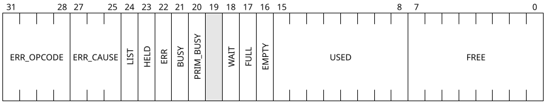

| `GPU_STAT` field | Meaning |
|---|---|
| [7:0] `FREE`, [15:8] `USED` | free and used FIFO words (a `DISCARD` marker counts as one); the depth is 2^`BLNS_CFG2.FIFO_AW` (`GPU_FIFO_AW`: 8 … 64 words, 8 by default). While a marker waits for room ([errors](#6-errors-abort-and-flush)) `FREE` reads 0 |
| [16] `EMPTY`, [17] `FULL` | FIFO state (`FULL` also while a marker waits for room) |
| [18] `WAIT` | a `WAIT_REFR_DONE` holds the decoder until the end of a frame |
| [20] `PRIM_BUSY` | a primitive is being set up or drawn |
| [21] `BUSY` | FIFO not empty, a command list being executed, a rectangle running, or the decoder waiting for an operand. A GPU stopped on a refused word stays `BUSY` (the word stays in the FIFO or the list); after `ERR_CAUSE` 5 or 6, whose words were taken, `BUSY` falls once nothing else is queued |
| [22] `ERR` | an error stopped the decoder |
| [23] `HELD` | the debug freeze has taken effect (between two pixels or idle; see [Debug freeze](programming_model.md#7-debug-freeze)) |
| [24] `LIST` | a [command list](#20-command-lists) is being executed |
| [27:25] `ERR_CAUSE` | why: 1 invalid command, 2 absent feature, 3 format, 4 list cut, 5 rectangle past the VRAM, 6 `CALL` past the VRAM ([errors](#6-errors-abort-and-flush)) |
| [31:28] `ERR_OPCODE` | opcode of the command of the last error |

---

## 3. Command stream

The GPU runs only with `CTRL.GPU_EN = 1`. Bits [31:28] of a word are its opcode. Some
commands take one operand: the next word of the stream.

### 3.1 Pushing

- **`GPU_CMD` never waits.** A store to it completes at once (no wait state). A word
  pushed while the FIFO is full, or with `GPU_EN = 0`, is dropped and raises
  `GPU_OVFL`: check `GPU_STAT.FREE` before pushing a command sequence. Words pushed
  while the GPU is stopped on an error are queued as usual, until the FIFO is full;
  `CLEAR_ERR` discards them with the rest of the FIFO.
- **The stream is parsed as it is pushed.** The GPU tracks, as words are pushed, whether
  the next one is an operand or [immediate data](#19-immediate-source), by the encoding of
  each command word (whatever the build: a refused command's operand is still counted
  as its operand). It counts only the words the FIFO accepts. After a dropped word the
  stream is therefore out of step: the next word pushed is taken as the missing operand
  (or command), and the words after it are misread. `CLEAR_ERR`, `ABORT` and `DISCARD`
  do not repair this (the GPU does not know a word was lost, see
  [errors](#6-errors-abort-and-flush)); only `GPU_EN` = 0 then 1 resynchronises the
  stream: the next word pushed is decoded as a command. The driver never pushes into a
  full FIFO. A stream the pusher itself stopped inside a command (a timeout in a long
  push) is made whole by `DISCARD` without losing the work queued.
- **Status and events.** `GPU_IDLE` is raised when `BUSY` falls after a word was pushed
  since the previous `GPU_IDLE` (a `DISCARD` marker alone raises none). A GPU stopped on a
  refused word stays `BUSY`, so it raises `GPU_ERR`, not `GPU_IDLE`; after `ERR_CAUSE` 5 or
  6 (their words already taken) `BUSY` falls once nothing else is queued, and `GPU_IDLE`
  is raised as well. A wait for the GPU tests both. `GPU_DONE` is raised when an `EXEC` completes (every kind, a triangle included),
  and also for a rectangle the clip window trims away and for a `TRI` in address mode
  (nothing drawn); not for a primitive abandoned by `ABORT` or `ERR_CAUSE` 5. A `FENCE`
  with `IRQ` raises `GPU_FENCE` ([fences](#21-fences)).
- **FIFO low water** (`IRQ_FLAG` [10] `GPU_FIFO_LOW`): raised when `FREE` rises above
  `GPU_FIFO_LOW.THRESH`, from `THRESH` or less to more (a flush included), an edge: once
  per crossing. `THRESH` resets to half the depth (`FREE` from `depth / 2` to
  `depth / 2 + 1`); 0 fires at the first free word, the depth or more never. A write
  to `GPU_FIFO_LOW` re-arms the event: with `FREE` already above the new value, it
  fires in the next cycle, so a producer clears the flag, writes the threshold it
  needs (the words of its next sequence − 1) and sleeps with no lost wake-up. `THRESH`
  is kept through `CLEAR_ERR`, `ABORT`, `GPU_EN` = 0 and `RESET_STATE`. A producer
  under an RTOS enables the interrupt and sleeps until the FIFO has room instead of
  polling `GPU_STAT.FREE` (`blns_gpu_wait_fifo_low` and `blns_gpu_wait_space` poll).
- **Pitch 0.** A surface pitch of 0 (`SET_SRC`, `SET_DST`, a free-pitch texture) is the
  frame width: the `DISP_SIZE` width, halved with pixel doubling, **never
  `REFR_PITCH`**. With a virtual frame wider than the display (`REFR_PITCH` set), give
  the pitch explicitly. In address mode it is taken when the `EXEC` starts (with
  `GFX_MODE`), in [x/y mode](#10-coordinates-and-clipping) at the `SET_DST` / `SET_XY`.
  The source of `EXEC_EXPAND` is the exception: its pitch 0 is the rectangle width. The
  driver replaces pitch 0 by the display pitch at each call.
- **One owner, settings kept.** The GPU keeps every [setting](#33-gpu-settings) from one
  command to the next, and a [command list](#20-command-lists) runs with whatever settings
  it finds: one software client pushes commands at a time, and a list sets what it
  uses.

What the driver adds on top of these rules (waiting for FIFO room for a whole call,
the recover, the prologue of a recorded list, the values it always sends) is in the
[driver conventions](driver_guide.md#4-conventions).

### 3.2 Command quick reference

One row per command word; the operand is the next word of the stream. "Built with" is the
parameter a command or field needs ([feature parameters](integration_guide.md#22-feature-parameters));
without it the word is refused with `ERR_CAUSE` 2 unless the row says otherwise. Format
errors (`ERR_CAUSE` 3) take precedence over cause 2, and cause 2 over cause 1. The
settings of the command word are taken when the decoder reads that word, those of the
operand when it reads the operand: a command cut between the two by a flush keeps what
its word set ([errors](#6-errors-abort-and-flush)).

| Opcode | Command | Words | The command word sets or does | The operand sets | Built with (absent: refused, cause 2) | See |
|---|---|---|---|---|---|---|
| `0x0` | — | 1 | an invalid opcode (`ERR_CAUSE` 1) | — | — | [errors](#6-errors-abort-and-flush) |
| `0x1` | `SET_SRC` | 2 | source pitch, `SRC_FMT`; from `GPU_CMD`, with `IMM` it arms the immediate source for the next copy or `EXEC_EXPAND`, without it disarms it | source base pixel address; with `IMM`: `N`, the data count (the base is kept) | `IMM`: `GPU_IMM_EN`; `SRC_FMT` 5 (RGB565A8): `GPU_BLEND_EN` | [formats](#9-source-and-destination-formats), [immediate source](#19-immediate-source), [alpha planes](#26-alpha-planes-rgb565a8) |
| `0x2` | `SET_DST` | 2 | destination pitch, x/y mode (`XY`), the pitch-0 frame width | destination base pixel address, which is also the surface origin of x/y mode; position (0, 0), the pitch-0 frame width (whatever `XY`) | `XY`: `GPU_XY_EN` | [coordinates](#10-coordinates-and-clipping) |
| `0x3` | `SET_SIZE` | 1 | width, height | — | every GPU | [commands](#7-commands) |
| `0x4` | `SET_FILL` | 2 | — | fill colour | every GPU | [commands](#7-commands) |
| `0x5` | `SET_TRANSP` | 2 | — | transparent colour | every GPU | [transparency](#5-transparency) |
| `0x6` sub 0 | `SET_TEX` | 1 | texture log2 width and height, `TRANSP_EN`, destination swaps, `FREE_PITCH`, `BOUND`, `REMAP`, `SHADE` (the texture base is the `SET_SRC` operand) | — | `BOUND`: `GPU_XY_EN`; `REMAP` 1, 2: `GPU_REMAP_EN` (`REMAP` 3: cause 1 in every build) | [textured spans](#12-textured-spans), [affine blits](#13-affine-blits) |
| `0x6` sub 1 | `SET_UV` | 2 | — | u0, v0: texture start | every GPU | [textured spans](#12-textured-spans) |
| `0x6` sub 2 | `SET_STEP` | 2 | — | du, dv: texture step per pixel | every GPU | [textured spans](#12-textured-spans) |
| `0x6` sub 3 | `SET_XY` | 1 | x, y of the next rectangle (and the pitch-0 frame width) | — | `GPU_XY_EN` | [coordinates](#10-coordinates-and-clipping) |
| `0x6` sub 4 | `SET_CLIP` | 2 | x0, y0 of the clip window | x1, y1 of the clip window | `GPU_XY_EN` | [coordinates](#10-coordinates-and-clipping) |
| `0x6` sub 5 | `SET_STEP_ROW` | 2 | — | du′, dv′: texture step per row | `GPU_XY_EN` | [affine blits](#13-affine-blits) |
| `0x6` sub 6 | `SET_TEXBOX` | 1 | texture box TW × TH | — | `GPU_XY_EN` | [affine blits](#13-affine-blits) |
| `0x6` sub 7 | `SET_GRAD` | 1 | gradient `N`, `AXIS`, `STEP`, `EN`, `RGB` | — | `GPU_GRAD_EN` | [gradient fills](#14-gradient-fills) |
| `0x6` sub 8 | `SET_ALPHA` | 1 | alpha `A`, `EN`, the blend rule `MIX5` | — | `GPU_BLEND_EN` | [blending](#16-blending) |
| `0x6` subs 9–11 | `SET_V0`–`SET_V2` | 2 | — | a triangle vertex {y, x}, 12.4 | `GPU_TRI_EN` and `GPU_XY_EN` | [triangles](#15-triangles) |
| `0x6` sub 12 | `SET_GRAD_RGB` | 2 | — | dR, dG, dB: per-channel gradient steps | `GPU_GRAD_EN` | [gradient fills](#14-gradient-fills) |
| `0x6` sub 13, `SEL` 0 | `SET_AUX` `REMAP_TABLE` | 2 | — | remap table pointer | `GPU_REMAP_EN` | [palette remap](#17-palette-remap) |
| `0x6` sub 13, `SEL` 1 | `SET_AUX` `MASK_PLANE` | 2 | `INV` | mask plane pointer (1-bpp pixel address of the mask bit of the source's first pixel) | `GPU_MPLANE_EN` (a `PITCH` other than 0: cause 2 in every build) | [mask plane](#18-mask-plane) |
| `0x6` sub 13, `SEL` 2 | `SET_AUX` `LINE_PEN` | 2 | — | the line pen {y, x}, 12.4 | `GPU_LINE_EN` and `GPU_XY_EN` | [lines](#25-lines) |
| `0x6` sub 13, `SEL` 3 | `SET_AUX` `LINE_PATTERN` | 2 | `LEN` − 1; the pattern phase to 0 | the line pattern | `GPU_LINE_EN` and `GPU_XY_EN` | [lines](#25-lines) |
| `0x6` sub 13, `SEL` 4 | `SET_AUX` `ALPHA_PLANE` | 2 | — | alpha plane pointer (byte address of the alpha of the source's first pixel) | `GPU_BLEND_EN` (a `PITCH` other than 0: cause 2 in every build) | [alpha planes](#26-alpha-planes-rgb565a8) |
| `0x6` sub 13, `SEL` 5 | `SET_AUX` `TEX_FILTER` | 2 | `BILINEAR`, `TBORDER` | — (ignored) | `GPU_BILINEAR_EN` and `GPU_XY_EN`; `TBORDER`: `GPU_BLEND_EN` | [bilinear sampling](#27-bilinear-sampling) |
| `0x6` sub 13, `SEL` 6–15 | — | 2 | invalid (`ERR_CAUSE` 1) | — | — | [errors](#6-errors-abort-and-flush) |
| `0x6` sub 14 | — | 1 | invalid (`ERR_CAUSE` 1) | — | — | [errors](#6-errors-abort-and-flush) |
| `0x6` sub 15, code 1 | `SET_EXT2` `WAIT_REFR_DONE` | 1 | the commands after it wait for the end of a frame | — | every GPU | [frame wait](#22-frame-wait-and-state-reset) |
| `0x6` sub 15, code 2 | `SET_EXT2` `RESET_STATE` | 1 | every setting back to its reset value | — | every GPU | [state reset](#22-frame-wait-and-state-reset) |
| `0x6` sub 15, other codes | — | 1 | invalid (`ERR_CAUSE` 1) | — | — | [errors](#6-errors-abort-and-flush) |
| `0x7` | `CALL` | 2 | `N` (in a list: invalid, `ERR_CAUSE` 1) | word address of the list in VRAM: runs its `N` words (past the VRAM: `ERR_CAUSE` 6) | every GPU | [command lists](#20-command-lists) |
| `0x8` | `EXEC_FILL` | 1 | fills the rectangle, or with `TRI` the triangle | — | `TRI`: `GPU_TRI_EN` and `GPU_XY_EN`; `REMAP` 1, 2: `GPU_REMAP_EN` | [commands](#7-commands), [triangles](#15-triangles) |
| `0x8` with `LINE` | `EXEC_FILL` `LINE` | 2 | the line options (`AA`, `NO_LAST`, `OPAQUE`, `PH_RST`) | the end point {y, x}, 12.4: draws the line from the pen, the pen moves there | `GPU_LINE_EN` and `GPU_XY_EN`; `AA`: `GPU_BLEND_EN`; `REMAP` 1, 2: `GPU_REMAP_EN` | [lines](#25-lines) |
| `0x9` | `EXEC_COPY` | 1, then `N` data words with the immediate source | copies the rectangle | — | `MPLANE`: `GPU_MPLANE_EN`; `REMAP` 1, 2: `GPU_REMAP_EN` | [commands](#7-commands), [mask plane](#18-mask-plane) |
| `0xA` | `EXEC_COPY_TRANSP` | as `EXEC_COPY` | copies the rectangle, skipping the transparent colour | — | as `EXEC_COPY` | [transparency](#5-transparency) |
| `0xB` | `EXEC_SPAN` | 1 | destination base += `DELTA` (x/y mode: x += `DELTA`), size width × 1, then a fill | — | every GPU | [commands](#7-commands) |
| `0xC` | `EXEC_EXPAND` | 1, then `N` data words with the immediate source | destination base += `DELTA` (x/y mode: x += `DELTA`), then a colour expansion of the `SET_SIZE` rectangle | — | `REMAP` 1, 2: `GPU_REMAP_EN`; `MASK`: `GPU_BLEND_EN` | [colour expansion](#11-colour-expansion) |
| `0xD` | `EXEC_TEXSPAN` | 1 | destination base += `DELTA` (x/y mode: x += `DELTA`), size `N` × 1, then a textured span | — | every GPU | [textured spans](#12-textured-spans) |
| `0xE` | `EXEC_TEXRECT` | 1 | x += `DELTA` (x/y mode), then the `SET_SIZE` rectangle through the texture; with `TRI` the triangle (`DELTA` ignored) | — | `GPU_XY_EN`; `TRI`: `GPU_TRI_EN` | [affine blits](#13-affine-blits), [textured triangles](#151-textured-triangles) |
| `0xF` | `FENCE` | 1 | `GPU_FENCE` = `TAG` (with `AUTO`: + 1) once the commands before it are complete; with `IRQ` the `GPU_FENCE` interrupt | — | every GPU | [fences](#21-fences) |

Fields of a built feature that have no effect in the current mode are accepted: `RGB`
of `SET_GRAD` below 16 bpp, `REMAP` at 16 bpp, `SET_ALPHA`, `MASK`, a line's `AA`,
`SRC_FMT` 5 and `TEX_FILTER` in the palette modes. Reserved bits other than `SET_DST`
[19:17] and `SRC_FMT` (cause 3) are ignored (write 0): [7] of the copies, [1:0] and [7]
of `EXEC_EXPAND`, [19:0] of `SET_AUX` `REMAP_TABLE` and `LINE_PEN`, [19:17] of `SET_AUX`
`MASK_PLANE`, [19:5] of `SET_AUX` `LINE_PATTERN`, [19:16] of `SET_AUX` `ALPHA_PLANE` and
the bits of its operand above [`VRAM_AW` + 1], [19:2] of `SET_AUX` `TEX_FILTER` and its
whole operand, [23:10] of `SET_ALPHA`, [15:0] of `SET_EXT2`, [27:25], [23:16] (without
`LINE`), [15:14] and [11:8] of `EXEC_FILL`. [24] of `EXEC_FILL` is not reserved: it
makes the word a line taking an operand, in every build. [9] of `SET_ALPHA` is not
reserved either: it is `MIX5`, the [blend rule](#16-blending).

### 3.3 GPU settings

Every setting below is kept from one command to the next and through `CLEAR_ERR`,
`ABORT` and `GPU_EN = 0`: none of these touches a setting register. `RESET_STATE` and
the hardware reset set each one to the value of the last column. The rows after the
settings are the stream and control state, which the flushes do change. (From the
register enables of [`blns_gpu_dec.v`](../rtl/verilog/blns_gpu_dec.v), sections 3 and
4, and the flush and FIFO of [`blns_gpu.v`](../rtl/verilog/blns_gpu.v).)

| State | Set by (word: the command word; operand: its operand) | `CLEAR_ERR` / `ABORT` | `GPU_EN = 0` | `RESET_STATE` |
|---|---|---|---|---|
| source pitch, `SRC_FMT` | `SET_SRC` word | kept | kept | 0, 0 |
| source base (the texture base) | `SET_SRC` operand (not with `IMM`) | kept | kept | 0 |
| destination pitch, x/y mode | `SET_DST` word | kept | kept | 0, address mode |
| destination base (address mode) | `SET_DST` operand; moved by the `DELTA` of `EXEC_SPAN`, `EXEC_EXPAND`, `EXEC_TEXSPAN`, `EXEC_TEXRECT` (in either mode) | kept | kept | 0 |
| surface origin (x/y mode) | `SET_DST` operand | kept | kept | 0 |
| pitch-0 frame width (x/y mode) | `SET_DST` word and operand, `SET_XY` | kept | kept | taken again at the next `SET_DST` |
| x/y position | `SET_DST` operand (0, 0); `SET_XY` word; x moved by `DELTA` (in either mode; 16 bits) | kept | kept | (0, 0) |
| size | `SET_SIZE` word; `EXEC_SPAN` (width × 1) and `EXEC_TEXSPAN` (`N` × 1) | kept | kept | 1 × 1 |
| fill colour | `SET_FILL` operand | kept | kept | 0 |
| transparent colour | `SET_TRANSP` operand | kept | kept | 0 |
| clip window | `SET_CLIP`: x0, y0 word; x1, y1 operand | kept | kept | whole range (−2048 … 2047) |
| texture configuration (log2 sizes, `TRANSP_EN`, swaps, `FREE_PITCH`, `BOUND`, `REMAP`, `SHADE`) | `SET_TEX` word | kept | kept | 0 |
| texture start, step, row step | `SET_UV`, `SET_STEP`, `SET_STEP_ROW` operands | kept | kept | 0 |
| texture box | `SET_TEXBOX` word | kept | kept | 0 |
| gradient (`N`, `AXIS`, `STEP`, `EN`, `RGB`) | `SET_GRAD` word | kept | kept | 0 (off) |
| per-channel gradient steps | `SET_GRAD_RGB` operand | kept | kept | 0 |
| alpha (`A`, `EN`), blend rule `MIX5` | `SET_ALPHA` word | kept | kept | 0 (off), 0 (rounding) |
| triangle vertices | `SET_V0`–`SET_V2` operands | kept | kept | 0 |
| remap table pointer | `SET_AUX` `REMAP_TABLE` operand | kept | kept | 0 |
| mask plane `INV` | `SET_AUX` `MASK_PLANE` word | kept | kept | 0 |
| mask plane pointer | `SET_AUX` `MASK_PLANE` operand | kept | kept | 0 |
| alpha plane pointer | `SET_AUX` `ALPHA_PLANE` operand | kept | kept | 0 |
| texture filter (`BILINEAR`, `TBORDER`) | `SET_AUX` `TEX_FILTER` word | kept | kept | 0, 0 (nearest, clamp) |
| line pen | `SET_AUX` `LINE_PEN` operand; the operand of every `EXEC_FILL` `LINE` decoded (either mode) | kept | kept | (0, 0) |
| line pattern, `LEN` | `SET_AUX` `LINE_PATTERN` operand, word | kept | kept | all ones, 32 |
| immediate source armed | `SET_SRC` with `IMM` from `GPU_CMD` (another `SET_SRC` from `GPU_CMD`, or the `EXEC` that takes it, disarms) | disarmed (in `ERR`: at the `CLEAR_ERR`) | disarmed | kept |
| immediate data words owed | `N` of the armed `SET_SRC`, from the `EXEC` that takes it, counted as they are pushed | kept: the words still pushed are dropped | dropped: the next word pushed is a command | kept |
| operand owed by the pushed stream | a command word with an operand pushed | the operand of a cut command is discarded when pushed (in `ERR`: armed by the `CLEAR_ERR`) | dropped: the next word pushed is a command | kept |
| FIFO, `WAIT_REFR_DONE` wait, command list being executed | pushes; `WAIT_REFR_DONE`; `CALL` | flushed, ended | flushed, ended | kept |
| `DISCARD` marker (queued, or waiting for room) | `DISCARD` with the stream partial | flushed | flushed | kept |
| `GPU_FIFO_LOW.THRESH` | a `GPU_FIFO_LOW` write | kept | kept | kept (hardware reset: depth / 2) |
| line pattern phase | every `EXEC_FILL` `LINE` in x/y mode; 0 at the `LINE_PATTERN` word, `PH_RST` and an `ERR_CAUSE` 5 fault | 0 | 0 | 0 |
| `ERR` | an error | `CLEAR_ERR` clears it, `ABORT` does not | cleared | kept |
| `ERR_OPCODE`, `ERR_CAUSE`, `GPU_ERR` | an error; `GPU_ERR` also at every `EXEC` | kept | kept | kept |
| `GPU_FENCE` | `FENCE` | kept | kept | kept |

`DISCARD` (`GPU_CTRL` [2], [errors](#6-errors-abort-and-flush)) drops the immediate
data and the operand owed and disarms the immediate source of the pushed stream; the
settings are not touched.

The fields of an `EXEC` word (raster op, swaps, `REMAP`, `MPLANE`, `TRI`, `OPAQUE`,
`MASK`, `LINE` and the line options) are not settings: they apply to that command only.

---

## 4. Raster operations

`S` is the source pixel (the fill colour for `EXEC_FILL`), `D` the destination pixel.

| Op | Result | | Op | Result |
|---|---|---|---|---|
| 0 | S | | 8 | ¬(S ⊕ D) |
| 1 | ¬S | | 9 | ¬S ∧ D |
| 2 | ¬D | | 10 | S ∧ ¬D |
| 3 | S ∧ D | | 11 | ¬S ∨ D |
| 4 | S ∨ D | | 12 | S ∨ ¬D |
| 5 | S ⊕ D | | 13 | 0, where S is not transparent |
| 6 | ¬(S ∧ D) | | 14 | all ones, where S is not transparent |
| 7 | ¬(S ∨ D) | | 15 | the fill colour (in a FILL, SPAN or triangle with a gradient, its value at the pixel; copies and `EXEC_EXPAND` take the fill colour itself), where S is not transparent |

Operations 13–15 turn a sprite into a mask or a silhouette: they write a constant where
the source is opaque. Op 15 on a copy writes the fill colour of `SET_FILL`, which only a
fill, a span or a colour expansion otherwise sets: send the silhouette's colour with
`SET_FILL` before the copy (the driver's session colour, see the
[driver conventions](driver_guide.md#4-conventions)).

`EXEC_SPAN` and the textures always use op 0. With [blending](#16-blending) on (16 bpp, a
`GPU_BLEND_EN` build: every `EXEC` while `SET_ALPHA` `EN` is set, an `EXEC_EXPAND` with
`MASK`, a copy or a texture with an [RGB565A8](#26-alpha-planes-rgb565a8) source, a
[bilinear](#27-bilinear-sampling) texture) the op gives the colour that is blended over D, S of the [blend](#16-blending):

- **Ops 0–12 blend S** (the source pixel, the fill colour or the expanded colour): the
  op's logic with D is not applied.
- **Ops 13–15 blend their constant**: 0, all ones, or the fill colour (with a gradient,
  its value at the pixel), at the pixels they would write without blending: a source (or
  a FILL's colour) equal to `SET_TRANSP` is skipped, and `EXEC_EXPAND` skips its value 0
  (without `OPAQUE`; with `MASK`, a coverage of 0). An op-15 copy with `SET_ALPHA` is a
  translucent shadow of the sprite in the fill colour; op 13 with `MASK` darkens the
  destination through the mask.

```c
blns_gpu_colour_set(&blns, SHADOW);              // the silhouette's colour
blns_gpu_copy_transp(&blns, &sprite, &shadow_at, w, h, BLNS_ROP_FILL_IF_S, 0);
blns_gpu_copy_transp(&blns, &sprite, &at, w, h, BLNS_ROP_S, 0);
```

---

## 5. Transparency

`EXEC_COPY_TRANSP`, and operations 13–15 of `EXEC_FILL`, `EXEC_COPY` and
`EXEC_COPY_TRANSP`, compare S with the transparent colour (`SET_TRANSP`): a pixel equal
to it is skipped (not written, but counted in the walk). For `EXEC_FILL` with ops 13–15,
S is the fill colour. `EXEC_EXPAND` has its own transparency (source value 0), so its
ops 13–15 make no `SET_TRANSP` test; the textures have `SET_TEX.TRANSP_EN`; `EXEC_SPAN`
has none. The comparison takes the raw source, before any [remap](#17-palette-remap) (ops
13–15 make no lookup); with the [mask plane](#18-mask-plane) a pixel must pass both tests.
With blending on, ops 13–15 make the same test ([raster operations](#4-raster-operations)).
Since ops 13–15 always compare, send a defined `SET_TRANSP` before using them (the
driver does: [driver conventions](driver_guide.md#4-conventions)).

---

## 6. Errors, abort and flush

- A command the GPU cannot execute sets `ERR` and records `ERR_OPCODE`, `ERR_CAUSE` and
  the word in `GPU_ERR`; the word stays at the head of the FIFO and the decoder stops
  (`GPU_ERR` interrupt). Words pushed meanwhile are queued behind it. Causes 5 and 6
  are found after their words were taken: the `EXEC` of cause 5 is gone and the decoder
  may have gone on (with [run-ahead](#242-run-ahead), a primitive already decoded behind the
  faulting one is dropped with it: not drawn, no `GPU_DONE`; the settings its command
  words made remain), the `CALL` of cause 6 is taken with its address. The causes, in
  order of precedence (4, then 3, 2, 1, for a word that is several). A `SET_EXT` word
  refused for its sub-command, a `SET_AUX` word refused for its `SEL`, its `PITCH` or
  `TBORDER` (absent or reserved), an `EXEC_FILL` `LINE` refused for `LINE` or `AA` (absent) or for `TRI`,
  and a `CALL` inside a list take no operand: as a list's last word they report their
  own cause (2 or 1), never 4. Any other word that takes an operand is a
  list cut as a list's last word, whatever else is wrong with it:

  | `ERR_CAUSE` | The word | `GPU_ERR` |
  |---|---|---|
  | 1 | an invalid opcode (0), `SET_EXT` sub 14, `SET_AUX` with a reserved `SEL` (6–15), `EXEC_FILL` with `LINE` and `TRI`, a `REMAP` field of 3, an undefined `SET_EXT2` code, a `CALL` inside a list; with the [immediate source](#19-immediate-source): `SET_SRC.IMM` inside a list, a copy or `EXEC_EXPAND` inside a list while it is armed, a copy taking it with source swaps; with an [RGB565A8](#26-alpha-planes-rgb565a8) source (`SRC_FMT` 5): a copy with `MPLANE`, a copy taking the immediate source | the word |
  | 2 | a command or field of a feature the build does not have ([parameters](integration_guide.md#22-feature-parameters)): without `GPU_XY_EN` `SET_DST` with `XY`, `SET_XY`, `SET_CLIP`, `SET_STEP_ROW`, `SET_TEXBOX`, `SET_TEX` with `BOUND` and `EXEC_TEXRECT`; without `GPU_GRAD_EN` `SET_GRAD` and `SET_GRAD_RGB`; without `GPU_BLEND_EN` `SET_ALPHA`, `EXEC_EXPAND` with `MASK`, a line with `AA`, `SET_SRC` with `SRC_FMT` 5, `SET_AUX` `ALPHA_PLANE` and `TEX_FILTER` with `TBORDER`; without `GPU_BILINEAR_EN` (or `GPU_XY_EN`) `SET_AUX` `TEX_FILTER`; without `GPU_TRI_EN` (or `GPU_XY_EN`) `SET_V0`–`SET_V2` and `EXEC_FILL` / `EXEC_TEXRECT` with `TRI`; without `GPU_LINE_EN` (or `GPU_XY_EN`) `EXEC_FILL` with `LINE` and `SET_AUX` `LINE_PEN` / `LINE_PATTERN`; without `GPU_REMAP_EN` `SET_AUX` `REMAP_TABLE` and a `REMAP` of 1 or 2; without `GPU_MPLANE_EN` `SET_AUX` `MASK_PLANE` and `MPLANE`; without `GPU_IMM_EN` `SET_SRC.IMM`. In every build: `SET_AUX` `MASK_PLANE` or `ALPHA_PLANE` with a `PITCH` other than 0 | the word |
  | 3 | a format the build does not support ([formats](#9-source-and-destination-formats)): a reserved `SRC_FMT` (6–15), `SET_DST` [19:17] other than 0, a command and a `SRC_FMT` that do not go together | the word |
  | 4 | a list ending between a command and its operand (`ERR_OPCODE` = 7); never a word refused without an operand (above) | the command |
  | 5 | a rectangle or a line reaching `VRAM_WORDS` (an immediate source: its data index; an alpha-plane word; a bilinear tap's word): the access is not made, the pixels before it are drawn, the rest is abandoned (no `GPU_DONE`) | the rectangle's `EXEC` |
  | 6 | a `CALL` whose list does not fit in the VRAM: nothing of it runs (`ERR_OPCODE` = 7) | the list address |

- The GPU checks every VRAM access of a rectangle against `VRAM_WORDS` (cause 5): a
  stride or an address computed past the end stops the GPU instead of writing nowhere.
  Every pixel before the faulting access is drawn, also when the access is a later
  pixel's source, mask or alpha word (or its immediate data index) and an older pixel
  is still being merged (a blended pixel, a `REMAP` `DST` lookup, a bilinear pixel's
  taps): the fault waits for it.
  The refresh wraps its addresses modulo 2^`VRAM_AW`.
- `GPU_CTRL.CLEAR_ERR` flushes the FIFO and clears `ERR` (written without an error, it
  flushes the queued words). A rectangle in progress completes; a primitive in the
  set-up stage completes too without [run-ahead](#242-run-ahead), and is dropped with it.
- `GPU_CTRL.ABORT` flushes the FIFO and abandons the rectangle in progress (no
  `GPU_DONE`; the pixels already merged into its destination word are still written, so
  the rectangle is left drawn up to that point). A pixel that reaches the merge stage in
  the cycle of the `ABORT` counts as already merged and is written. `ABORT` does not
  clear `ERR`. Both bits may
  be written together. In `ERR`, `ABORT` flushes and abandons, but the stream
  bookkeeping below waits for the `CLEAR_ERR`.
- `CTRL.GPU_EN = 0` flushes, aborts and clears `ERR`. Every [setting](#33-gpu-settings)
  survives it.
- `ERR_OPCODE` and `ERR_CAUSE` keep their values after the error is cleared. `GPU_ERR`
  keeps its value until the next `EXEC` is decoded: it holds the last `EXEC`, the word a
  cause 5 reports.
- A rectangle running past the VRAM is reported even when the decoder has already
  stopped on a later word: cause 5 replaces that error's record, the earlier command
  first. A `CLEAR_ERR` (or, outside `ERR`, an `ABORT`) taking effect in the cycle of the
  fault abandons the rectangle with no record and no interrupt; an `ABORT` while in
  `ERR` does not cancel the record.
- In a [command list](#20-command-lists), a refused word stops the GPU in the same way: the
  list stays active and `GPU_LIST` gives the word's address (for cause 5, the word after
  the `EXEC` without [run-ahead](#242-run-ahead); with it, the word the decoder had
  reached). `CLEAR_ERR`, `ABORT` and `GPU_EN = 0` also end the list being executed.
- A [`FENCE`](#21-fences) flushed before the decoder reached it never updates `GPU_FENCE`:
  a program polling for its tag after a flush waits for ever.
- `CLEAR_ERR` and `ABORT` keep the GPU in step with the words pushed to `GPU_CMD` when
  a command is cut between its word and its operand (decoded or still queued, its
  operand not yet pushed): the next word pushed, its operand, is discarded. A cut
  command keeps what its command word set ([quick reference](#32-command-quick-reference):
  the pitch and `SRC_FMT` of `SET_SRC`, the pitch and x/y mode of `SET_DST` (pitch 0:
  the frame width at the word; from one mode to the other the base, origin and
  position are those of the settings table), x0 / y0 of
  `SET_CLIP`, `INV` of `SET_AUX` `MASK_PLANE`, `BILINEAR` and `TBORDER` of `SET_AUX`
  `TEX_FILTER`, the `N` of a `CALL`, which runs nothing; the
  immediate-source arm is cleared again by the flush) and loses what its operand
  would have set: send the whole command again. They may be written from another
  context (an interrupt handler, a watchdog) while a command sequence is being pushed;
  the commands pushed after the flush run as usual, with the settings in place. `BUSY`
  does not wait for the word to discard. They cannot repair a stream put out of step by
  a dropped push ([pushing](#31-pushing)).
- `GPU_EN = 0` resets the stream: the next word pushed is decoded as a command. Do not
  disable the GPU from another context while a command sequence is being pushed.
- `GPU_CTRL.DISCARD` makes a stream the pusher stopped inside a command whole again,
  **without flushing**. The stream is *partial* when, as the GPU counted the words
  pushed, an operand is owed (a command word pushed without its operand, the skip a
  flush leaves included), [immediate data](#19-immediate-source) is owed, or `SET_SRC`
  `IMM` and its `N` were pushed without the `EXEC` that takes them. Not partial, or with
  `GPU_EN` = 0, `DISCARD` does nothing. Partial:
  - the pushed stream is in step at once: the next word pushed is decoded as a command
    (as after a `GPU_EN` pulse), and nothing queued is lost;
  - a **marker** enters the FIFO behind the last word pushed, in the same cycle. It takes
    one FIFO word (`USED` + 1) and is never decoded as a word (its value is undefined).
    With the FIFO full the marker waits until the first word leaves it and enters before
    any push: meanwhile `FREE` reads 0, `FULL` 1, and a word pushed is dropped
    (`GPU_OVFL`);
  - the decoder, reaching the marker (after a [command list](#20-command-lists) the
    commands before it called), drops the command cut at it: a command waiting for its
    operand (a cut one's skip too) is dropped with what its command word set kept and
    what its operand would have set lost (as for a flush cut, below: a `CALL` runs
    nothing, an `EXEC_FILL` `LINE` draws nothing and the pen does not move); the
    immediate source is disarmed (also when the `SET_SRC` `IMM` word armed it and its
    `N` was not pushed); an immediate rectangle whose data the cut left owed is
    **abandoned** as `ABORT` abandons one (the pixels already merged stay, no
    `GPU_DONE`, never completed with 0), in the set-up stage or in the engine, the
    engine's other primitive ([run-ahead](#242-run-ahead)) untouched. Otherwise the
    marker has no effect. The complete commands before and after it run;
  - no error, no `GPU_ERR`. `BUSY` covers the marker while it is queued, but a marker
    drained on an otherwise idle GPU raises no `GPU_IDLE` (the event needs a word pushed
    since the previous one).

  With `CLEAR_ERR` and / or `ABORT` in the same write the flush applies first, and the
  push side is then in step: no marker is needed (none is queued; the operand a flush
  would discard is not awaited). `ABORT` | `CLEAR_ERR` | `DISCARD` is therefore a
  complete recover in one write, with no `GPU_EN` pulse: the FIFO empty, the settings
  kept, the stream in step. In `ERR` no marker is queued either (only a flush leaves
  `ERR`, and the push side is already in step for it). `DISCARD` belongs to the context
  that pushes: written from another one between a command word and the operand it is
  about to push, it would cut a whole command (the rule of `GPU_EN` = 0).

---

## 7. Commands


| Opcode | Command | Command word | Operand |
|---|---|---|---|
| `0x1` | `SET_SRC` | [15:0] source pitch (0 = frame width), [19:16] `SRC_FMT` ([formats](#9-source-and-destination-formats)), [20] `IMM` ([immediate source](#19-immediate-source)) | source base pixel address; with `IMM`: [23:0] `N`, the data words pushed after the next copy or `EXEC_EXPAND` (the base is kept) |
| `0x2` | `SET_DST` | [15:0] destination pitch (0 = frame width), [16] `XY` ([x/y mode](#10-coordinates-and-clipping)), [19:17] reserved (0, else `ERR_CAUSE` 3) | destination base pixel address (with `XY`: the surface origin) |
| `0x3` | `SET_SIZE` | [13:0] width, [27:14] height | — |
| `0x4` | `SET_FILL` | — | fill colour ([15:0], low `bpp` bits used) |
| `0x5` | `SET_TRANSP` | — | transparent colour |
| `0x6` | `SET_EXT` | [27:24] sub-command: 0 `SET_TEX`, 1 `SET_UV`, 2 `SET_STEP` ([textured spans](#12-textured-spans)); 3 `SET_XY`, 4 `SET_CLIP` ([coordinates](#10-coordinates-and-clipping)); 5 `SET_STEP_ROW`, 6 `SET_TEXBOX` ([affine blits](#13-affine-blits)); 7 `SET_GRAD`, 12 `SET_GRAD_RGB` ([gradients](#14-gradient-fills)); 8 `SET_ALPHA` ([7:0] `A`, [8] `EN`, [9] `MIX5`: [blending](#16-blending)); 9–11 `SET_V0`–`SET_V2` ([triangles](#15-triangles)); 13 `SET_AUX`: [23:20] `SEL`, 0 `REMAP_TABLE` ([palette remap](#17-palette-remap)), 1 `MASK_PLANE` ([mask plane](#18-mask-plane)), 2 `LINE_PEN`, 3 `LINE_PATTERN` ([lines](#25-lines)), 4 `ALPHA_PLANE` ([alpha planes](#26-alpha-planes-rgb565a8)), 5 `TEX_FILTER` ([bilinear sampling](#27-bilinear-sampling)), 6–15 invalid; 14 is invalid; 15 `SET_EXT2`: [23:16] code, [15:0] ignored: 1 `WAIT_REFR_DONE`, 2 `RESET_STATE` ([frame wait and state reset](#22-frame-wait-and-state-reset)), the other codes invalid | `SET_UV`, `SET_STEP`, `SET_CLIP`, `SET_STEP_ROW`, `SET_V0`–`SET_V2`, `SET_GRAD_RGB`: one; `SET_AUX`: one, whatever `SEL` |
| `0x7` | `CALL` | [23:0] `N`: words in the [command list](#20-command-lists) (0: nothing) | word address of the list in VRAM |
| `0x8` | `EXEC_FILL` | [3:0] raster op, [6:4] destination swaps, [7] `TRI` ([triangle](#15-triangles) instead of the rectangle), [13:12] `REMAP` ([palette remap](#17-palette-remap)), [24] `LINE` ([line](#25-lines) instead of the rectangle: [16] `AA`, [17] `NO_LAST`, [18] `OPAQUE`, [19] `PH_RST`) | with `LINE`: the end point, [31:16] y, [15:0] x, signed 12.4 |
| `0x9` | `EXEC_COPY` | as FILL without `TRI` ([7] ignored), + [10:8] source swaps, [11] `MPLANE` ([mask plane](#18-mask-plane)) | — |
| `0xA` | `EXEC_COPY_TRANSP` | as COPY | — |
| `0xB` | `EXEC_SPAN` | [13:0] width, [27:14] signed `DELTA` | — |
| `0xC` | `EXEC_EXPAND` | [1:0] ignored (write 0; the source depth is `SET_SRC.SRC_FMT`), [2] `OPAQUE`, [3] `MASK` ([blending](#16-blending)), [6:4] destination swaps, [7] ignored, [11:8] raster op, [13:12] `REMAP`, [27:14] signed `DELTA` | — |
| `0xD` | `EXEC_TEXSPAN` | [13:0] `N`, [27:14] signed `DELTA` | — |
| `0xE` | `EXEC_TEXRECT` | [27:14] signed `DELTA`; the rectangle is `SET_SIZE` ([affine blits](#13-affine-blits)); [7] `TRI`: the triangle of `SET_V0`–`SET_V2` instead ([textured triangles](#151-textured-triangles)); the remap is `SET_TEX`'s | — |
| `0xF` | `FENCE` | [23:0] `TAG`, [24] `IRQ`, [25] `AUTO` (`GPU_FENCE` + 1 instead of the tag) ([fences](#21-fences)) | — |

The swap fields are written {X, Y, CL} in the text, X the most significant bit (the
figures show the three bits D.X, D.Y, D.CL separately).

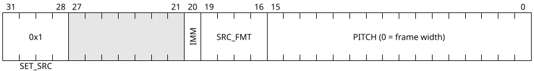

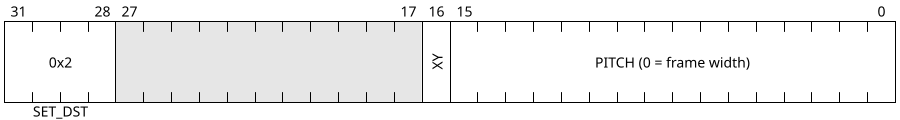

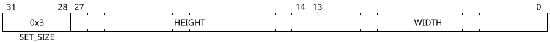

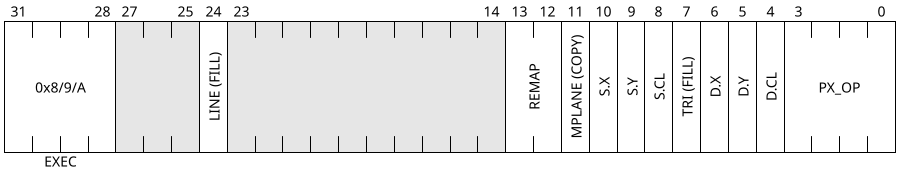

*The EXEC figure covers `0x8`–`0xA`: `TRI` and `LINE` (its options in [19:16]: see
[lines](#25-lines)) are `EXEC_FILL` only; the source swaps and `MPLANE` are the copies'
only.*

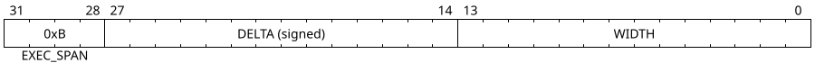

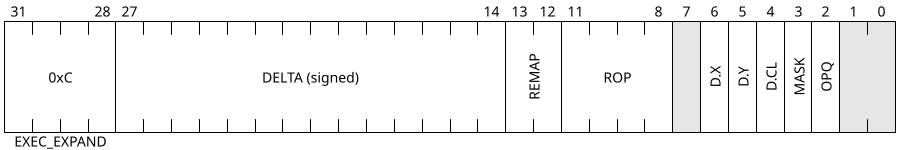

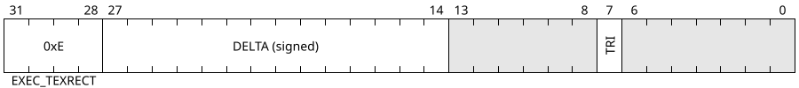

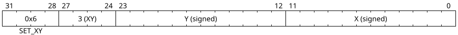

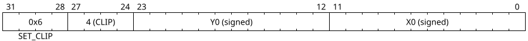

*`SET_CLIP`'s operand holds X1, Y1 (inclusive) in the same fields.*

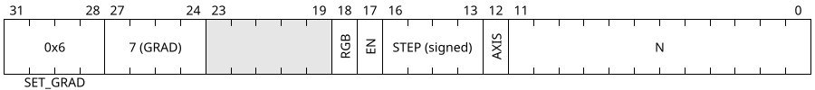

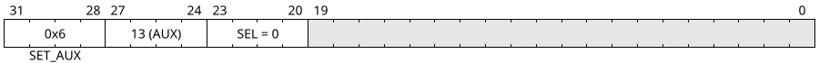

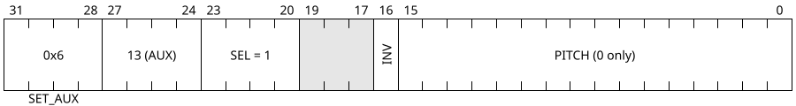

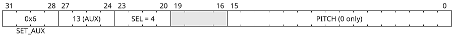

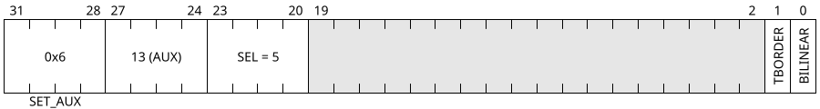

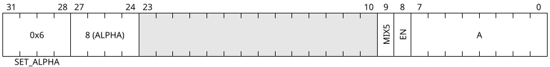

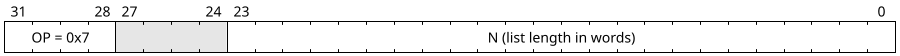

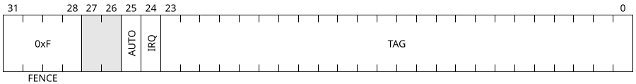

- The surface, size and colour settings stay until changed: a sequence of rectangles of
  the same size only needs a new `SET_DST` and `EXEC` each.
- Sizes keep min(`DIM_W`, 14) bits (the command fields are 14 bits wide): a value of
  2^`DIM_W` or more wraps (its high bits are ignored), and 0 is stored as 1, so both
  draw something (a width of 1024 at `DIM_W` = 10 draws one pixel; the same holds for
  the `N` of `EXEC_SPAN` and `EXEC_TEXSPAN`). The size resets to 1 × 1. The driver
  refuses both.
- The base address of a surface is the **first pixel visited** (see the
  [rectangle walks](#8-rectangle-walks)); the swap fields of `EXEC` set the
  walk of the source and the destination independently, so a copy can rotate or mirror.
  With CL swap the width is the length of the vertical run.
- `GFX_MODE` and the display width are taken when an `EXEC` starts.
- `EXEC_SPAN` draws a horizontal run in one word. It behaves exactly as: destination
  base += `DELTA` (−8192 … +8191, pitch unchanged), `SET_SIZE` width × 1, `EXEC_FILL`
  with op 0 (S) and no swaps. The moved base and the width × 1 size stay for the next
  command. Run-length images cost one word per run instead of six: set the colour and
  the start once, then one `EXEC_SPAN` per run with `DELTA` = run start − previous run
  start.
- `EXEC_EXPAND` draws text and other 1, 2, 4 or 8-bit images: see
  [colour expansion](#11-colour-expansion).
- `EXEC_TEXSPAN` draws a run of pixels through a texture: see
  [textured spans](#12-textured-spans).
- The events of a command (`GPU_DONE`, `GPU_FENCE`) are listed under
  [pushing](#31-pushing).

```c
// Fill a w x h rectangle at pixel address dst with colour c
const blns_surf_t d = { .addr = dst, .pitch = 0, .swap = BLNS_SWAP_NONE };
blns_gpu_fill(&blns, &d, w, h, c, BLNS_ROP_S);
//   pushes, once 6 FIFO words are free: SET_SIZE | (h << 14) | w,
//   SET_DST (the display pitch: the driver resolves pitch 0 at the call), dst,
//   SET_FILL, c, EXEC_FILL (op 0, no swap); SET_SIZE and SET_FILL only when they
//   changed since the last call

// Copy a w x h block from src to dst, mirrored horizontally (destination X swap):
// dst is then the top-right corner of the destination rectangle
const blns_surf_t s  = { .addr = src, .pitch = 0, .swap = BLNS_SWAP_NONE };
const blns_surf_t dm = { .addr = dst, .pitch = 0, .swap = BLNS_SWAP_X };
blns_gpu_copy(&blns, &s, &dm, w, h, BLNS_ROP_S);
//   pushes SET_SIZE, SET_SRC + src, SET_DST + dst, EXEC_COPY | DST_X
```

The helpers, their checks and how they wait for FIFO room are described in the
[driver conventions](driver_guide.md#4-conventions); `blns_gpu_push()` sends raw command
words.

---

## 8. Rectangle walks

A GPU rectangle is walked as an inner run of its width, then to the next line (the
surface pitch, or the frame width), with the direction set by the three swap bits of
`EXEC`. The surface base is the **first pixel visited**: with an X swap it is the right
end of the first run, with a Y swap the bottom line. With CL swap the inner run is
vertical (width steps of one line each).

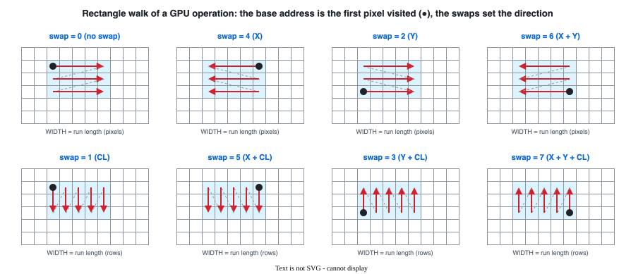

---

## 9. Source and destination formats

`SET_SRC` [19:16] `SRC_FMT` gives the format of the source pixels. The destination is
always in the display format (`CTRL.GFX_MODE`); `SET_DST` [19:17] is reserved and must
be 0.

| `SRC_FMT` | Source | Used by |
|---|---|---|
| 0 | the destination's format | every command with a source |
| 1, 2, 3, 4 | 1, 2, 4, 8 bpp values | `EXEC_EXPAND` (colour indices, or coverage with `MASK`) |
| 5 | RGB565A8: RGB565 pixels at the source base and pitch, the alpha of each from the `ALPHA_PLANE` pointer ([alpha planes](#26-alpha-planes-rgb565a8)) | `EXEC_COPY`, `EXEC_COPY_TRANSP`, `EXEC_TEXSPAN`, `EXEC_TEXRECT` (textured triangles included); `GPU_BLEND_EN` |
| 6–15 | reserved (6 is kept for a later ARGB8888 source) | — |

A format word the GPU does not take stops it with `ERR_CAUSE` 3: a reserved `SRC_FMT`
(6–15), `SET_DST` [19:17] other than 0, `EXEC_EXPAND` with `SRC_FMT` 0 or 5, a copy or a
texture with `SRC_FMT` 1–4. `SET_SRC` with `SRC_FMT` 5 in a build without blending is
refused as an absent feature (`ERR_CAUSE` 2); `EXEC_FILL` and `EXEC_SPAN` ignore
`SRC_FMT`. `SET_SRC` [20] `IMM` takes the source from the command stream instead of the
VRAM ([immediate source](#19-immediate-source)); without `GPU_IMM_EN` a `SET_SRC` with it
stops the GPU with `ERR_CAUSE` 2. `SRC_FMT` stays until the next `SET_SRC`: after an
`EXEC_EXPAND`, send a `SET_SRC` with format 0 (or 5) before a copy or a texture (else cause 3).

---

## 10. Coordinates and clipping

A destination is given in one of two ways:

- **Address mode** (`SET_DST.XY` = 0): the base pixel address of the first pixel, as
  described above. Never clipped.
- **x/y mode** (`SET_DST.XY` = 1): the `SET_DST` operand is pixel (0, 0) of the surface (its
  pitch as for any `SET_DST`, 0 = frame width), and every rectangle starts at a signed
  (x, y) given by `SET_XY` ([11:0] x, [23:12] y, −2048 … 2047): the GPU computes
  origin + y · pitch + x. `SET_DST` with `XY` starts at (0, 0).

In x/y mode:

- the signed `DELTA` of `EXEC_SPAN`, `EXEC_EXPAND`, `EXEC_TEXSPAN` and `EXEC_TEXRECT` moves x
  (a string is one `EXEC_EXPAND` per glyph; a span on another row costs one `SET_XY`).
  A `DELTA` moves the address-mode base and x together, whatever the mode, and each
  mode draws with its own: a `SET_DST` that changes the mode and is cut before its
  operand shows the other one moved;
- the rectangle is **trimmed to the clip window** before it is drawn: `SET_CLIP`
  [11:0] x0, [23:12] y0, operand [11:0] x1, [23:12] y1, signed and inclusive, as LVGL
  areas. After reset the window is the whole range (no clipping). Only the visible part
  is walked (the source, the texture coordinates and the gradient start where that part
  starts), and a rectangle entirely outside the window draws nothing and only raises
  `GPU_DONE`; a triangle's walk is its box intersected with the window.
- (x, y) is the first pixel visited: the swaps work as in address mode.

In x/y mode, pitch 0 becomes the frame width of the time of the `SET_DST` or `SET_XY`, for
the start address and the line step alike.

```c
blns_gpu_xy_begin(&blns, FRAME0, 0, colour);    // origin = frame start, pitch 0: the display pitch
blns_gpu_clip(&blns, 0, 0, 319, 239);           // nothing outside the screen
blns_gpu_fill_xy(&blns, -20, 100, 64, 32);      // partly off-screen: clipped
```

Built without x/y coordinates (`BLNS_CFG2` [4] `XY` = 0), `SET_DST` with `XY`, `SET_XY` and
`SET_CLIP` are refused (`ERR_CAUSE` 2, absent feature).

---

## 11. Colour expansion

`EXEC_EXPAND` copies the `SET_SIZE` rectangle from a source stored at 1, 2, 4 or 8 bits per
pixel (`SET_SRC.SRC_FMT` 1, 2, 3, 4), whatever `GFX_MODE` is, and turns every source value
`v` into a colour:

| `v` | Written |
|---|---|
| 0 | nothing (the pixel is skipped), or with `OPAQUE` the background: the `SET_TRANSP` colour |
| 1 … | the fill colour + (`v` − 1), low `bpp` bits kept |

At 1 bpp that is one colour; at 2 bpp a 3-step ramp from the fill colour (antialiased
text through three LUT entries); at 4 bpp 15 steps or 15 colours.

- The destination base moves by the signed `DELTA` first (−8192 … +8191), as for
  `EXEC_SPAN`, and the moved base stays: a string is one `SET_SRC` (the glyph) and one
  `EXEC_EXPAND` (the advance) per character.
- The source base and pitch (`SET_SRC`) are in source pixels; **pitch 0 is the rectangle
  width** (glyphs stored packed, one after the other), unlike the other copies. The
  source walk has no swaps.
- The destination is written with the [raster op](#4-raster-operations) of [11:8] (0, S,
  by default) and the swaps of [6:4] (rotated or mirrored text); its pitch 0 is the frame
  width as for any `EXEC`. The op applies to the expanded colour (the fill colour + v − 1,
  or the background with `OPAQUE`); pixels of value 0 stay transparent without `OPAQUE`.
  Ops 13–15 have no `SET_TRANSP` test here (value 0 is EXPAND's transparency): they write
  0, all ones or the fill colour, so op 15 draws a one-colour silhouette of an image
  and op 5 (XOR) a flash. With blending on (`MASK`, or `SET_ALPHA` `EN`: 16 bpp in a
  `GPU_BLEND_EN` build) ops 0–12 blend the expanded colour (with `MASK`, the fill colour)
  and ops 13–15 their constant, at the same pixels
  ([raster operations](#4-raster-operations)); in the palette modes `MASK` is ignored and
  the op of [11:8] applies. Built without blending, `MASK` is refused (`ERR_CAUSE` 2).

```c
// White 2-bit antialiased text (ramp at LUT entries 200..202) from a packed 8 x 16 font
const blns_expand_t font = { .width = 8, .height = 16, .src_pitch = 0,
                             .depth = BLNS_EXP_2BPP, .opaque = false, .swap = BLNS_SWAP_NONE };
blns_gpu_expand_begin(&blns, &font, dst, 0, 200, 0);
for (const char *c = text; *c; c++, dst += 8)
    blns_gpu_expand(&blns, FONT_BASE + (uint32_t) (*c - ' ') * 8 * 16, dst);
```

---

## 12. Textured spans

`EXEC_TEXSPAN` draws a run of `N` pixels (a row, or a column with the CL swap) while
stepping through a texture: pixel *i* reads the texel at (u0 + *i*·du, v0 + *i*·dv). It
scales, rotates and texture-maps: a scaled image row has dv = 0, a rotated one
(du, dv) = (cos θ, sin θ), a raycaster wall column du = 0.

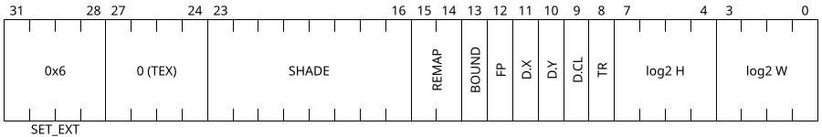

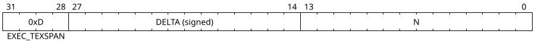

| Setting | Command | Format |
|---|---|---|
| texture base | `SET_SRC` operand | pixel address at `GFX_MODE` depth |
| size, wrap, swaps, shade | `SET_EXT` 0 `SET_TEX` | [3:0] log2 width, [7:4] log2 height (0–10; a larger value acts as 10), [8] `TRANSP_EN`, [11:9] destination swaps {X, Y, CL}, [12] `FREE_PITCH`, [13] `BOUND` ([affine blits](#13-affine-blits); it applies to `EXEC_TEXSPAN` too), [15:14] `REMAP` ([palette remap](#17-palette-remap)), [23:16] `SHADE` |
| start | `SET_EXT` 1 `SET_UV` + operand | [31:16] u0, [15:0] v0: unsigned 10.6 texels |
| step per pixel | `SET_EXT` 2 `SET_STEP` + operand | [31:16] du, [15:0] dv: signed 5.11 (±16 texels per pixel) |
| filter | `SET_EXT` 13 `SET_AUX` `SEL` 5 `TEX_FILTER` (`GPU_BILINEAR_EN`) | [0] `BILINEAR`, [1] `TBORDER` ([bilinear sampling](#27-bilinear-sampling); 16 bpp) |
| alpha plane | `SET_SRC` `SRC_FMT` 5 and `SET_AUX` `SEL` 4 `ALPHA_PLANE` (`GPU_BLEND_EN`) | the alpha of each texel ([alpha planes](#26-alpha-planes-rgb565a8); 16 bpp) |

- **Texture addressing.** With `FREE_PITCH` = 0 the texture is 2^log2width ×
  2^log2height texels, its pitch is the width, and the coordinates wrap (tiling). With
  `FREE_PITCH` = 1 the pitch is the `SET_SRC` pitch (0 = the frame width) and nothing
  wraps below 1024 texels (u and v keep 10 integer bits and wrap at 1024): any image can
  be scaled or rotated, the software keeps (u, v) inside it.
- **Colour.** Each texel is written as texel + `SHADE` (modulo 2^bpp): with a palette
  arranged in shade blocks this is distance lighting for free. With `TRANSP_EN`, a raw
  texel (before `SHADE`) equal to the `SET_TRANSP` colour is skipped. An RGB565A8 texture
  blends each texel with its alpha ([alpha planes](#26-alpha-planes-rgb565a8)); with
  `BILINEAR` each pixel blends the four texels around its sample point
  ([bilinear sampling](#27-bilinear-sampling)), and `SHADE` has no effect at 16 bpp.
- **Destination.** The base moves by the signed `DELTA` first, as for `EXEC_SPAN`; the
  size becomes `N` × 1 and stays. u0, v0, du, dv and the texture settings stay too:
  every `EXEC_TEXSPAN` starts again from (u0, v0), so a new span sends its own `SET_UV`.
- The coordinates keep 10 integer and 11 fraction bits; a 320-pixel span stays within
  about 0.16 texel of the exact position.

```c
// A 64 x 64 wall texture drawn as a column of h pixels at (x, y), shade s
const blns_tex_t wall = { .addr = WALL_TEX, .log2_w = 6, .log2_h = 6, .swap = BLNS_SWAP_CL };
blns_gpu_tex_begin(&blns, &wall, frame, 0, 32 * s);
blns_gpu_tex_step(&blns, 0, (int16_t) (64 * 2048 / h));            // dv: 64 texels over h pixels (h > 4: below 16)
blns_gpu_tex_span(&blns, frame + y * width + x, h, (uint16_t) (tx << 6), 0);
```

---

## 13. Affine blits

`EXEC_TEXRECT` fills the `SET_SIZE` rectangle (W × H) from the texture of `SET_TEX`, as a
stack of textured spans: pixel i of row r reads the texel at
(u0 + i·du + r·du′, v0 + i·dv + r·dv′), where (u0, v0) is `SET_UV`, (du, dv) `SET_STEP`
and (du′, dv′) `SET_STEP_ROW` (signed 5.11). Rotation by an angle a with a scale
k: du = cos a / k, dv = sin a / k, du′ = −sin a / k, dv′ = cos a / k. Shade, swaps and
transparency are those of `EXEC_TEXSPAN`; `GPU_DONE` is raised once per blit.

**Source bounds**: with `SET_TEX` [13] `BOUND`, a pixel whose texel falls outside
[0, TW) × [0, TH) is skipped (no read, no write), the texture box TW × TH coming from
`SET_TEXBOX` ([11:0] TW, [23:12] TH). With `BOUND` the coordinates are signed (u0, v0 and
the steps), so the corners of a rotated image can start outside the texture; the texture
is then at most 512 × 512 (a larger `SET_TEXBOX` acts as 512, with no error). A
power-of-two texture wraps, with `BOUND` too: inside a box larger than the texture the
texture repeats (the box test takes the coordinates before the wrap). A free-pitch one
reads on (up to 1024 texels without `BOUND`), as for `EXEC_TEXSPAN`. `BOUND` skips the texels outside the box on `EXEC_TEXSPAN` as well.
With [bilinear sampling](#27-bilinear-sampling) the skip is the same test on the sample
point (⌊u⌋, ⌊v⌋), and `SET_AUX` `TEX_FILTER` [1] `TBORDER` decides what the taps outside
the box read: the edge texel (0, clamp) or nothing, transparent (1: anti-aliased image
edges, with blending).

Built without affine blits (`BLNS_CFG2` [4] `XY` = 0: `GPU_XY_EN` = 0), `EXEC_TEXRECT`,
`SET_STEP_ROW`, `SET_TEXBOX` and `SET_TEX` with `BOUND` are refused (`ERR_CAUSE` 2).

---

## 14. Gradient fills

`SET_GRAD` ([11:0] `N`, [12] `AXIS`, [16:13] signed `STEP`, [17] `EN`) makes `EXEC_FILL` and
`EXEC_SPAN` write fill + ⌊i / N⌋ · `STEP` (low `bpp` bits kept), i being the line index
(`AXIS` = 0) or the pixel index along the run (`AXIS` = 1) from the rectangle's start; N =
0 counts as 1. With a palette ramp this draws a sky or a bar in one command. At 16 bpp the
value is added to the RGB565 word as a number. `EN` = 0 restores plain fills. Built without
gradients (`BLNS_CFG2` [5] `GRAD` = 0), `SET_GRAD` and `SET_GRAD_RGB` are refused
(`ERR_CAUSE` 2).

At 16 bpp, `SET_GRAD` [18] `RGB` makes the gradient per channel: each RGB565 field of the
fill colour + ⌊i / N⌋ · its step, saturated to the field's range (0–31, 0–63, 0–31). The
steps come from `SET_GRAD_RGB` (`SET_EXT` 12) and its operand: [29:20] dR, [19:10] dG,
[9:0] dB, signed, in 1/64 of a field unit (−8 … +7.98 per step). The products are kept
on 14 bits with 6 fraction bits and saturate there, so a long ramp ends on the field's
limit instead of wrapping. Below 16 bpp `RGB` is ignored (`STEP` applies).

```c
// 16 bpp: red to blue, left to right. The ramp starts from the fill colour (red, 0xF800);
// per pixel R falls and B rises by 6/64: (31, 0, 0) at x = 0, (16, 0, 15) at x = 160,
// (1, 0, 29) at x = 319
blns_gpu_xy_begin(&blns, FRAME0, 0, 0xF800);    // the session colour: red
blns_gpu_gradient_rgb(&blns, true, 1, true, -64 * 31 / 320, 0, 64 * 31 / 320);
blns_gpu_fill_xy(&blns, 0, 0, 320, 40);
```

---

## 15. Triangles

`EXEC_FILL` with [7] `TRI` draws the triangle of the vertices `SET_V0`, `SET_V1`, `SET_V2`
(`SET_EXT` subs 9–11, each with an operand {y [31:16], x [15:0]}, signed 12.4 fixed point:
1/16 pixel, −2048 … 2047.9375) instead of the `SET_SIZE` rectangle, in x/y mode:

- A pixel is drawn when its centre (x + ½, y + ½) lies inside the triangle; on an edge, the
  top-left rule decides (an edge is top when horizontal with the triangle below it, left
  when the triangle is to its right going up): triangles sharing an edge leave no gap and
  draw no pixel twice. Either vertex order works; a triangle of zero area draws nothing.
- The GPU walks the triangle's pixel box intersected with the clip window (at most
  2<sup>`DIM_W`</sup> − 1 pixels each way), row by row: the set-up computes, once per
  triangle, where each edge crosses the rows (about 60 cycles, overlapped with the previous
  primitive's drawing with [run-ahead](#242-run-ahead)), then each row is a run of its inside
  pixels, written a whole destination word at a time for a FILL. With a gradient along the
  run, every pixel of the box is walked (the gradient counts pixels from the walk's start).
  The walk starts at the box after clipping, so clipping moves a triangle's gradient (a
  clipped rectangle's gradient keeps its phase, a triangle's does not).
  The raster op, the gradient (lines counted from the walk's start), blending and the
  [palette remap](#17-palette-remap) ([13:12] `REMAP`: `SRC` the fill colour, or its gradient
  value, through the table; `DST` the destination pixel through it, the shadow of a
  polygon) apply; the swaps do not. A remapped triangle goes one pixel per step, and
  pixels outside it make no table read.
- In address mode a `TRI` draws nothing. `GPU_DONE` is raised once per triangle.
- Built without triangles (`BLNS_CFG2` [7] `TRI` = 0, which a build without x/y coordinates
  implies), `SET_V0`–`SET_V2` and `EXEC_FILL` or `EXEC_TEXRECT` with `TRI` are refused
  (`ERR_CAUSE` 2).

```c
blns_gpu_xy_begin(&blns, FRAME0, 0, colour);
blns_gpu_clip(&blns, 0, 0, 319, 239);
blns_gpu_tri_xy(&blns, BLNS_SUB(10), BLNS_SUB(5), BLNS_SUB(100), BLNS_SUB(40), 300, 1500);  // 1/16 px
blns_gpu_remap_table(&blns, SHADE_TABLE);       // 8 bpp: a darkening table (word address)
blns_gpu_remap_tri_xy(&blns, BLNS_SUB(12), BLNS_SUB(7), BLNS_SUB(102), BLNS_SUB(42), 302, 1502);  // its shadow
```

### 15.1 Textured triangles

`EXEC_TEXRECT` with [7] `TRI` (built with triangles and affine blits) maps the texture of
`SET_TEX` on the triangle of `SET_V0`–`SET_V2`, affine (no perspective correction):

- `SET_UV` gives (u, v) **at vertex V0** (10.6; signed with `BOUND`); `SET_STEP` the steps
  per pixel (du/dx, dv/dx) and `SET_STEP_ROW` per row (du/dy, dv/dy), signed 5.11. The
  software computes the four gradients once per triangle from the (u, v) of its vertices
  (`blns_gpu_tri_uv_gradients`).
- The GPU carries (u, v) from V0 to the centre of the first pixel of the triangle's box: u =
  u0 + ⌊du/dx · Δx / 16⌋ + ⌊du/dy · Δy / 16⌋ (Δx, Δy: the 12.4 offset from V0), then steps
  it as an affine blit; the pixels drawn are those of `EXEC_FILL` `TRI`.
- Transparency, `SHADE`, `BOUND`, blending, the [palette remap](#17-palette-remap) of `SET_TEX`
  [15:14] (texel + `SHADE`, or the destination, through the table), an
  [RGB565A8](#26-alpha-planes-rgb565a8) source, [bilinear sampling](#27-bilinear-sampling)
  and the clip window apply; `DELTA` and the texture swaps are ignored. In address mode
  nothing is drawn.

```c
int32_t x[3] = { BLNS_SUB(10), BLNS_SUB(120), BLNS_SUB(40) }, y[3] = { BLNS_SUB(8), BLNS_SUB(30), BLNS_SUB(90) };
int32_t u[3] = { 0, 63 * 64, 0 }, v[3] = { 0, 0, 63 * 64 };        // 10.6
int16_t g[4];
blns_gpu_tex_set(&blns, &tex, 0);
if (blns_gpu_tri_uv_gradients(x, y, u, v, g))
    blns_gpu_tritex_xy(&blns, x, y, (uint16_t) u[0], (uint16_t) v[0], g[0], g[1], g[2], g[3]);
```

---

## 16. Blending

At 16 bpp the GPU can mix what it draws with the destination, per RGB565 channel: s and
d are the field values (unsigned: 0–31, 0–63, 0–31), α is 0 … 255, and `SET_ALPHA` [9]
`MIX5` chooses the rule:

| | `MIX5` = 0 (reset) | `MIX5` = 1 (LVGL's rule) |
|---|---|---|
| out | d + ⌊((s − d) · a + 128) / 256⌋, a = α (256 for α = 255) | d + ⌊(s − d) · 8m / 256⌋ = d + ⌊(s − d) · m / 32⌋, m = (α + 4) >> 3 (0 … 32) |
| not written | α = 0 | m = 0 (α ≤ 3) |
| written as s | α = 255 | m = 32 (α ≥ 252) |
| x combined with `A` (a coverage, an alpha byte, a tap's alpha, with `SET_ALPHA` `EN`): x ∘ `A` | x · `A` / 255 rounded to the nearest: ((x · `A` + 127) · 257 + 256) >> 16 | ⌊x · `A` / 256⌋ |

`MIX5` is bit-exact with LVGL 9's RGB565 blend (`lv_color_16_16_mix`, and `LV_OPA_MIX2`
for x ∘ `A`); the rounding rule keeps 8 bits of precision. s is S for ops 0–12 (their
logic with D is not applied), and the constant of ops 13–15 (0, all ones, the fill
colour), which keep their `SET_TRANSP` test ([raster operations](#4-raster-operations)):
with `SET_ALPHA`, op 15 on a copy draws a translucent one-colour shadow. The destination
is read for every blended pixel, except an [RGB565A8](#26-alpha-planes-rgb565a8) pixel
that its alpha byte makes opaque and a [bilinear](#27-bilinear-sampling) pixel whose taps
are all opaque.

- `SET_ALPHA` (`SET_EXT` sub 8): [7:0] `A`, [8] `EN`, [9] `MIX5`, [23:10] ignored. With
  `EN`, every FILL, SPAN, COPY, COPY_TRANSP, EXPAND, TEXSPAN, TEXRECT and triangle blends
  with α = `A` (an RGB565A8 source or a bilinear texture: its alpha ∘ `A`). `MIX5` is a
  setting like `A` and `EN` (0 at reset and after `RESET_STATE`) and applies to every
  blend while it is set, with `EN` = 0 too: `MASK`, anti-aliased lines, RGB565A8 sources
  and bilinear textures blend without `EN`. A program using LVGL's rule sends `MIX5` once,
  and `EN` only for an opacity.
- `EXEC_EXPAND` with [3] `MASK` (16 bpp): the source values are a coverage, α = v (8 bpp),
  17 v (4 bpp), 85 v (2 bpp) or 255 v (1 bpp), and the colour is the fill colour: anti-
  aliased text and shapes from an A1/A2/A4/A8 mask. With `SET_ALPHA` enabled too, α =
  coverage ∘ `A`. α = 0 (with `MIX5`: m = 0) writes nothing; `OPAQUE` has no effect with
  `MASK`.
- A copy or a texture with `SRC_FMT` 5 blends each pixel with its own alpha
  ([alpha planes](#26-alpha-planes-rgb565a8)); a texture with `BILINEAR`, each pixel with
  the weighted alpha of its taps ([bilinear sampling](#27-bilinear-sampling)).
- In the palette modes `SET_ALPHA`, `MASK`, a line's `AA`, `SRC_FMT` 5 and the filter
  have no effect.
- Built without blending (`BLNS_CFG2` [6] `BLEND` = 0), `SET_ALPHA`, `MASK`, a line with
  `AA`, `SRC_FMT` 5, `SET_AUX` `ALPHA_PLANE` and `TEX_FILTER` with `TBORDER` are refused
  (`ERR_CAUSE` 2).
- An anti-aliased [line](#25-lines) blends each pixel with its coverage, ∘ `A` with
  `SET_ALPHA` `EN` (as `MASK`).

---

## 17. Palette remap

In the palette modes the GPU can send the colour it draws through a byte table in VRAM
(`BLNS_CFG2.REMAP`, `GPU_REMAP_EN`): house colours, shading and fades with the palette
arranged in blocks, an image drawn with another palette.

- **The table**: one byte per entry, entry *i* at byte *i* (little-endian in its word: 4
  entries per word), the low `bpp` bits of the entry used. 256 bytes at 8 bpp, 16 at 4
  bpp, 4 at 2 bpp, 2 at 1 bpp. It starts on a 256-byte boundary: `SET_AUX` (`SET_EXT` 13)
  with `SEL` 0 `REMAP_TABLE`, operand = its VRAM word address, a multiple of 64 (the GPU
  ignores the low 6 bits; [19:0] of the command are reserved, write 0). Any number of
  tables may exist: the pointer is plain state, like `SET_SRC`.
- **The mode**, per command: [13:12] `REMAP` of `EXEC_FILL` (a [triangle](#15-triangles)
  included), `EXEC_COPY`, `EXEC_COPY_TRANSP` and `EXEC_EXPAND`; for `EXEC_TEXSPAN` and
  `EXEC_TEXRECT` ([textured triangles](#151-textured-triangles) included), [15:14] of `SET_TEX`
  (it stays, as `SHADE` does). An `EXEC` field applies to that command only.

  | `REMAP` | The colour S the raster op takes |
  |---|---|
  | 0 | S (no remap) |
  | 1 `SRC` | T[S]: S is the source pixel (COPY), fill + v − 1 (EXPAND; with `OPAQUE`, the background of value 0, remapped too), texel + `SHADE` (textures), the fill colour (FILL, with a gradient its value at the pixel) |
  | 2 `DST` | T[D]: the destination pixel through the table |
  | 3 | reserved (`ERR_CAUSE` 1) |

- The raster op then applies to S' as usual (op 0 writes it). Ops 2, 13, 14 and 15 do not
  use S: no lookup. At 16 bpp the field has no effect (mode 3 is reserved), as `SET_ALPHA` has none in the palette modes. `EXEC_SPAN` has no field: use a FILL.
- Transparency is decided first, on the raw source: the key (`COPY_TRANSP`, ops 13–15),
  EXPAND's value 0, `TRANSP_EN`, the [mask plane](#18-mask-plane). A remapped colour never
  becomes transparent; a transparent pixel makes no table read.
- The remap changes the colour only: the walk, the swaps (mirrors, CL), the clip window
  and the pixels of a triangle are those of the command without it.
- **Ordering.** Nothing may write the table while a command that uses it runs (as for
  its source words). `SET_AUX REMAP_TABLE` is where the GPU may (re)read the table: after
  changing a table, even at the same address, send it again before the next command that
  uses it (`blns_gpu_remap_table()` always sends it). This RTL drops its table word at
  every command start and so reads the table again anyway; the rule keeps a program
  correct on later versions, which may keep the table. A table written by earlier GPU
  commands may be used by a later one. The table must not overlap the destination of the
  command that uses it (the GPU does not check this).
- **The pointers persist.** The `REMAP_TABLE`, `MASK_PLANE` and `ALPHA_PLANE` pointers
  and `INV` keep their value through `CLEAR_ERR`, `ABORT` and `GPU_EN = 0`; only `RESET_STATE` (and the
  reset) sets them, and the `SET_TEX` field, to 0. A `SET_AUX` takes effect in two steps:
  `INV` with the command word, the pointer with its operand, so one cut by `CLEAR_ERR` or
  `ABORT` between the two (its operand flushed) has changed `INV` and not the pointer.
  How the driver tracks the pointers (refusing a draw until one is set, forgetting them
  at a recover) is in the [driver conventions](driver_guide.md#4-conventions).
- The GPU keeps the last table word it read (dropped at each command start and while
  frozen): runs of one colour or of neighbouring indices read the table once. A remapped
  command goes one pixel per step; `DST` reads the destination of every pixel (cycles in
  [performance](#24-performance)). A table word at or past `VRAM_WORDS` stops the command
  with `ERR_CAUSE` 5.
- At 16 bpp a FILL with `REMAP` `DST` paints the fill colour (the field has no effect
  there); the driver's `DST` helpers refuse that depth.

```c
// A sprite in the house colours of player p (tables of 256 bytes at word 0x8000 + 64 p),
// then the bottom of the screen darkened through the shade table at word 0x8400
blns_gpu_remap_table(&blns, 0x8000u + 64u * p);
const blns_blit_t house = { .rop = BLNS_ROP_S, .transp = true, .transparent = 0,
                            .remap = BLNS_REMAP_SRC };
blns_gpu_blit_xy(&blns, &sprite, x, y, 16, 16, BLNS_SWAP_NONE, &house);
blns_gpu_remap_table(&blns, 0x8400u);
blns_gpu_remap_rect_xy(&blns, 0, 200, 320, 40);       // FILL, REMAP DST: D' = T[D]
```

---

## 18. Mask plane

`EXEC_COPY` and `EXEC_COPY_TRANSP` with [11] `MPLANE` (`BLNS_CFG2.MPLANE`,
`GPU_MPLANE_EN`) write a pixel only where a 1-bpp mask allows it: one-pass masked
sprites, stencils of any shape, transparency at 16 bpp without spending a key colour.

- The mask is a 1-bpp surface with **the source's pitch, counted in pixels**: the mask
  bit of source pixel *p* is at mask pixel `mask_addr` + (*p* − source base). `SET_AUX`
  (`SET_EXT` 13) with `SEL` 1 `MASK_PLANE`: [15:0] `PITCH` must be 0 (another value is
  `ERR_CAUSE` 2, room for a mask pitch of its own later), [16] `INV`, [19:17] ignored
  (write 0); operand = the 1-bpp pixel address of the mask bit of the source's first
  pixel. A pixel is drawn where its bit is 1, or 0 with `INV`.
- The mask follows the source walk: clipping, every swap, mirrors and CL swaps apply to
  it with no extra setting.
- With a key (`COPY_TRANSP`, ops 13–15) both tests must pass. With a
  [remap](#17-palette-remap), the mask decides whether the pixel is drawn, the remap its
  colour.
- `MPLANE` and an [RGB565A8](#26-alpha-planes-rgb565a8) source (`SRC_FMT` 5) exclude each
  other: a copy with both is refused (`ERR_CAUSE` 1; 2 in a build without the mask
  plane). The alpha plane takes the GPU's one auxiliary word holder.
- `MPLANE` applies to its `EXEC` only; the pointer and `INV` stay (plain state, kept
  through `CLEAR_ERR`, `ABORT` and `GPU_EN = 0`, see [palette remap](#17-palette-remap)).
  `RESET_STATE` sets them to 0. FILL, EXPAND and the textures have no
  mask plane (EXPAND has its value 0, the textures `TRANSP_EN`).
- The GPU holds one mask word: it reads one every 32 mask bits along a row (every pixel
  with a CL swap). Below 8 bpp a masked copy always reads the destination. Op 2 reads
  no source but still walks the mask. A mask word at or past `VRAM_WORDS` stops the copy
  with `ERR_CAUSE` 5. The mask must not overlap the destination of the copy (not
  checked).

```c
// A 16 x 16 sprite at 4 bpp with its 1-bpp mask stored at the same pitch (16 bits a row)
blns_gpu_mask_plane(&blns, MASK_PIX, false);          // mask bit of the sprite's first pixel
const blns_blit_t masked = { .rop = BLNS_ROP_S, .mplane = true };
blns_gpu_blit_xy(&blns, &sprite, x, y, 16, 16, BLNS_SWAP_NONE, &masked);
```

---

## 19. Immediate source

With `GPU_IMM_EN` (`BLNS_CFG2` [10] `IMM`) a copy or a colour expansion reads
its source from words pushed to `GPU_CMD` behind it, in order with the GPU's own
drawing: pixels rendered by the CPU in system memory (an LVGL draw buffer) and glyphs
or icons in ROM reach the frame without a staging area in VRAM and without a fence
between the CPU's and the GPU's work.

```
SET_SRC  IMM | SRC_FMT     operand: N
...      (other settings: SET_SIZE, SET_DST, SET_TRANSP, ...)
EXEC_COPY / EXEC_COPY_TRANSP / EXEC_EXPAND
data word 0 ... data word N-1
```

- **Arming.** A `SET_SRC` with [20] `IMM` written to `GPU_CMD` arms the immediate source
  for the next `EXEC_COPY`, `EXEC_COPY_TRANSP` or `EXEC_EXPAND` written to `GPU_CMD`; its
  operand is `N` ([23:0]), the number of data words pushed right after that `EXEC`
  ([31:24] ignored). `SRC_FMT` and the pitch field are taken as by any `SET_SRC` (the
  pitch is not used by the immediate source); the source base is kept. Another `SET_SRC`
  from `GPU_CMD` disarms it, the `EXEC` that takes it disarms it, and so do `ABORT`,
  `CLEAR_ERR`, `DISCARD` and `GPU_EN = 0`. `RESET_STATE` leaves it. Fills, spans and textures do not
  take it.
- **Layout.** The source is a surface at pixel 0 whose pitch is the rectangle's width
  (`SET_SIZE`): `width × height` pixels at the source depth (the destination's for a
  copy, `SRC_FMT` 1–4 for `EXEC_EXPAND`), packed row after row **without padding** —
  rows are not word-aligned. Pixel `k` (row-major, `k = row · width + column`) is at bit
  `(k · bpp) mod 32` of word `⌊k · bpp / 32⌋`, the usual [packing](programming_model.md#21-pixel-formats-and-packing).
  `N = ⌈width · height · bpp / 32⌉` words describe the whole rectangle.
- **Walk.** The destination swaps apply as usual (mirrored and rotated sprites); a copy
  with source swaps is invalid (`ERR_CAUSE` 1: the data come in one order). The source
  of `EXEC_EXPAND` never has swaps. Raster operations, `SET_TRANSP` keys, `OPAQUE`,
  `MASK`, the [palette remap](#17-palette-remap) and the [mask plane](#18-mask-plane) (its
  mask pixel of source pixel `k` is the `SET_AUX` `MASK_PLANE` address + `k`: a mask
  plane with the rectangle's width as pitch) apply as with a VRAM source. An
  [RGB565A8](#26-alpha-planes-rgb565a8) source cannot be immediate: a copy taking the
  immediate source with `SRC_FMT` 5 is refused (`ERR_CAUSE` 1).
- **Clipping.** In [x/y mode](#10-coordinates-and-clipping) the clip window trims the
  rectangle as usual: the data words of pixels left out are still pushed, and the GPU
  drops them. `N` does not depend on the clip window.
- **Data count.** The GPU takes the data words as the rectangle needs them and drops
  those left once it is complete (or trimmed away). A shorter `N` reads 0 for the
  missing words; a longer one is dropped. The words are counted as they are pushed:
  they are never decoded as commands, even when the rectangle is refused or abandoned.
  `ABORT` and `CLEAR_ERR` keep that count — data words still pushed after them are
  dropped — while `GPU_EN = 0` and `DISCARD` drop it (the next word pushed is a
  command; a `DISCARD` alone abandons the rectangle at its marker, [errors](#6-errors-abort-and-flush)). After
  `CLEAR_ERR` without `ABORT` a rectangle being drawn completes, reading 0 for the data
  it has not taken yet (a word it takes in the cycle of the `CLEAR_ERR` is taken, as
  the flush's `GPU_STAT.USED` still counts it); the next immediate `EXEC` waits for it.
- **Lists.** A [command list](#20-command-lists) carries no data: `SET_SRC` with `IMM` in a
  list, and a copy or `EXEC_EXPAND` in a list while the immediate source is armed, are
  invalid (`ERR_CAUSE` 1). A list's own `SET_SRC` (without `IMM`) does not disarm it.
- **Bounds.** The data index is checked like a VRAM address, and does not wrap at the
  end of the pixel-address range: a rectangle whose
  immediate source reaches `VRAM_WORDS` words (in practice: a start past it after
  clipping) stops the GPU with `ERR_CAUSE` 5; drop the data still owed with
  `DISCARD` (with the `CLEAR_ERR`, in one write).
- **Order and timing.** The decoder does not go past the data words: the commands after
  them wait, and one immediate rectangle runs at a time ([run-ahead](#242-run-ahead) still
  sets it up while the previous primitive draws). The GPU takes one data word per cycle
  at most, with one more cycle for each new word (the engine registers each word): faster
  than a CPU can push. FIFO space is counted as for any command: the driver reads
  `GPU_STAT.FREE` about once per FIFO depth.

```c
// LVGL flush: the 16-bpp area rendered in SRAM, in order with the GPU's drawing
const blns_surf_t dst = { .addr = blns_pixel_addr(&blns, frame, x, y), .pitch = 0 };
const blns_blit_t opt = { BLNS_ROP_S };
blns_gpu_blit_imm(&blns, &dst, w, h, &opt, (const uint32_t *) px_map);

// A 1-bpp glyph from ROM, expanded in the fill colour
blns_gpu_expand_begin(&blns, &(blns_expand_t) { .width = 8, .height = 16 }, dst_addr, 0, fg, bg);
blns_gpu_expand_imm(&blns, dst_addr, font_8x16 + 4 * ch);   // 4 words per glyph
// (LSB first: pixel k of the glyph at bit k of its words; a font of MSB-first bytes is
// bit-reversed first)
```

---

## 20. Command lists

`CALL` makes the GPU read its next `N` command words from VRAM instead of the FIFO; when
the list has been executed, it goes back to the FIFO. The `CALL` is pushed like any other
command, so the words pushed after it wait in the FIFO behind the whole list. A list
drawn every frame is written once and replayed with one push; a list written each frame
goes through the VRAM window, which never waits for the GPU, instead of through
`GPU_CMD`, which needs FIFO room checked before each push (a push to a full FIFO is
dropped).

- The list is `N` 32-bit words at a **word** address (VRAM byte address / 4), whatever
  the `GFX_MODE`. It must lie inside the VRAM: a `CALL` with address + `N` past
  `VRAM_WORDS` runs nothing and stops the GPU (`ERR_CAUSE` 6). The address is the
  operand's low `VRAM_AW` bits; the bits above are ignored.
- Every command is valid in a list except `CALL` (no nesting): a `CALL` in a list is
  refused (`ERR_CAUSE` 1, `ERR_OPCODE` = 7).
- A list must not end between a command and its operand: its last word then stops the
  GPU (`ERR_CAUSE` 4, `ERR_OPCODE` = 7); the next FIFO word is never taken as the
  operand.
- `FENCE` works in a list as in the FIFO: a `FENCE` as the last word sets `GPU_FENCE`
  (and with `IRQ` raises it) when the list is done. A `CALL` raises no event itself. A
  tagged fence sets the same tag at every `CALL`; use `AUTO` for fences
  inside lists replayed among other fences ([fences](#21-fences)).
- A list carries no [immediate source](#19-immediate-source) data (`ERR_CAUSE` 1).
- A list written through the VRAM window is complete before a `CALL` pushed afterwards
  reaches the GPU (AHB-Lite keeps the order of transfers, and a register-port transfer
  waits until a posted window write has reached the VRAM). 
- Changing a list while the GPU executes it is undefined: draw from two lists in turn
  (write one while the GPU executes the other, check `GPU_STAT.LIST` or wait for
  `GPU_IDLE` before writing the list just called).
- The GPU reads the list through its own VRAM port, in the cycles it does not draw, two
  words ahead.

With the driver, any sequence of `blns_gpu_*` calls is recorded into a list:

```c
static blns_gpu_list_t rows = { .addr = LIST_WORD_ADDR, .capacity = 1024 };

blns_gpu_list_begin(&blns, &rows, 0u);          // the calls below go into the list
blns_gpu_tex_begin(&blns, &tex, frame, 0, 0);
for (unsigned y = 0; y < 240; y++)
    blns_gpu_tex_span(&blns, frame + y * 320, 320, 0, (uint16_t) (y * 32));
blns_gpu_list_end(&blns);                       // BLNS_ERR_FULL if it overflowed

blns_gpu_list_call(&blns, &rows, false);        // every frame: one push (CALL + FENCE)
```

---

## 21. Fences

`FENCE` [23:0] `TAG`, [24] `IRQ` completes when every command before it is complete, the
writes of its rectangles included. It then writes its tag to `GPU_FENCE` and, with `IRQ`,
raises `GPU_FENCE` in `IRQ_FLAG`. Number the fences in order and a single read of
`GPU_FENCE` tells which work is finished, without waiting for the GPU to be idle: draw
tasks can be retired while the next ones run. A fence flushed before the decoder reached
it (`CLEAR_ERR`, `ABORT`, `GPU_EN = 0`) never updates `GPU_FENCE`: after a flush, do
not wait for its tag (the driver reports such fences as dropped).

```c
uint32_t tag;
blns_gpu_xy_begin(&blns, FRAME0, 0, colour);    // x/y mode (coordinates and clipping)
blns_gpu_fill_xy(&blns, x, y, w, h);
blns_gpu_fence(&blns, false, &tag);             // tags count up (24 bits)
// ... more work ...
if (blns_gpu_fence_done(&blns, tag))            // the fill is complete
    reuse_buffer();
```

**`AUTO`** (`FENCE` [25]): the fence sets
`GPU_FENCE` to `GPU_FENCE` + 1 (24 bits, wrapping) instead of its tag field, which is
ignored. A fence recorded in a [command list](#20-command-lists) is replayed at every `CALL`:
with a tag it sets the same value each time, so `GPU_FENCE` goes back to it; with `AUTO`
it counts like any other fence and `GPU_FENCE` only moves forward. The driver uses `AUTO`
for every fence and predicts the tags ([driver conventions](driver_guide.md#4-conventions)).

---

## 22. Frame wait and state reset

Two `SET_EXT2` codes (every GPU):

- **`WAIT_REFR_DONE`** (code 1): the commands after it wait for the end of a frame sent to
  the panel: the frame being sent when the word reaches the head of the stream (the
  primitive before it may still be drawing, and the GPU may be frozen), else the next
  one. A frame ending in the very cycle the word reaches the head counts. Meanwhile the word stays
  at the head of the FIFO (or of the [command list](#20-command-lists)), `GPU_STAT.WAIT` and
  `BUSY` read 1 and `GPU_IDLE` is not raised. `CLEAR_ERR`, `ABORT` and `GPU_EN = 0` end the
  wait, flushing it with the commands behind it. With no refresh running it waits until
  one of those. The rectangle before it, already started, completes.
- **`RESET_STATE`** (code 2): every setting back to its reset value: surfaces, size, fill
  and transparent colours, x/y mode and position, clip window, texture (its `REMAP` field
  included), gradient, alpha and `MIX5`, vertices, the `SET_AUX` remap table, mask plane
  and alpha plane pointers (0), `INV` and the texture filter (nearest, clamp) (the
  [settings](#33-gpu-settings) table). The error record,
  `GPU_FENCE`, a command list being executed and the immediate-source arm are kept.

`WAIT_REFR_DONE` lets a single-buffered composition run behind the refresh without the
CPU waiting for the frame: push the wait, the drawing (or its `CALL`) and a `FENCE` with
`IRQ`, and go on. The fence's interrupt (or `GPU_FENCE`) tells when the GPU is done with
what it read. Queue a few words, not long command sequences: the FIFO (8 words by
default) fills while the GPU waits, and a raw push into a full FIFO is dropped (the
driver waits for room). With no refresh running the wait never ends: the driver refuses
it then ([driver conventions](driver_guide.md#4-conventions)).

```c
blns_gpu_wait_refresh(&blns);                   // after the frame being sent
blns_gpu_list_call(&blns, &compose, true);      // compose into the frame just sent, then a
                                                // FENCE: GPU_FENCE interrupt at compose.tag
// ... the CPU computes the next frame meanwhile ...
blns_gpu_reset_state(&blns);                    // a known state for the next client
```

---

## 23. Concurrent CPU access

The GPU reads a source word once for all the pixels it holds and writes a destination
word once, after its last pixel, with byte enables: a write carries only the bytes
holding pixels of the rectangle, even when the GPU read the word first. While a command
runs, software (or another bus manager) must not write the bytes it reads or writes: at
8 and 16 bpp exactly the pixels of its rectangles, below 8 bpp the whole bytes holding
any of them (such a byte is written back whole, its other pixels as the GPU read them).
Such a write may be ignored or overwritten. Every other byte of the VRAM, in the same
frame buffer included, can be written freely while the GPU draws, the other pixels of
the partial words at both ends of each row included (at 8 and 16 bpp). A renderer mixing
CPU and GPU drawing therefore waits for a GPU command only when its own area overlaps
the command's, widened to whole bytes below 8 bpp. In a debug freeze the GPU first
writes what it holds, and reads again after the release, so a debugger may change the
image while the GPU is held.

---

## 24. Performance

Best case, cycles per pixel with no VRAM contention, measured by the `gpu_perf` test in
the default configuration (`VRAM_RD_LAT` = 1, no run-ahead, no blending, no triangles);
the blending rows in the `ultra` configuration (the default with blending, run-ahead and
triangles), which gives the same values for every other row; the bilinear rows in the
`*_bil` configurations (`GPU_BILINEAR_EN` = 1), as the slope between a 16 × 8 and a 48 × 8
rectangle, like the RGB565A8 rows. The test checks each figure
as a floor and as a ceiling (within one cycle) at the read latencies given here:

| Operation | Cycles per pixel |
|---|---|
| FILL with ops 0, 1, 13, 14, 15 (no gradient along the run, no CL swap) | one destination word per cycle: 0.5 at 16 bpp, 0.25 at 8 bpp, less below |
| FILL with an op that uses the destination, at 16 bpp | 1 |
| FILL with a [gradient](#14-gradient-fills) across the rows (`AXIS` = 0), also per channel (`RGB`) | as without it: 0.5 at 16 bpp, 0.25 at 8 bpp |
| FILL with a gradient along the run (`AXIS` = 1, any `N`), also per channel | 1 at 8 and 16 bpp (a pixel per cycle); first access 11 cycles after the push at 16 bpp, 13 at 8 bpp |
| COPY and COPY_TRANSP along rows (no CL swap) with ops 0, 1, 13–15; mirrored at 8 and 16 bpp too | a source word and a destination word every 2 cycles: 1 at 16 bpp, 0.5 at 8 bpp, 0.25 at 4 bpp, 0.125 at 2 bpp, 0.0625 at 1 bpp |
| ... below 8 bpp, mirrored, keyed (COPY_TRANSP, ops 13–15) or source and destination a part of a byte apart | 0.375 at 4 bpp, 0.19 at 2 bpp, 0.094 at 1 bpp (the destination is read) |
| COPY along rows with an op that uses the destination | 1.5 at 16 bpp, 0.75 at 8 bpp, as the line above below 8 bpp |
| COPY along rows overlapping its destination, the source trailing it by less than a word (a scroll right by 1 pixel, walked forward) | 5 at 8 and 16 bpp, 2.03 at 1 bpp, 2.06 at 2 bpp, 2.125 at 4 bpp |
| EXPAND; TEXSPAN | 1 |
| COPY with a CL swap on the destination (source along rows), ops 0, 1, 13–15 | 1.25 at 8 bpp, 1.5 at 16 bpp (a write per pixel); below 8 bpp 2.03 at 1 bpp, 2.06 at 2 bpp, 2.125 at 4 bpp (the destination is read) |
| COPY with a CL swap on the source only, or on both sides | 2 at 8 and 16 bpp; source only below 8 bpp as the line above, both sides 3 |
| COPY op 2 (no source read) at 16 bpp | 1 |
| COPY with a CL swap on the destination and an op that uses it | 2.25 at 8 bpp, 2.5 at 16 bpp; below 8 bpp as without the op |
| FILL with [blending](#16-blending) at 16 bpp | 1 (`ultra`) |
| COPY with blending at 16 bpp | 2 (`ultra`) |
| COPY along rows with an [RGB565A8](#26-alpha-planes-rgb565a8) source at 16 bpp (`MIX5`) | 1.5 with every alpha 255, 1.5 with every alpha 0, 2.25 with partial alphas (the destination read); an image edge (alternate alpha words opaque and 0, 0, 128, 255): 1.625 |
| TEXRECT with an RGB565A8 texture, nearest, 1:1 (one alpha word in three partial) | 1.75 |
| TEXRECT [bilinear](#27-bilinear-sampling), opaque texture (`SRC_FMT` 0), `BOUND`, free pitch | zoom-in 2× (4 taps): 4.5; 1:1 rotated by 30°: 5.34; zoom-out 2:1: 6.0; texel-aligned (1 tap): 1.5 |
| ... RGB565A8 texture (`MIX5`) | zoom-in 2×: 5.55; 1:1 rotated by 30°: 8.27; zoom-out 2:1: 10.0; texel-aligned: 2.5 |
| ... a pixel skipped by `BOUND` | 1 (no read; from the walk, not measured by `gpu_perf`) |
| COPY along rows with the [mask plane](#18-mask-plane) | as COPY_TRANSP, plus 2 cycles per mask word (one every 32 pixels of a row) below 16 bpp: 0.5625 at 8 bpp, 0.4375 at 4 bpp; no cost at 16 bpp (1) |
| COPY with a [palette remap](#17-palette-remap) `SRC`, the table word held (runs of one colour, neighbouring indices) | 1, plus 1 cycle per destination word below 8 bpp (the destination read): 1.125 at 4 bpp |
| ... `SRC`, a table word read for every pixel | 2, plus 2 cycles per destination word (3 below 8 bpp): 2.5 at 8 bpp, 2.375 at 4 bpp |
| ... `DST` | 2 when the table word is held, 3 when it is read for every pixel |
| ... `SRC` with the mask plane | as `SRC` plus 3 cycles per mask word: 1.09 at 8 bpp |
| TEXSPAN with a remap at 8 bpp (du = 1) | `SRC`: 1 when the table word is held, 2 when it is read; `DST`: 2 |
| A remap at 16 bpp | no effect: as without it |
| [Line](#25-lines), ops 0, 1, 13–15, at 8 and 16 bpp | 1 per step (the pixels of a word merged: a steep line writes a word per step) |
| ... an op that uses D, at 16 bpp | 1 per step along rows, 2 per step on a steep line (a read per destination word) |
| ... at 1 bpp | 1.03 along rows, 2 per step on a steep line (a read-modify-write per byte) |
| ... anti-aliased, 16 bpp | 2 per pixel drawn along rows (4 per step with both pixels), 3 per step on a steep line (the pair shares a word half the time) |
| ... steps outside the clip window | 1 per step, no VRAM access |

A copy along rows takes, in one step, every pixel its destination word and its source word
share, so it runs at the speed of the VRAM port, like a FILL. Where its source lies in the
word it writes and trails the destination along the walk (a scroll to the right or down by
less than a word, walked forward), it goes a pixel at a time there, so that the image stays
the one of a copy done pixel by pixel: 5 cycles per pixel at 8 and 16 bpp (10 and 5 times
the plain copy), about 2 below 8 bpp. Walk such a copy the other way (the X swap on both
sides, the bases at the right ends of the rows), so that the source leads: it then keeps
the word rate: a scroll right by 1 pixel walked that way measures 0.5 at 8 bpp and 1 at
16 bpp, and below 8 bpp the rate of a copy a part of a byte apart (0.375 at 4 bpp), as a
scroll left by 1 pixel, whose source leads walked forward.

In a build with a VRAM read latency of 2 (the read data registered, `VRAM_RD_REG_EN`, or
a two-cycle macro, `VRAM_RD_LAT` = 2; measured in the `rdlat2` and `rdreg`
configurations, which give the same values), a line with an op that uses D takes 1.25
cycles per step along rows, a 1-bpp line 1.06 along rows and 3 per step steep, an
anti-aliased line 2.25 per pixel drawn along rows and 3.3 per step steep; TEXSPAN takes
1.5 cycles per pixel and a
copy's destination read costs a cycle more (a copy along rows with an op that uses the
destination: 2 at 16 bpp, 1 at 8 bpp; below 8 bpp keyed or a part of a byte apart: 0.5 at
4 bpp, mirrored or a reversed scroll 0.625); a scroll right by 1 pixel walked forward takes
6 at 8 and 16 bpp (2.06 to 2.25 below 8 bpp); a CL swap on the destination 3.03 to 3.125
below 8 bpp (with an op that uses the destination: 2.06 to 2.25, and 2.5 at 8 bpp, 3 at 16
bpp), on the source only 2.06 to 2.25 below 8 bpp, on both sides 4 below 8 bpp; the others
keep these values. A remapped copy then takes 1.25 at 4 bpp when the table word is held (the
destination read), 3.25 at 8 bpp (3.375 at 4 bpp) when it is read for every pixel, `DST`
2 when held and 4.25 at 8 bpp when read; a mask word costs 5 cycles at 8 bpp (0.656 per
pixel), 2 below; an 8-bpp TEXSPAN with du = 1 (four texels a word) takes 1.25, 2.25 with
a table read per pixel or `DST`. With a longer latency, the operations that read VRAM
slow down further: the GPU has one read in flight. The RGB565A8 and bilinear figures are
floors at a longer latency (checked as such in `ultra_rdlat3`, a three-cycle
macro): each alpha-word read and each tap-cache miss costs the latency.

A bilinear pixel takes one cycle per tap it reads (1, 2 or 4: a tap of weight 0 is not
read), plus the reads its taps miss in a 2 × 2 cache of colour words (one read in flight,
as for every GPU read). An RGB565A8 tap also reads the alpha word of a colour word it
misses, and a second one when the two alphas of that colour word straddle two alpha
words, which only an odd alpha offset (`ALPHA_PLANE` − source base) makes happen: a
driver keeps it even. A zoom-out reads more new words per pixel than a zoom-in, hence the spread of
the rows above.

The GPU works on 32-bit words: it reads a source word once for every pixel it holds (and
reads the next one ahead), merges the pixels of a destination word in a buffer, and writes
the word once, from a write-back slot that waits for a free VRAM cycle. It reads the
destination only when the operation needs it (ops other than 0, 1, 13–15, blending, a
`DST` remap; not for an RGB565A8 pixel its alpha makes opaque, nor for a bilinear pixel
whose taps are all opaque), or below 8 bpp when the pixels written do not fill whole bytes (and, below 8
bpp, for a keyed or masked copy along rows). A copy along rows whose source pixels in a
word are all transparent writes nothing for them.

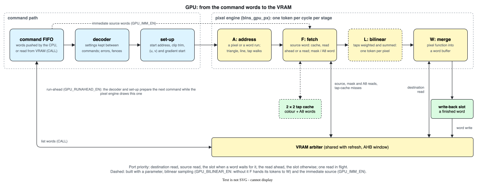

The first VRAM access comes 6 cycles after the `EXEC` word is pushed for a copy (the set-up
of the rectangle takes 3 of them; in x/y mode the clip box takes 1 more, and trimming a
rectangle against the clip window adds 1 cycle for a source, 2 to 4 for texture
coordinates and min(`DIM_W`, 14) + 1 for a gradient phase, 11 at the default `DIM_W` of
10, 2 more with `RGB`); a fill's first access is the
write of its first destination word (10 cycles after the push). Two queued 16-pixel FILLs
at 16 bpp leave 11 cycles between the last write of the first and the first write of the
second (8 with [run-ahead](#242-run-ahead), measured in `ultra`).

A FILL triangle with a 48 × 32 box at 16 bpp takes 480 cycles from its `EXEC` to the GPU
idle; sixteen 8 × 8 triangles pushed back to back take 916 cycles, about 57 each, with
run-ahead (`ultra`), 1352, about 85 each, without (`sim_ultra_nora`).

A line's first VRAM access comes about 18 cycles after its `EXEC_FILL` word is pushed
(the operand, the set-up and its pattern phase included); an anti-aliased line's about 30
(the slope's division).

Each primitive therefore costs about ten GPU cycles on top of its pixels, and its command
words cost the CPU one store each. Drawing a few pixels with the CPU through the VRAM
window costs one store per word written. For single pixels and runs of a few pixels
(small glyphs) the CPU path is as fast and keeps the GPU queue free; the GPU pays off from
runs of about a dozen pixels, and more the longer the run. A line costs 2 words per
segment and one cycle per pixel.

### 24.1 VRAM sharing

In the VRAM arbitration the GPU comes after a refresh whose pixel FIFO is running low
(its urgent fetch) and the VRAM window, and before the refresh's normal (non-urgent)
fetch and the window's read-ahead (which only takes a cycle nobody else asks for). A bus manager issuing a
window transfer on every cycle (back to back, as a DMA engine could) still leaves the GPU one
VRAM cycle in eight: after 7 cycles in a row lost to the window, a waiting GPU
takes the next one (the `gpu_win_starve` test: at most 7 GPU losses in a row under a
3000-write window burst). A CPU storing as fast as it can leaves gaps the GPU uses.
Measured on the aRVern SoC, not in simulation (an unrolled store loop into the window
while a full-frame FILL runs at 8 bpp): the stores are slowed by less than 1 %, and the FILL,
which writes a word every cycle on its own, advances at about 30 % of its speed while the
stores last. A copy along rows also uses the port on every cycle (a read and a write per
destination word). While the refresh sends a frame with the CL swap (one VRAM read per pixel,
here every fourth cycle) it takes a quarter of the cycles: the stores are then slowed by
about 20 % and the FILL advances at about 15 % of its speed.

### 24.2 Run-ahead

With `GPU_RUNAHEAD_EN = 1` the engine takes a copy of everything its command uses when it
starts drawing; the decoder and the set-up stage then go on with the following words while
it draws, so the settings between two commands (`SET_DST`, `SET_FILL`, ...) cost no time:
three 16-pixel FILLs, each after its `SET_DST` and `SET_FILL`, take 38 cycles from the first
write to the last instead of 52 (the 38 measured in `ultra`, the 52 in the default
configuration, which has no run-ahead). The larger gain is on the CPU side: the command FIFO
drains while the GPU draws, so a stream of small primitives finds free FIFO words sooner
and the CPU waits less in its pushes. Software cannot tell whether a build has run-ahead
(`BLNS_CFG2` does not report it, see the [feature parameters](integration_guide.md#22-feature-parameters)):
it must be correct either way. What may change for software:

- a `FENCE` waits until the engine has finished, as without run-ahead;
- `GPU_STAT.USED` counts the words not yet decoded: the words of the primitive being set
  up have already left the FIFO while the previous one draws, so `USED` can read lower
  (and `FREE` higher) than without run-ahead for the same words pushed;
- a primitive may take the display width (its default pitch) as early as its set-up,
  while the previous primitive draws: change `GFX_MODE`, `DISP_CFG` and the display width
  after a `FENCE` (or with the GPU idle) when commands are queued;
- `GPU_ERR` of a rectangle past the VRAM gives that rectangle's `EXEC`, even if later
  commands were decoded meanwhile, and replaces the record of an error met on one of them;
  the primitive already decoded behind it (in the set-up stage) is dropped with it, not
  drawn and with no `GPU_DONE`, while the settings its command words made remain;
- the copy holds the command's remap mode and table pointer, its mask plane (`MPLANE`,
  `INV`, the mask position), its alpha plane (the alpha position), its texture filter
  (`BILINEAR`, `TBORDER`) and `MIX5`: a `SET_AUX` or `SET_ALPHA` may change them while the
  previous command draws.
  A table must still not be rewritten while a command that uses it may run (wait for its
  `FENCE`).

---

## 25. Lines

`EXEC_FILL` with [24] `LINE` (`BLNS_CFG2` [11] `LINE`, `GPU_LINE_EN` with `GPU_XY_EN`)
draws a one-pixel line from the **pen** to the end point of its operand ({y [31:16], x
[15:0]}, signed 12.4: 1/16 pixel, −2048 … 2047.9375), in x/y mode, in the fill colour.
The pen then moves to the end point, so a polyline costs 2 words per vertex. `SET_AUX`
`SEL` 2 `LINE_PEN` sets the pen (operand {y, x}, 12.4; word [19:0] ignored).

| `EXEC_FILL` `LINE` field | Meaning |
|---|---|
| [3:0] | raster op, all 16; ops 13–15 skip a colour equal to `SET_TRANSP` |
| [6:4] | ignored (no swaps) |
| [7] | `TRI`: must be 0 (`ERR_CAUSE` 1) |
| [13:12] | `REMAP` as for a FILL: `SRC` the line colour, `DST` the destination through the table |
| [16] `AA` | anti-aliased (needs `GPU_BLEND_EN`, else `ERR_CAUSE` 2); in the palette modes the solid line is drawn |
| [17] `NO_LAST` | the last step (its end pixel, or the last AA column) is not drawn and does not count |
| [18] `OPAQUE` | the pattern's gaps drawn in the `SET_TRANSP` colour instead of skipped |
| [19] `PH_RST` | the pattern phase set to 0 before the line |
| [11:8], [15:14], [23:20], [27:25] | ignored (write 0) |

**Solid line.** It joins the pixels holding the end points, (⌊x/16⌋, ⌊y/16⌋): the major
axis is x when |Δx| ≥ |Δy| in whole pixels, else y; one pixel is drawn per major
coordinate, from the pen's to the end point's (D + 1 steps for a major distance D, D with
`NO_LAST`; D = 0 is one pixel, none with `NO_LAST`); the minor coordinate is the exact line
value rounded to the nearest, an exact half toward the smaller coordinate. Both
directions draw the same pixels; the walk and the pattern follow the direction. Pass 16
x + 8 (the pixel centre) for an integer pixel. A polyline with `NO_LAST` on every segment
but the last visits each joint once (an XOR polyline leaves no hole).

**Anti-aliased line** (16 bpp, Wu): the major axis from the 12.4 deltas; the slope G =
sign(ΔQ) · ⌊|ΔQ| · 2¹⁶ / |ΔP|⌋ (P, Q: the major and minor coordinates, 0 for a point); the
columns i = ⌊P/16⌋ from the pen's to the end point's (the steps, one less with `NO_LAST`);
at column k, T = Q₀ · 2¹² + ⌊G · d₀ / 16⌋ + k · G − 2¹⁵ (d₀ = s · (16 i₀ + 8 − P₀), s the
direction): pixel row r = ⌊T / 2¹⁶⌋ gets the coverage 255 − f and row r + 1 the coverage
f, f = (T mod 2¹⁶) >> 8. Each pixel is blended with α = its coverage (with `SET_ALPHA`
`EN`, coverage ∘ `A`) by the rule of [blending](#16-blending): out = d + ((s − d) · α +
128) >> 8 (α = 255 as 256), or with `MIX5` LVGL's; a coverage of 0 (`MIX5`: m = 0) is
not drawn, and the end columns get the whole
profile (no end weighting). The result is exact but not symmetric: draw shared edges in
one direction.

**Pattern.** `SET_AUX` `SEL` 3 `LINE_PATTERN`: word [4:0] `LEN` − 1 (1–32 bits, [19:5]
ignored), operand the pattern, bit *i* the bit of phase *i* (1 draws); the word sets the
phase to 0. Each step takes the bit of the phase, then the phase advances (modulo `LEN`):
a 0 skips the step's pixels (both pixels of an AA step), or with `OPAQUE` draws them in
the `SET_TRANSP` colour (so ops 13–15 skip every gap pixel). The phase carries from one
line to the next (polylines and closed outlines keep their rhythm across the corners); it
advances by the line's steps in x/y mode whatever is drawn or clipped.

| State | Set by | `CLEAR_ERR` / `ABORT` / `GPU_EN = 0` | `RESET_STATE` |
|---|---|---|---|
| pen | `LINE_PEN`; every `LINE` operand decoded (x/y or address mode) | kept | (0, 0) |
| pattern, `LEN` | `LINE_PATTERN` operand, word | kept | all ones, 32 |
| phase | each line's steps; 0 at the `LINE_PATTERN` word, `PH_RST`, an `ERR_CAUSE` 5 fault | 0 | 0 |

The phase is stream state: software can set it only to 0 and cannot read it, and it is 0
after every flush, so the line decoded after a recover starts at phase 0 in every build.
A command list runs with the pen, pattern and phase it finds: a list that wants a known
rhythm sets `PH_RST` on its first line.

**Clipping.** A pixel outside the clip window is skipped (no access) but counts as a
step; the walk ends as soon as either coordinate has passed the window's far bound, and a
line whose pixel box misses the window is not walked. A step before the walk enters the
window costs one cycle.

**Other features.** Blending (`SET_ALPHA`) and the palette remap apply as to a FILL; the
gradient does not (the fill colour is drawn); the `SET_XY` position is neither used nor
moved. In address mode a line draws nothing and raises `GPU_DONE` (the pen moves, the
phase does not advance; `PH_RST` still sets it to 0). `GPU_DONE` is raised once per line,
`ABORT` abandons it (the pixels merged are written), the debug freeze holds between two
pixels. A pixel at or past `VRAM_WORDS` stops the GPU with `ERR_CAUSE` 5, the pixels
before it drawn. With [run-ahead](#242-run-ahead) the engine's copy keeps the line's
pattern and clip window: a `LINE_PATTERN` decoded while it draws applies to the next one.

```c
blns_gpu_xy_begin(&blns, FRAME0, 0, colour);
blns_gpu_line_pattern(&blns, 0x0F0F0F0Fu, 8);           // 4 on, 4 off
const blns_line_t dash = { .rop = BLNS_ROP_S };
blns_gpu_rect_outline_xy(&blns, 10, 10, 100, 40, &dash); // a dashed focus frame
const blns_line_t aa = { .rop = BLNS_ROP_S, .aa = true };
blns_gpu_line_xy(&blns, BLNS_SUB(5) + 3, BLNS_SUB(7), BLNS_SUB(90), BLNS_SUB(60) + 9, &aa);
```

---

## 26. Alpha planes (RGB565A8)

With blending (`GPU_BLEND_EN`, `BLNS_CFG2` [6] `BLEND`) a 16-bpp source can carry an alpha
per pixel in a plane of its own: `SET_SRC` `SRC_FMT` 5, RGB565A8. `EXEC_COPY`,
`EXEC_COPY_TRANSP`, `EXEC_TEXSPAN` and `EXEC_TEXRECT` ([textured
triangles](#151-textured-triangles) included) blend each pixel with its alpha: anti-aliased
icons and images with soft edges in one command, LVGL's RGB565A8 images (and ARGB8888
ones converted to RGB565A8) as LVGL itself draws them.

- **The plane.** One byte per source pixel, with **the source's pitch, counted in
  pixels** (LVGL's layout: the alpha stride in bytes is half the colour stride): the
  alpha of source pixel *p* is the byte at the pointer + (*p* − source base), little-endian
  in its word as every 8-bpp pixel. `SET_AUX` (`SET_EXT` 13) with `SEL` 4 `ALPHA_PLANE`:
  [15:0] `PITCH` must be 0 (another value is `ERR_CAUSE` 2 in every build, room for an
  alpha pitch of its own later), [19:16] ignored (write 0); operand [`VRAM_AW` + 1:0] = the
  byte address (the 8-bpp pixel address) of the alpha of the `SET_SRC` base pixel, the
  bits above ignored (write 0). For a texture that is the alpha of texel (0, 0), and the
  alpha of a texel is at the pointer + v · pitch + u, the texel address rule (a
  power-of-two texture's alphas wrap with its texels, a free-pitch one reads on).
- **The walk.** The alpha follows the source walk: clipping, every swap, mirrors and CL
  swaps apply with no extra setting, as for the [mask plane](#18-mask-plane). For a
  sub-rectangle of an image whose first visited pixel is *p*₀, the pointer is the alpha of
  *p*₀ (the driver's `blns_alpha_of`).
- **Each pixel** (16 bpp):
  1. the key test, on the raw colour first (`COPY_TRANSP`, ops 13–15, `SET_TEX`
     `TRANSP_EN`): a keyed pixel is skipped whatever its alpha (its alpha word is still
     read);
  2. α = the alpha byte b, or with `SET_ALPHA` `EN` b ∘ `A` ([blending](#16-blending));
  3. the blend of [blending](#16-blending) with α, by the rule `MIX5` selects: nothing is
     written at α = 0 (with `MIX5`, m = 0); the pixel is written as S **without reading
     the destination** when b makes it opaque: without `MIX5`, b = 255 with `EN` = 0 or
     `A` = 255; with `MIX5`, b ≥ 252 with `EN` = 0, or b ≥ 253 with `EN` = 1 and `A` = 255.
     The other pixels read it (a few that reach m = 32 through `A` included: the same
     result, only slower).
- **Raster ops** as for every blend ([raster operations](#4-raster-operations)): ops 0–12
  blend S; ops 13–15 blend their constant with the pixel's alpha, so an op-15 RGB565A8
  copy is a soft shadow of the image in the fill colour.
- **Not with**: the [mask plane](#18-mask-plane) (a copy with `MPLANE`: `ERR_CAUSE` 1, 2
  without the mask plane) and the [immediate source](#19-immediate-source) (`ERR_CAUSE` 1):
  the alpha plane takes the GPU's one auxiliary word holder, and the pushed data carry no
  alpha. `EXEC_EXPAND` with `SRC_FMT` 5 is `ERR_CAUSE` 3; `EXEC_FILL` and `EXEC_SPAN`
  ignore `SRC_FMT`. The [palette remap](#17-palette-remap) has no effect at 16 bpp, as
  always.
- **Palette modes**: `SRC_FMT` 5 acts as 0, and the plane is not read.
- **Bounds.** An alpha word at or past `VRAM_WORDS` stops the command with `ERR_CAUSE` 5,
  the pixels before it drawn. A texel skipped by `BOUND` reads no alpha. The plane must
  not overlap the destination of the command (not checked).
- **State.** `SRC_FMT` stays until the next `SET_SRC`; the pointer is a setting, kept
  through `CLEAR_ERR`, `ABORT` and `GPU_EN = 0` and set to 0 by `RESET_STATE`. An
  `ALPHA_PLANE` cut by a flush between its word and its operand changes nothing (its
  word sets nothing). With [run-ahead](#242-run-ahead) the engine keeps the alpha
  position of its command: an `ALPHA_PLANE` decoded while it draws applies to the next one.
- **Fetch.** The GPU holds one alpha word (four alphas along a row) and reads the next
  one ahead in a free VRAM cycle: a copy along rows whose alphas are 0 or opaque takes
  1.5 cycles a pixel ([performance](#24-performance)). Where an opaque pixel and a
  translucent one share a destination word, the opaque one first, the word is written,
  read again and written: one access more each way.

```c
// An LVGL RGB565A8 image (w x h, colours at pixel address IMG with pitch 'pitch', its
// A8 plane at byte address IMG_A8) drawn at (x, y) as LVGL draws it
const blns_surf_t img = { .addr = IMG, .pitch = pitch, .swap = BLNS_SWAP_NONE };
blns_gpu_blend_rule(&blns, BLNS_MIX5);                  // LVGL's rule...
blns_gpu_alpha(&blns, opa < 253, opa);                  // ...sent with SET_ALPHA (EN: an opacity)
blns_gpu_alpha_plane(&blns, IMG_A8);                    // the alpha of the first pixel
const blns_blit_t a8 = { .rop = BLNS_ROP_S, .src_alpha = true };
blns_gpu_blit_xy(&blns, &img, x, y, w, h, BLNS_SWAP_NONE, &a8);
```

---

## 27. Bilinear sampling

With `GPU_BILINEAR_EN` (and `GPU_XY_EN`: `BLNS_CFG2` [12] `BILINEAR`) a texture can be
sampled between its texels: `EXEC_TEXSPAN`, `EXEC_TEXRECT` and [textured
triangles](#151-textured-triangles) blend, for each pixel, the four texels around its
sample point, weighted by its position between them. Scaled and rotated images look
smooth instead of blocky, and with `BOUND` their edges are anti-aliased: LVGL's image
transforms.

`SET_AUX` (`SET_EXT` 13) with `SEL` 5 `TEX_FILTER`: [0] `BILINEAR` (0: the nearest texel,
1: bilinear), [1] `TBORDER` (with `BOUND`: 0 clamps the taps to the box, 1 makes the taps
outside it transparent; needs `GPU_BLEND_EN`, else `ERR_CAUSE` 2), [19:2] ignored (write
0); the operand is ignored (write 0). The filter is a setting: it takes effect with the
word (a `TEX_FILTER` cut by a flush before its operand keeps it), is kept through
`CLEAR_ERR`, `ABORT` and `GPU_EN = 0`, and `RESET_STATE` sets nearest and clamp. With
[run-ahead](#242-run-ahead) a `TEX_FILTER` decoded while a blit draws applies to the next.

**Taps and weights** (16 bpp; the walk, the steps and `SET_UV` are those of
[textured spans](#12-textured-spans) and [affine blits](#13-affine-blits), the texel
centres at integer + ½):

- The walk starts half a texel back, at (u0 − ½, v0 − ½), and steps as usual. For a pixel
  at (u, v): x0 = ⌊u − ½⌋, f8x = the top 8 fraction bits of u − ½, fx = (f8x + 4) >> 3
  (0 … 32); likewise y0, fy.
- The taps are T₀₀ = (x0, y0), T₀₁ = (x0 + 1, y0), T₁₀ = (x0, y0 + 1), T₁₁ = (x0 + 1, y0 +
  1), with the weights k = wx · wy, wx = 32 − fx or fx, wy = 32 − fy or fy (the four sum
  to 1024). A tap of weight 0 is not read: a texel-aligned pixel (a 90° turn, an integer
  offset, an unscaled position on texel centres) takes one tap, an axis-aligned zoom two
  or four.
- Each tap's texel is at the texture address of (x, y): a power-of-two texture wraps
  (seamless tiling), a free-pitch one reads on. Its alpha a is 255, or with an
  [RGB565A8](#26-alpha-planes-rgb565a8) texture its alpha byte; a raw tap texel equal to
  `SET_TRANSP` with `TRANSP_EN` has a = 0 (a keyed sprite gets soft scaled edges); with
  `SET_ALPHA` `EN`, a ← a ∘ `A`.
- **With `BOUND`** ([affine blits](#13-affine-blits)): the pixel is skipped (no tap read,
  nothing written) when (⌊u⌋, ⌊v⌋) lies outside the box [0, TW) × [0, TH), LVGL's "fully
  outside the image" test. Its taps: with `TBORDER` = 0, x clamped to [0, TW − 1] and y to
  [0, TH − 1] (both taps of a clamped pair are read: the edge texel repeated); with
  `TBORDER` = 1, a tap outside the box is transparent and not read. Without `BOUND`,
  `TBORDER` has no effect.

**The colour.** With a′ = a + (a >> 7) (255 counts as 256), each tap gives e = (k · a′) >> 8;
S = Σ e and, per RGB565 field, P = Σ e · c (c the tap's field value).

- **Blend build** (`GPU_BLEND_EN`), every bilinear pixel, opaque or not: α₂₅₆ = S >> 2
  (0 … 256) and Pm = P >> 2 with `MIX5`, (P + 2) >> 2 without; the pixel is blended
  premultiplied: out = d + ⌊(Pm − d · α₂₅₆ + r) / 256⌋, r = 0 with `MIX5`, 128 without. At
  α₂₅₆ = 0 nothing is written; at α₂₅₆ = 256 (every tap opaque) out = (Pm + r) >> 8 with no
  destination read, so an opaque image never shows the destination through its interior.
- **Build without blending**: every tap is opaque and the colour is (P + 512) >> 10.
  `TBORDER` and `SRC_FMT` 5 are absent there, and a texture with `TRANSP_EN` is sampled
  nearest (`BILINEAR` ignored for it) so that its key keeps working.

**Distance from LVGL.** The arithmetic follows LVGL's (5-bit weights, the half-texel
convention, the premultiplied alpha), but is not bit-exact with it: LVGL switches
between two kernels per row and per pixel, which differ from each other by up to 5
levels of G on the same taps. For the same sample point the GPU differs from LVGL by at
most 1 per field (opaque taps), 2 / 3 / 2 for R / G / B on smooth image edges, and 3 / 5 /
3 in the worst case. The sample positions are another approximation: (u0, v0) has 6
fraction bits and the steps 11, so a driver re-seeds long blits in tiles (the driver's
`blns_gpu_texrect_fx_xy`: tiles of at most 64 × 64, within 1/32 texel of LVGL's sample
point).

**Other features.**

- `SHADE` has no effect with `BILINEAR` at 16 bpp. Raster ops: textures always use op 0.
- The destination swaps, `DELTA`, `N`, the rectangle and the address mode are as without
  the filter: it changes what each pixel reads, not the walk.
- In the palette modes `BILINEAR` and `TBORDER` have no effect (indices cannot be
  interpolated): nearest sampling, and `SHADE` and the [palette remap](#17-palette-remap)
  work as without them.
- A bilinear texture **must not overlap the destination** of its blit (the result is
  undefined; not checked).
- A tap's colour word, or its alpha word, at or past `VRAM_WORDS` stops the blit with
  `ERR_CAUSE` 5; the pixels before the one holding that tap are drawn. With `BOUND` the taps
  stay inside the box; without it a free-pitch texture's right or bottom taps read past
  the image (one texel), and past the VRAM at its end.
- `GPU_DONE` is raised once per span, blit or triangle; `ABORT` abandons the blit (the
  pixels merged are written, a pixel's partial sum dropped); the debug freeze holds
  between two pixels, never between the taps of one.
- The GPU keeps the last four colour words its taps read (two texel rows by two word
  columns, each with the alphas of its two texels), dropped at each command start and
  while frozen: a footprint shared by neighbouring pixels is read once
  ([performance](#24-performance)).

```c
// An RGB565A8 image of w x h at IMG (pitch in pixels; alphas at byte IMG_A8), rotated and
// scaled about its centre into the clip window, with anti-aliased edges
const blns_tex_t t = { .addr = IMG, .free_pitch = true, .pitch = pitch, .bound = true,
                       .box_w = w, .box_h = h, .src_alpha = true,
                       .bilinear = true, .border_transparent = true };
blns_gpu_blend_rule(&blns, BLNS_MIX5);
blns_gpu_alpha(&blns, false, 0);
blns_gpu_alpha_plane(&blns, IMG_A8);
blns_gpu_tex_set(&blns, &t, 0);                          // sends TEX_FILTER when it changes
blns_gpu_texrect_fx_xy(&blns, x, y, bw, bh, u_at_xy, v_at_xy, du, dv, du_r, dv_r);  // 1/65536 texel
```

---

## See Also

- [driver_guide.md](driver_guide.md) — the GPU calls of the C driver, conventions, concurrency and recovery
- [programming_model.md](programming_model.md) — pixels, frame buffers and the interrupts the GPU raises
- [slipstream_trace_format.md](slipstream_trace_format.md) — what the GPU does in a simulation, cycle by cycle
- [integration_guide.md](integration_guide.md#22-feature-parameters) — the parameter of each optional feature
