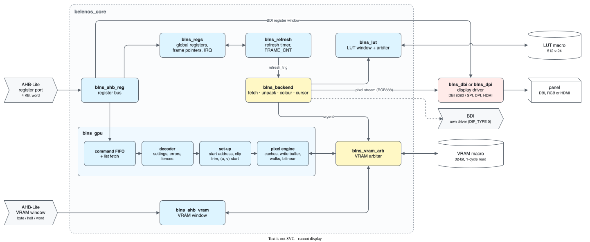
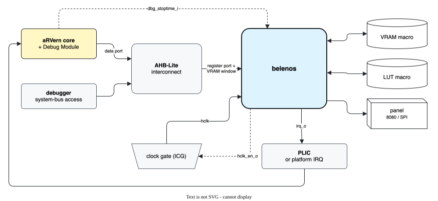
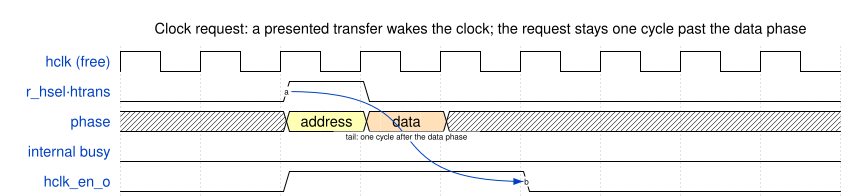

<p align="center">
  
</p>

# Belenos integration guide

*A 32-bit frame-buffer graphic controller with two AHB-Lite ports, a 2D GPU and built-in
display drivers: MIPI-DBI (8080 and SPI), MIPI-DPI with scaling, and HDMI with audio.*

*For SoC integrators: the parameters and personas, the ports and tie-offs, clocks and
constraints, reset, interrupt, debug and privilege. The bus ports and the memory macros
are in [memory_and_ahb.md](memory_and_ahb.md), the area in
[synthesis_guide.md](synthesis_guide.md), the display interface in
[display_interface.md](display_interface.md); programming is in the
[programming model](programming_model.md), the [register map](register_map.md) and the
[GPU command set](gpu_commands.md). Where to start for each reader: the
[README](../README.md#where-to-go-next).*

---

## Table of Contents

1. [Overview](#1-overview)
    - [1.1 Features](#11-features)
    - [1.2 Block structure](#12-block-structure)
2. [Design parameters](#2-design-parameters)
    - [2.1 Personas](#21-personas)
    - [2.2 Feature parameters](#22-feature-parameters)
    - [2.3 Integration parameters](#23-integration-parameters)
3. [Module hierarchy](#3-module-hierarchy)
4. [Integrating Belenos — the short version](#4-integrating-belenos--the-short-version)
5. [Ports and tie-offs](#5-ports-and-tie-offs)
    - [5.1 Port summary](#51-port-summary)
    - [5.2 DPI and HDMI ports](#52-dpi-and-hdmi-ports)
    - [5.3 DPI clock output](#53-dpi-clock-output)
    - [5.4 TMDS serialiser](#54-tmds-serialiser)
    - [5.5 Tie-offs](#55-tie-offs)
    - [5.6 Display interface selection](#56-display-interface-selection)
6. [Clocks](#6-clocks)
    - [6.1 Clock gating](#61-clock-gating)
    - [6.2 Separate pixel clock](#62-separate-pixel-clock)
7. [Timing constraints](#7-timing-constraints)
8. [Reset](#8-reset)
9. [Interrupt](#9-interrupt)
10. [Debugger accesses and debug freeze](#10-debugger-accesses-and-debug-freeze)
11. [Privilege check](#11-privilege-check)
- [See Also](#see-also)

---

## 1. Overview

Belenos is the graphic controller of the aRVern ecosystem, built around a 32-bit
datapath and AHB-Lite and derived from the openGFX430 controller. It keeps a frame buffer
in a single-port video memory (VRAM), refreshes an external display panel from it, and
gives software two ways to draw into it:

- **directly**, through an AHB-Lite window that maps the whole VRAM into the address
  space (byte, half-word and word accesses);
- **with the GPU**, a command-driven engine that fills and copies rectangles with
  sixteen raster operations and an optional transparent colour.

The panel side is a pixel stream, the **Belenos Display Interface (BDI)**. A built-in
MIPI-DBI driver turns it into the 8080 parallel bus or 4-wire SPI of ILI9341-class
panels, and a built-in MIPI-DPI driver into the timing and RGB lines of a parallel RGB
panel, with scaling, or with its TMDS encoder into the symbols of an HDMI (DVI) link;
an integrator who needs another panel type replaces the driver with
their own and leaves the controller unchanged.

### 1.1 Features

| Area | What Belenos provides |
|---|---|
| Pixel formats | 1, 2, 4, 8 and 16 bits per pixel, packed LSB first in 32-bit words |
| Colour | 16 bpp RGB565; 8 bpp RGB332; 4/2/1 bpp CGA-based hardware palettes; a programmable 2 × 256-entry RGB888 look-up table for every indexed mode, with a hardware rotation of an index range (colour cycling) |
| Frame buffers | one, two or four frame pointers into one VRAM; the refresh picks one (double buffering, scrolling, off-screen sprites) |
| Orientation | eight scan orders (X, Y and column swaps) for landscape/portrait panels and mirroring; pixel doubling (a half-size frame shown at full size) |
| Cursor | optional hardware cursor: 32 × 32 pixels, three RGB888 colours and transparency, a hotspot, overlaid on the frame sent (it turns, doubles and scales with the picture), moved tear-free at frame starts |
| Refresh | period timer or manual one-shot, frame countdown and free-running frame number, the latched frame index (exact flip completion), start/done interrupts |
| GPU | FILL, COPY, COPY with transparency, one-word horizontal spans, colour expansion of 1/2/4/8-bit images (text), textured spans; 16 raster operations; independent source and destination swaps; a command FIFO of 8 to 64 words (8 by default) and command lists read from VRAM. Optional, one parameter each: x/y coordinates with a clip window and affine blits (scaling, rotation, texture mapping, source bounds), gradient fills, alpha blending at 16 bpp (constant and coverage masks), flat and textured triangles (sub-pixel vertices, top-left rule, affine texture mapping), palette remap through a table in VRAM (house colours, shading, fades), a 1-bpp mask plane on copies (one-pass masked sprites, stencils), an immediate source (CPU pixels and ROM glyphs pushed through the command FIFO, in order with the drawing), self-incrementing fences and a FIFO low-water interrupt |
| Display | 8080-16 parallel bus and/or SPI (DBI type C option 3), hardware window, full-screen fill, scanline or TE synchronisation; or parallel RGB (DPI): programmable timing and polarities, image placement and nearest or bilinear scaling, optional separate pixel clock, panel detect; or HDMI (DVI signalling): the DPI driver with a TMDS encoder, three 10-bit symbols per pixel for a serialiser, HDMI mode with an InfoFrame per frame, stereo audio from an I2S input with a generic packet (an SPD InfoFrame, for instance), and the DDC lines for the monitor's EDID; or the BDI exported for a custom driver |
| Bus | two AHB-Lite subordinates: a 4 KB register port and a VRAM window |
| SoC features | clock-request output for clock gating, a level interrupt, a debug freeze of refresh and GPU, an optional user-mode access check |

### 1.2 Block structure



The **register port** decodes onto an internal register bus that reaches the global
registers, the GPU, the colour LUT and the display driver's register
window. Three requesters share the single-port **VRAM** through the arbiter: the
backend (the refresh), the AHB window and the GPU, plus the window's
read ahead. The **backend** reads the
frame, unpacks the pixels, converts them to RGB888 through the hardware tables or the
LUT, lays the hardware cursor over them, and streams them to the display driver. The
cursor's shape words share the backend's requester, told apart by its read tag.

VRAM arbitration, highest priority first:

1. the backend, when its pixel FIFO is nearly empty and its next pixel needs a word
   (urgent);
2. the AHB window;
3. the GPU;
4. the backend, prefetching ahead;
5. the window's read ahead, only in a cycle no other requester wants.

A refresh therefore never starves, and the CPU's accesses are served before the GPU's,
except that a GPU which has lost 7 cycles in a row to the window takes the
next one: a back-to-back bus manager on the window cannot stop the GPU.

Each requester is one slot of the arbiter's packed request vectors (request,
urgent, write, byte enables, address, write data, read tag in; grant and read valid
out). The arbiter follows every read it grants, with its requester and tag, through
one shift register as deep as the read latency, and gives that requester its read
valid when the data returns: no requester counts cycles. The policy above comes
from the requester's class: urgent-capable (the backend), host
(the window), normal (the GPU, then the backend) and idle-only (the read ahead),
the lower slot first within a class. The window's grant is decoded from flops only (the window's request, the backend's
urgent flag, the GPU's lost-cycle counter), never from an address compare nor from
`bdi_refresh_active_i` (the backend's requests follow it through a flop), and it
reaches flop inputs only: both ports' `hreadyout`, `hresp` and `hrdata` come from flops,
so no VRAM-side path (a grant, a read valid, the macro's output) reaches the SoC bus,
and the CPU behind it, in the same cycle. A window write that loses its cycle is posted
(one word) and made in the next cycle the urgent refresh or the GPU's aged cycle
leaves; until then the next window transfer and the next register-port transfer wait,
so the order of the bus is kept for every observer inside Belenos (the GPU, the
refresh, the window's own reads). The limit of 7 lost cycles is the parameter
`AGE_MAX` of `blns_vram_arb`.

---

## 2. Design parameters

Belenos has two kinds of parameters. **Feature parameters** decide how much drawing the
hardware does for the CPU; **integration parameters** follow from the SoC and the panel
(VRAM size, panel driver, reset style, bus attributes) and are always the integrator's.

### 2.1 Personas

Five ready-made feature sets, each a step in what the hardware can draw for the CPU. Each
persona sets every feature parameter, the GPU command FIFO depth included; integration
parameters are chosen separately.

| Persona | Hardware | What it can accelerate (LVGL at 16 bpp as the yardstick) | Other uses | Area |
|---|---|---|---|---:|
| `light` | display controller, no GPU: the CPU draws through the VRAM window; one LUT bank (a 256-entry LUT macro) | nothing: the CPU renders everything | small panels driven by an MCU | 14.0 kGates |
| `essential` | the 2D GPU core: fills, copies (raster operations, transparency), spans, colour expansion, textured spans, command lists; addresses only | the opaque subset from VRAM: fills, borders, opaque and colour-keyed image blits, 1-bpp text | simple user interfaces, text consoles | 38.6 kGates |
| `classic` | + x/y coordinates and clip window, affine blits, gradient fills, lines, palette remap, mask plane, immediate source, hardware cursor | + linear gradients, rotated or scaled images, solid and dashed lines, sources pushed from the CPU's memory, a pointer with no redraw | 8-bit-per-pixel user interfaces, 2D games (palette remap, masked sprites) — **the parameter defaults** | 67.3 kGates |
| `performance` | + alpha blending at 16 bpp, run-ahead, bilinear sampling, a command FIFO of 16 words | almost everything: + translucent fills, anti-aliased (A8) text and lines, image and layer opacity, smooth rotated and scaled images | 16-bit user interfaces | 94.5 kGates |
| `ultra` | + triangles, a command FIFO of 32 words | + triangles and polygon fills | games and 3D effects | 122.8 kGates |

The second column is what the hardware can do; how much a given software uses is up to
it: the reference LVGL draw unit offloads opaque fills, borders and opaque image blits on
every persona with a GPU, translucency and images with an alpha channel exactly as LVGL
draws them (`performance`, `ultra`), and with its extensions images staged in the VRAM,
layers in the VRAM, anti-aliased text (`performance`, `ultra`) and, opt-in and
approximate, gradients and rotated or scaled images (`classic` and up; the images bilinear with anti-aliased edges in `performance` and `ultra`) ([what each persona offloads](lvgl_guide.md#43-what-each-persona-offloads);
on LVGL's benchmark, × 1.05 without blending and × 1.95 to × 2.04 with it, the per-pixel alpha and bilinear sampling (× 1.71 with the exact draws only, at 480 × 272): [performance](performance.md)). The area is without the VRAM, LUT
and line-buffer macros and without a display driver; the breakdown per block, the cost of
each feature and of each display driver are in the
[area results](synthesis_guide.md#1-area-results) of the synthesis guide.

| Feature parameter | `light` | `essential` | `classic` | `performance` | `ultra` |
|---|---|---|---|---|---|
| `LUT_EN`, `LUT_BANKS`, `FRAME_NR` | 1, 1, 2 | 1, 2, 2 | 1, 2, 2 | 1, 2, 2 | 1, 2, 2 |
| `GPU_EN` | 0 | 1 | 1 | 1 | 1 |
| `GPU_XY_EN`, `GPU_GRAD_EN` | — | 0 | 1 | 1 | 1 |
| `GPU_REMAP_EN`, `GPU_MPLANE_EN` | — | 0 | 1 | 1 | 1 |
| `GPU_IMM_EN` | — | 0 | 1 | 1 | 1 |
| `GPU_LINE_EN` | — | 0 | 1 | 1 | 1 |
| `GPU_BLEND_EN` | — | 0 | 0 | 1 | 1 |
| `GPU_RUNAHEAD_EN` | — | 0 | 0 | 1 | 1 |
| `GPU_BILINEAR_EN` | — | 0 | 0 | 1 | 1 |
| `GPU_TRI_EN` | — | 0 | 0 | 0 | 1 |
| `CURSOR_EN` | 0 | 0 | 1 | 1 | 1 |
| `GPU_FIFO_AW` (FIFO words) | — | 3 (8) | 3 (8) | 4 (16) | 5 (32) |

### 2.2 Feature parameters

| Parameter | Default | Range | Meaning |
|---|---|---|---|
| `LUT_EN` | 1 | 0, 1 | programmable colour LUT present |
| `LUT_BANKS` | 2 | 1, 2 | LUT banks of 256 entries (needs `LUT_EN`) |
| `FRAME_NR` | 2 | 1, 2, 4 | number of frame pointers |
| `GPU_EN` | 1 | 0, 1 | GPU present |
| `GPU_XY_EN` | 1 | 0, 1 | GPU [x/y coordinates and clip window](gpu_commands.md#10-coordinates-and-clipping) (`SET_DST` `XY`, `SET_XY`, `SET_CLIP`) and [affine blits](gpu_commands.md#13-affine-blits) (`EXEC_TEXRECT`, `SET_STEP_ROW`, `SET_TEXBOX`, `SET_TEX` `BOUND`) |
| `GPU_GRAD_EN` | 1 | 0, 1 | GPU [gradient fills](gpu_commands.md#14-gradient-fills) (`SET_GRAD`) |
| `GPU_BLEND_EN` | 0 | 0, 1 | GPU [alpha blending](gpu_commands.md#16-blending) at 16 bpp (`SET_ALPHA` and its `MIX5` blend rule, `EXPAND` masks, anti-aliased lines, [RGB565A8 sources](gpu_commands.md#26-alpha-planes-rgb565a8): `SRC_FMT` 5, `SET_AUX` `ALPHA_PLANE`) |
| `GPU_TRI_EN` | 0 | 0, 1 | GPU [triangles](gpu_commands.md#15-triangles) (`SET_V0`–`SET_V2`, `EXEC_FILL` `TRI`; textured with `EXEC_TEXRECT` `TRI`); needs `GPU_XY_EN` |
| `GPU_FIFO_AW` | 3 | 3 … 6 | GPU command FIFO of 2^`GPU_FIFO_AW` words (8 to 64): a deeper FIFO lets the CPU queue more commands ahead of the GPU (longer pushes without a wait, longer runs between interrupts); command lists need none. 32 or 64 cost almost nothing in FPGA LUT RAM. Software reads the depth in `BLNS_CFG2` [3:0] |
| `GPU_RUNAHEAD_EN` | 0 | 0, 1 | GPU [run-ahead](gpu_commands.md#242-run-ahead): the engine draws from a copy of its command, so the decoder and the set-up go on with the next one (no gaps for the settings between commands); timing only, not reported in a register |
| `GPU_REMAP_EN` | 1 | 0, 1 | GPU [palette remap](gpu_commands.md#17-palette-remap) (`SET_AUX` `REMAP_TABLE`, the `REMAP` fields of `EXEC_FILL`, `EXEC_COPY`, `EXEC_COPY_TRANSP`, `EXEC_EXPAND` and `SET_TEX`, triangles included); reported in `BLNS_CFG2` [8] |
| `GPU_MPLANE_EN` | 1 | 0, 1 | GPU [mask plane](gpu_commands.md#18-mask-plane) on copies (`SET_AUX` `MASK_PLANE`, `EXEC_COPY` / `EXEC_COPY_TRANSP` `MPLANE`); reported in `BLNS_CFG2` [9] |
| `CURSOR_EN` | 1 | 0, 1 | [hardware cursor](programming_model.md#44-hardware-cursor) in the backend (`CURSOR_CTRL`, `CURSOR_POS`, `CURSOR_ADDR`, `CURSOR_COL1`–`3`); independent of the GPU, settable in any build (with `light` too); reported in `BLNS_CFG` [18]. Without it the six registers read 0 and ignore writes |
| `GPU_IMM_EN` | 1 | 0, 1 | GPU [immediate source](gpu_commands.md#19-immediate-source) (`SET_SRC` `IMM`: `EXEC_COPY`, `EXEC_COPY_TRANSP` and `EXEC_EXPAND` read their source from the words pushed after them); reported in `BLNS_CFG2` [10]. Without it `SET_SRC` `IMM` is refused (`ERR_CAUSE` 2) |
| `GPU_LINE_EN` | 1 | 0, 1 | GPU [lines](gpu_commands.md#25-lines) (`EXEC_FILL` `LINE`, `SET_AUX` `LINE_PEN` / `LINE_PATTERN`: solid and dashed; anti-aliased with `GPU_BLEND_EN`); needs `GPU_XY_EN` (without it lines are absent); reported in `BLNS_CFG2` [11] |
| `GPU_BILINEAR_EN` | 0 | 0, 1 | GPU [bilinear texture sampling](gpu_commands.md#27-bilinear-sampling) (`SET_AUX` `TEX_FILTER`: `EXEC_TEXSPAN`, `EXEC_TEXRECT`, textured triangles; a 2 × 2 tap cache and a multiply-accumulate stage); needs `GPU_XY_EN` (without it bilinear is absent). With `GPU_BLEND_EN` also the transparent border (anti-aliased image edges), RGB565A8 textures and keyed taps; without it opaque filtering with clamped or wrapped edges. In the `performance` and `ultra` personas, 0 by default ([area](synthesis_guide.md#13-feature-cost)); reported in `BLNS_CFG2` [12] |

A command or field of an absent GPU feature stops the GPU with `ERR` (`ERR_CAUSE` 2,
absent feature; 1 is for undefined codes); a feature that needs another (triangles or
lines or bilinear sampling without `GPU_XY_EN`, anti-aliased lines, RGB565A8 sources and a bilinear transparent border without `GPU_BLEND_EN`) is absent. Which parameter each command and field needs: the
[command quick reference](gpu_commands.md#32-command-quick-reference).

#### Choosing the features

What each feature parameter lets the software do, in plain terms, and what the CPU must do
instead when it is left out. Every feature is optional: leaving one out moves its work
back to the CPU (or, for the LUT and the frame pointers, takes a display mode away); the
software must then do that work itself. What each one costs in gates is in the
[feature cost](synthesis_guide.md#13-feature-cost) table.

| Parameter | What it gives the software | Without it | Who needs it |
|---|---|---|---|
| `LUT_EN` | a programmable palette for the indexed modes (1 to 8 bits per pixel): any 256 colours out of 16 million, palette fades and colour cycling (`LUT_ROT`) without touching a pixel | indexed modes show fixed colour tables; true-colour (16 bpp) is unaffected | anything drawn at 8 bpp or less: retro games, small-memory user interfaces |
| `LUT_BANKS` = 2 | a second palette: software prepares it while the first is shown, then switches at the next frame (no half-changed palette on screen) | palette changes are written into the palette being shown | games and demos that change the palette every frame (fades, day/night) |
| `FRAME_NR` | one, two or four frames in the VRAM that the display can switch between: draw the next picture while the current one is shown (double or triple buffering) | with one frame, drawing happens on the picture being shown (visible tearing, or drawing restricted to blanking) | animation and scrolling; one frame is enough for static screens |
| `GPU_EN` | the 2D graphics engine: rectangle fills, copies between images (with raster operations and a transparent colour), 1-bit text and icon expansion, textured spans, command lists; the CPU queues commands and carries on | the CPU draws every pixel itself through the VRAM window | any user interface or game beyond a few redraws a second |
| `GPU_XY_EN` | address by (x, y) instead of computing memory addresses; a clip rectangle; rotated, scaled and mirrored images (affine blits) | software computes addresses and clips each rectangle itself; rotation and scaling are done by the CPU | user-interface libraries (LVGL), any rotated or zoomed image, mode-7 style effects |
| `GPU_GRAD_EN` | colour gradients filled by the engine, along x or along y, in one command | gradients drawn line by line by the CPU, or as many thin fills | modern-looking buttons and backgrounds, skies, progress bars |
| `GPU_LINE_EN` | lines between any two points, solid or dashed (anti-aliased with `GPU_BLEND_EN`) | the CPU computes every pixel of a line (only horizontal and vertical lines are cheap fills) | charts, gauges, wireframes, maps, oscilloscope-style displays, vector games |
| `GPU_REMAP_EN` | in the palette modes (8 bpp and below), recolour while drawing: one image, many colour variants (team colours, highlight, flash on hit, dim) through a table of up to 256 entries | one stored copy per colour variant, or a CPU pass over the pixels | games with palette effects, themed user interfaces at 8 bpp |
| `GPU_MPLANE_EN` | draw an image through a separate 1-bit mask: irregular sprites and shaped windows, with any colour allowed in the image | transparency through one reserved colour only, or masking done by the CPU | games with sprites stored with masks (many classic games), icons with holes |
| `GPU_IMM_EN` | draw an image straight from the CPU's own memory (the pixels follow the command), with no copy into the VRAM first | images must first be copied into the VRAM, or drawn by the CPU | images and fonts kept in flash or CPU RAM, streaming content, small VRAM |
| `CURSOR_EN` | a 32 × 32 mouse pointer drawn by the display itself: moving it is one register write, nothing in the picture is redrawn | the pointer is drawn into the picture, and the area under it saved and restored at every move | anything with a mouse or touch pointer; also a cheap overlay marker (crosshair) |
| `GPU_BLEND_EN` | translucency at 16 bpp: see-through fills and images, smooth (anti-aliased) text and lines, fading layers, images with their own transparency (icons with soft edges, LVGL's RGB565A8 and ARGB8888 images), drawn exactly as LVGL draws them | edges are hard, translucency is done by the CPU (slow) or avoided | polished 16-bit user interfaces (LVGL with anti-aliased fonts and images), overlays |
| `GPU_BILINEAR_EN` | rotated and scaled images that look smooth, with smooth edges (with `GPU_BLEND_EN`): LVGL's image rotations and zooms, close to LVGL's own result (its `TRANSFORM` approximation) | the GPU draws rotated and scaled images blocky (nearest texel), or the CPU draws them smooth (slow) | user interfaces with rotating or zooming images (gauges, dials, transitions), games with zoomed backgrounds; in `performance` and `ultra`, its area in the [feature cost](synthesis_guide.md#13-feature-cost) |
| `GPU_RUNAHEAD_EN` | the engine prepares the next command while drawing the current one: many small commands run with fewer gaps | the same pictures, a little slower with many small commands | user interfaces made of many small elements; free to leave out when area matters |
| `GPU_TRI_EN` | filled and textured triangles: polygons, simple 3D | polygons drawn by the CPU, row by row | 3D effects, vector graphics with filled shapes, games with polygons |
| `GPU_FIFO_AW` | how many command words the CPU can queue ahead of the engine before it has to wait | at the minimum of 8 words, the CPU waits more often when it issues many commands in a burst; command lists avoid the wait in any build | software issuing long bursts of commands from the CPU; on an FPGA a deep FIFO costs almost nothing |

How to pick, in practice:

1. Start from the [persona](#21-personas) closest to what the software must draw, then add
   or remove single features.
2. **Does the software use a library?** LVGL and similar libraries draw with x/y
   coordinates and clipping: take `GPU_XY_EN` with the GPU. For smooth fonts and
   translucency at 16 bpp, add `GPU_BLEND_EN` (the `performance` persona).
3. **8 bits per pixel or less?** Keep `LUT_EN`; add the second bank and `GPU_REMAP_EN` for
   palette effects.
4. **Games and sprites?** `GPU_MPLANE_EN` and `GPU_REMAP_EN` for classic sprites,
   `FRAME_NR` = 2 for tear-free animation, `GPU_TRI_EN` only for polygons and 3D.
5. **Images in flash or CPU RAM, little VRAM?** `GPU_IMM_EN`.
6. **A mouse or touch pointer?** `CURSOR_EN`: the pointer moves without any redraw.
7. **Area first?** Leave out `GPU_RUNAHEAD_EN` and keep the FIFO at 8 words: both change
   speed, never what can be drawn.

Software never has to guess: it reads the features present from `BLNS_CFG` and
`BLNS_CFG2` (see the [programming model](programming_model.md#1-identification)). The
driver library returns `BLNS_ERR_ABSENT` for a feature not built, with nothing sent, so the
application or a graphics library can fall back to drawing with the CPU; the LVGL draw
unit does so by itself ([driver guide](driver_guide.md), [LVGL guide](lvgl_guide.md)).

### 2.3 Integration parameters

| Parameter | Default | Range | Meaning |
|---|---|---|---|
| `VRAM_WORDS` | 38400 | 1 … 2²⁴ | VRAM depth in 32-bit words (38400 = 320 × 240 at 16 bpp) |
| `VRAM_AW` | derived | — | VRAM word-address width, ⌈log2(`VRAM_WORDS`)⌉ (at least 1): leave at its default |
| `VRAM_RD_LAT` | 1 | 1 … 3 | the VRAM macro's read latency in cycles: 1 for a plain synchronous RAM, 2 or 3 for a macro with output registers (an FPGA block RAM with its output register); every VRAM read takes that long (see [VRAM macro](memory_and_ahb.md#3-vram-macro)) |
| `VRAM_RD_REG_EN` | 0 | 0, 1 | register the VRAM read data: every VRAM read takes one cycle more, for a macro too slow for the read path, except the window's, which registers its read data either way (see [VRAM macro](memory_and_ahb.md#3-vram-macro)) |
| `DIM_W` | 10 | 4 … 16 | width of the width/height fields: display windows up to 2^DIM_W − 1 pixels, GPU rectangles up to 2^min(DIM_W, 14) − 1 |
| `DIF_TYPE` | 2 | 0 … 5 | built-in display driver: 0 `BDI` (none, the BDI exported), 1 `DBI_SPI`, 2 `DBI_PAR` (8080), 3 `DBI_PAR_SPI`, 4 `DPI`, 5 `HDMI` (DPI and TMDS encoder) ([display interface](display_interface.md#1-overview)) |
| `DPI_LB_AW` | 10 | 9 … 12 | DPI line-buffer address width: up to 2^`DPI_LB_AW` source pixels per line are kept; size it for the widest source line (see [DPI line-buffer macro](memory_and_ahb.md#6-dpi-line-buffer-macro)) (`DIF_TYPE` 4, 5) |
| `DPI_SCALER` | 1 | 0 … 2 | DPI scaler: 0 none (the frame 1:1), 1 nearest-neighbour scaler, 2 nearest-neighbour and bilinear scaler (a third line buffer) (`DIF_TYPE` 4, 5) |
| `DPI_PCLK_SEP` | 0 | 0, 1 | 0 the DPI panel timing runs on `hclk_i`; 1 it runs on its own clock `dpi_pclk_i` (exact standard pixel rates) (`DIF_TYPE` 4, 5; [separate pixel clock](#62-separate-pixel-clock)) |
| `DPI_DDC_EN` | 1 | 0, 1 | the HDMI [DDC register](programming_model.md#114-ddc) for the monitor's EDID (`DIF_TYPE` 5) |
| `DPI_ISLAND_EN` | 1 | 0, 1 | [HDMI mode](programming_model.md#112-hdmi-mode): guard bands and a data island with the AVI InfoFrame per frame (`DIF_TYPE` 5) |
| `DPI_AUDIO_EN` | 0 | 0, 1 | [HDMI audio](programming_model.md#113-hdmi-audio) from an I2S input, and a generic packet (`DIF_TYPE` 5 with `DPI_ISLAND_EN = 1`, checked at elaboration) |
| `PRIV_CHECK_EN` | 0 | 0, 1 | refuse user-mode accesses on both ports |
| `ASYNC_RST_EN` | 1 | 0, 1 | 1 asynchronous active-low reset, 0 synchronous reset |

Illegal values stop elaboration: simulators print a `$fatal` message naming the
parameter; synthesis and FPGA tools, which skip that check, fail on the missing module
`belenos_illegal_parameter_value` (the same checks, `PARAM_ERR` in `belenos.v`). Pixel addresses are `VRAM_AW + 5` bits
wide (32 pixels per word at 1 bpp). Software reads back what it can act on from
`BLNS_CFG`, `BLNS_CFG2`, `VRAM_WORDS` and, with the DPI driver, `DPI_CAPS` (see the
[programming model](programming_model.md#1-identification)): the memory, frame, LUT,
display-driver, cursor and GPU options, `DIM_W` and `PRIV_CHECK_EN`. Options that change only
timing (`GPU_RUNAHEAD_EN`, `VRAM_RD_LAT`, `VRAM_RD_REG_EN`) or the integration
(`ASYNC_RST_EN`) are not reported.

Elaboration rules of the `DPI_*` parameters:

- they build something only with `DIF_TYPE` 4 or 5 (`DPI_DDC_EN`, `DPI_ISLAND_EN` and
  `DPI_AUDIO_EN` only with 5), but their ranges are checked in **every** build: keep
  `DPI_LB_AW` in 9 … 12, `DPI_SCALER` in 0 … 2 and the flags at 0 or 1 even in a DBI build;
- `DPI_AUDIO_EN = 1` needs `DIF_TYPE = 5` **and** `DPI_ISLAND_EN = 1`: any other
  combination fails elaboration;
- `DPI_CAPS` reads them back.

---

## 3. Module hierarchy

```
belenos                      top: parameters, built-in display driver selection
├── belenos_core             controller (everything but the display driver)
│   ├── blns_ahb_reg         register port, internal register bus
│   ├── blns_regs            global registers, frame pointers, interrupts
│   │   └── blns_refresh     refresh timer, FRAME_CNT
│   ├── blns_ahb_vram        VRAM window
│   ├── blns_vram_arb        VRAM arbiter
│   ├── blns_gpu             GPU (blns_gpu_fifo, blns_gpu_list, blns_gpu_dec, blns_gpu_setup with
│   │                        blns_gpu_tri_setup, blns_gpu_px with blns_gpu_px_a (stage A,
│   │                        blns_gpu_walk) and blns_gpu_px_fw (stages F and W, VRAM port))
│   ├── blns_backend         refresh fetch, colour, cursor, pixel stream
│   │   └── blns_bk_fetch, blns_bk_fifo, blns_bk_color, blns_bk_hwcol, blns_bk_cursor
│   └── blns_lut             LUT window and arbiter
├── blns_dbi                 MIPI-DBI driver (DIF_TYPE 1–3)
│   ├── blns_dbi_engine      command / refresh / fill sequencer
│   │   └── blns_dbi_fifo    parameter FIFO
│   ├── blns_dbi_8080        8080-16 PHY
│   └── blns_dbi_spi         SPI PHY
└── blns_dpi                 MIPI-DPI driver (DIF_TYPE 4, 5)
    ├── blns_dpi_regs        registers (both pages), staged configuration and UPDATE, interrupts
    ├── blns_dpi_bdi         BDI side: one frame per panel frame into the line buffers
    ├── blns_dpi_cdc         every crossing between hclk_i and the pixel clock
    ├── blns_dpi_scan        pixel domain: panel timing, line-buffer reads, scaler, outputs
    └── one of (DIF_TYPE 5):
        ├── blns_tmds (x3)   TMDS channel encoders (DVI only: DPI_ISLAND_EN = 0)
        └── blns_hdmi        HDMI signalling and the packet engine (blns_tmds x3; with
                             DPI_AUDIO_EN = 1, audio and blns_hdmi_i2s)
```

Every flop is an arv_primitives cell (`arv_ipdff`; `arv_ipdff_sinit` and the two-flop
`arv_synchronizer` in the display drivers) from
[arv_primitives](https://github.com/Arvern-Silicon/arvern-ips/tree/main/arv_primitives).
`rtl/verilog/filelist.f` includes its file list as
`../../../arvern-ips/arv_primitives/rtl/verilog/filelist.f`: check arvern-ips out next to
arvern-belenos. With FuseSoC, `belenos.core` depends on `arvern:ips:arv_primitives:1.0`
instead.

---

## 4. Integrating Belenos — the short version

1. Pick a [persona](#21-personas) (or set the feature parameters one by one).
2. Size the VRAM: one frame of W × H pixels at `bpp` bits needs ⌈W·H·bpp / 32⌉ words,
   times the number of frames you keep. Set `VRAM_WORDS` (`VRAM_AW` follows), and attach
   a single-port 32-bit synchronous RAM with byte enables ([VRAM macro](memory_and_ahb.md#3-vram-macro)).
3. With `LUT_EN = 1`, attach a 512 × 24 synchronous RAM ([LUT macro](memory_and_ahb.md#5-lut-macro)).
4. Map the **register port** (4 KB) and the **VRAM window** (`4 · 2^VRAM_AW` bytes) as
   two AHB-Lite subordinates.
5. Connect `irq_o` to a platform interrupt or a PLIC source, `dbg_stoptime_i` to the
   core's debug stop-time signal (or 0), and the panel pins for your `DIF_TYPE`; tie the
   unused inputs as in [Tie-offs](#55-tie-offs).
6. With `DIF_TYPE` 4 or 5 (DPI, HDMI): attach `NB` line-buffer RAMs sized for the widest
   source line ([DPI line-buffer macro](memory_and_ahb.md#6-dpi-line-buffer-macro)), wire `dpi_clk_d0_o` /
   `dpi_clk_d1_o` to a DDR output cell ([DPI clock output](#53-dpi-clock-output)), with
   `DIF_TYPE = 5` a 10:1 serialiser per TMDS channel and the clock channel
   ([TMDS serialiser](#54-tmds-serialiser)), and with `DPI_PCLK_SEP = 1` the pixel clock
   `dpi_pclk_i` and its reset `dpi_presetn_i` ([separate pixel clock](#62-separate-pixel-clock)).
7. Optionally gate `hclk_i` with `hclk_en_o`; with `ASYNC_RST_EN = 0` the gate's enable
   must include the reset ([Clock gating](#61-clock-gating)).
8. Constrain: the `hclk_i` clock, false paths into the asynchronous inputs, the ICG
   enable path, and with `DPI_PCLK_SEP = 1` the pixel clock and
   `rtl/constraints/belenos_dpi.sdc` (Vivado, Gowin) or `belenos_dpi_dc.sdc` (Design
   Compiler, PrimeTime) ([Timing constraints](#7-timing-constraints)).



---

## 5. Ports and tie-offs

The ports by group, the display pins of the DPI and HDMI builds and how to wire them, what to tie off, and the display interface of each build. The bus ports and the macro ports are described in [memory_and_ahb.md](memory_and_ahb.md).

### 5.1 Port summary

| Group | Signals | Notes |
|---|---|---|
| Clock, reset | `hclk_i`, `hresetn_i`, `hclk_en_o` | `hclk_en_o` is the clock request; with `DPI_PCLK_SEP = 1` the DPI driver's panel timing runs on its own `dpi_pclk_i` ([separate pixel clock](#62-separate-pixel-clock)) |
| Register port | `r_hsel_i`, `r_haddr_i[11:0]`, `r_htrans_i`, `r_hwrite_i`, `r_hsize_i`, `r_hprot_i`, `r_hsmode_i`, `r_hready_i`, `r_hwdata_i`, `r_hrdata_o`, `r_hreadyout_o`, `r_hresp_o` | AHB-Lite subordinate, word accesses |
| VRAM window | `v_*`, address `v_haddr_i[VRAM_AW+1:0]` | AHB-Lite subordinate, byte/half/word |
| VRAM macro | `vram_cen_o`, `vram_wen_o[3:0]`, `vram_addr_o[VRAM_AW-1:0]`, `vram_din_o[31:0]`, `vram_dout_i[31:0]` | active-low enables, `VRAM_RD_LAT`-cycle read (1 by default) |
| LUT macro | `lut_cen_o`, `lut_wen_o`, `lut_addr_o[8:0]`, `lut_din_o[23:0]`, `lut_dout_i[23:0]` | active-low enables, 1-cycle read |
| Debug, interrupt | `dbg_stoptime_i`, `irq_o` | |
| SPI panel | `spi_sck_o`, `spi_mosi_o`, `spi_miso_i`, `spi_cs_n_o`, `spi_dc_o` | `DIF_TYPE` 1 or 3 |
| 8080 panel | `lcd_d_i[15:0]`, `lcd_d_o[15:0]`, `lcd_d_oe_o`, `lcd_cs_n_o`, `lcd_rd_n_o`, `lcd_wr_n_o`, `lcd_dc_o` | `DIF_TYPE` 2 or 3 |
| DPI panel | `dpi_de_o`, `dpi_hs_o`, `dpi_vs_o`, `dpi_rgb_o[23:0]`, `dpi_clk_d0_o`, `dpi_clk_d1_o`, `dpi_pclk_i`, `dpi_presetn_i`, `panel_detect_i` | `DIF_TYPE` 4 or 5 ([ports](#52-dpi-and-hdmi-ports)) |
| HDMI | `tmds_o[29:0]`, `ddc_scl_i`, `ddc_sda_i`, `ddc_scl_pd_o`, `ddc_sda_pd_o`, `i2s_bclk_i`, `i2s_lrck_i`, `i2s_sd_i` | `DIF_TYPE` 5; DDC with `DPI_DDC_EN = 1`, audio with `DPI_AUDIO_EN = 1` ([HDMI](programming_model.md#11-hdmi), [DDC](programming_model.md#114-ddc), [HDMI audio](programming_model.md#113-hdmi-audio)) |
| DPI line-buffer macros | `dpi_lb_we_o[NB-1:0]`, `dpi_lb_waddr_o`, `dpi_lb_wdata_o[23:0]`, `dpi_lb_raddr_o`, `dpi_lb_rdata_i[24·NB-1:0]` | `DIF_TYPE` 4 or 5; `NB` = 3 with `DPI_SCALER = 2`, else 2 |
| Panel control | `lcd_reset_n_o`, `lcd_on_o`, `lcd_te_i` | shared by every built-in driver (`lcd_te_i`: DBI only) |
| BDI | `bdi_*` | used with `DIF_TYPE = 0`, see [the display interface](display_interface.md#2-the-belenos-display-interface-bdi) |

`r_hsmode_i` and `v_hsmode_i` are the aRVern supervisor-mode sideband; Belenos does not
use them (the privilege check needs `hprot[1]` only), they exist so that the ports
connect like every other aRVern subordinate. The outputs of an absent driver or PHY are
driven inactive (chip selects and strobes high, SCK low); what to tie the unused inputs
to is in [Tie-offs](#55-tie-offs).

### 5.2 DPI and HDMI ports

| Signal | Dir | Width | Meaning |
|---|---|---|---|
| `dpi_de_o` | out | 1 | data enable (polarity `DIF_CFG.DE_POL`) |
| `dpi_hs_o` | out | 1 | horizontal sync (polarity `DIF_CFG.HS_POL`) |
| `dpi_vs_o` | out | 1 | vertical sync (polarity `DIF_CFG.VS_POL`) |
| `dpi_rgb_o` | out | 24 | pixel: [23:16] red, [15:8] green, [7:0] blue (swapped with `DIF_CFG.BGR`) |
| `dpi_clk_d0_o`, `dpi_clk_d1_o` | out | 1 | the panel clock as the two halves of a DDR output cell clocked by the pixel-domain clock: `d0` drives the first half of each clock period, `d1` the second |
| `dpi_pclk_i` | in | 1 | pixel clock, with `DPI_PCLK_SEP = 1` (unused otherwise: tie to any constant, 0 for instance) |
| `dpi_presetn_i` | in | 1 | pixel-domain reset with `DPI_PCLK_SEP = 1`, active low, asserted asynchronously and released synchronously to `dpi_pclk_i` (unused otherwise: any constant) |
| `panel_detect_i` | in | 1 | panel or monitor present (a hot-plug detect, a connector sense pin); asynchronous; tie 1 when the board has none. `DIF_STATUS.PRESENT` resets to 0 and follows the pin once it has been stable for 2^16 `hclk_i` cycles, counted only while the clock runs (with clock gating, only while `hclk_en_o` keeps it running): with the pin tied 1, `PRESENT` rises (with a `DETECT` event) that long after reset ([panel detection](programming_model.md#108-panel-detection)) |
| `ddc_scl_i`, `ddc_sda_i` | in | 1 | DDC clock and data line levels ([DDC](programming_model.md#114-ddc)); asynchronous; tie 1 when unused |
| `ddc_scl_pd_o`, `ddc_sda_pd_o` | out | 1 | DDC pull-downs: 1 drives the line low, 0 releases it (the output enable of an open-drain pad whose data is 0) |
| `i2s_bclk_i`, `i2s_lrck_i`, `i2s_sd_i` | in | 1 | [HDMI audio](programming_model.md#113-hdmi-audio) input, I2S with Belenos the clock slave; asynchronous; tie 0 when unused |
| `dpi_lb_we_o` | out | `NB` | line-buffer write enables (active high), one per bank; `NB` = 3 with `DPI_SCALER = 2`, else 2 |
| `dpi_lb_waddr_o` | out | `DPI_LB_AW` | write address, shared by the banks |
| `dpi_lb_wdata_o` | out | 24 | write data (RGB888), shared |
| `dpi_lb_raddr_o` | out | `DPI_LB_AW` | read address, shared by the banks |
| `dpi_lb_rdata_i` | in | 24 · `NB` | read data, bank *b* in [24·*b*+23 : 24·*b*], one cycle after the address |
| `tmds_o` | out | 30 | `DIF_TYPE = 5`: the TMDS symbols of channels 2, 1, 0 (red, green, blue) in [29:20], [19:10], [9:0], symbol bit 0 sent first; 0 with other drivers |

`lcd_on_o` and `lcd_reset_n_o` follow `DIF_CFG.LCD_ON` and `LCD_RESET`, as with the DBI
driver (panel power or backlight, panel reset).

For the output timing budget: `dpi_de_o`, `dpi_hs_o`, `dpi_vs_o`, `dpi_rgb_o` and the
clock halves are registers of the pixel-clock domain. `dpi_lb_raddr_o` (a clamp, a
compare and a multiplexer after the scan counters), `dpi_lb_we_o` (from the stream's
handshake) and, with `DPI_ISLAND_EN = 1`, `tmds_o` (the TERC4 / guard-band multiplexer
after the encoder registers) are logic after registers: budget them as combinational outputs of their domain
(`dpi_lb_we_o`, `dpi_lb_waddr_o` and `dpi_lb_wdata_o` of `hclk_i`, the others of the
pixel-domain clock).

### 5.3 DPI clock output

Wire `dpi_clk_d0_o` / `dpi_clk_d1_o` to one DDR output register clocked
by the pixel-domain clock (`hclk_i`, or `dpi_pclk_i` with `DPI_PCLK_SEP = 1`). With a
divider of 1 the halves are constant (0 then 1, or swapped with `PCLK_EDGE`) and the
panel clock is the pixel-domain clock itself, shifted by half a period. With a divider
of 2 or more both halves carry the clock's value for the next cycle, so that the
register's output changes together with the data outputs; a board without a DDR cell
then takes `dpi_clk_d0_o` through a plain output register.

### 5.4 TMDS serialiser

With `DIF_TYPE = 5` the [HDMI](programming_model.md#11-hdmi) driver's TMDS symbols leave on
`tmds_o` ([ports](#52-dpi-and-hdmi-ports)) for a serialiser outside the IP:

- **Timing.** The symbols leave the encoder registers of the pixel-clock domain, two
  clocks after the DPI pins, through a multiplexer (TERC4, guard bands, control
  symbols) when `DPI_ISLAND_EN = 1`, directly from them when it is 0: budget `tmds_o` as
  logic after registers in an HDMI-mode build. One symbol leaves per pixel-domain clock: the serialiser's parallel clock is
  the pixel-domain clock and its bit clock ten times faster (five with a DDR
  serialiser). With `CLK_DIV` above 0 each pixel is sent `CLK_DIV + 1` times, so the
  sink sees a pixel clock of the pixel-domain clock and every horizontal timing value
  multiplied by `CLK_DIV + 1`; standard modes use `CLK_DIV = 0`.
- The TMDS clock channel is the pixel clock itself: a serialiser lane sending the
  constant pattern `0b1111100000`.

### 5.5 Tie-offs

What to connect to the display-driver inputs that a build does not use (outputs that a
build does not drive can be left open). "Any" means the input is not read in that build.
Outside the display drivers: `lut_dout_i` ties to 0 with `LUT_EN = 0`, and
`dbg_stoptime_i` to 0 without a debugger.

| Input | `DIF_TYPE` 0 (BDI) | 1, 2, 3 (DBI) | 4 (DPI) | 5 (HDMI) |
|---|---|---|---|---|
| `bdi_px_ready_i` | your driver | any (1) | any (1) | any (1) |
| `bdi_refresh_active_i`, `bdi_irq_i`, `bdi_busy_i` | your driver | any (0) | any (0) | any (0) |
| `bdi_reg_rdata_i` | your driver | any (0) | any (0) | any (0) |
| `bdi_reg_ready_i` | your driver | any (1) | any (1) | any (1) |
| `lcd_d_i` | any (0) | the 8080 bus with `DIF_TYPE` 2, 3; any with 1 | any (0) | any (0) |
| `spi_miso_i` | any (0) | the SPI MISO with `DIF_TYPE` 1, 3 (0 if the panel has none); any with 2 | any (0) | any (0) |
| `lcd_te_i` | any (0) | the panel's TE, or 0 without one (then do not use TE synchronisation) | any (0) | any (0) |
| `panel_detect_i` | any | any | the detect pin, or **1** without one | the hot-plug detect, or **1** |
| `dpi_pclk_i`, `dpi_presetn_i` | any | any | with `DPI_PCLK_SEP = 1` the pixel clock and its reset, else any | as `DIF_TYPE` 4 |
| `dpi_lb_rdata_i` | any (0) | any (0) | the line buffers | the line buffers |
| `ddc_scl_i`, `ddc_sda_i` | any | any | any | with `DPI_DDC_EN = 1` the DDC lines, or **1** (idle bus) without a connector; else any |
| `i2s_bclk_i`, `i2s_lrck_i`, `i2s_sd_i` | any | any | any | with `DPI_AUDIO_EN = 1` the I2S source, or 0; else any |

With `DIF_TYPE = 0` and no driver attached, tie `bdi_reg_ready_i = 1`,
`bdi_reg_rdata_i = 0`, `bdi_px_ready_i = 1` and the other BDI inputs to 0 (a read of the driver's register window
then answers 0). With a built-in driver
the `bdi_*` inputs are ignored and the `bdi_*` outputs still carry the internal pixel
stream (for observation only); with `DIF_TYPE = 0` the panel-control outputs are
constants (`lcd_on_o = 0`, `lcd_reset_n_o = 1`).

### 5.6 Display interface selection

| `DIF_TYPE` | Display driver | Panel pins | BDI ports |
|---|---|---|---|
| 0 `BDI` | none | inactive (`lcd_on_o = 0`, `lcd_reset_n_o = 1`) | exported: connect your own driver |
| 1 `DBI_SPI` | DBI, SPI | `spi_*` | outputs mirror the internal stream (for observation); inputs unused |
| 2 `DBI_PAR` | DBI, 8080-16 | `lcd_*` | as above |
| 3 `DBI_PAR_SPI` | DBI, both; `DIF_CFG.PHY_SEL` chooses | `lcd_*` and `spi_*` | as above |
| 4 `DPI` | DPI | `dpi_*`, line-buffer macros | as above |
| 5 `HDMI` | DPI and TMDS encoder | `tmds_o`, `dpi_*`, line-buffer macros | as above |

`lcd_reset_n_o` and `lcd_on_o` serve every built-in driver, `lcd_te_i` the DBI driver.
The outputs of an absent driver are inactive, its inputs unused (what to tie them to:
[Tie-offs](#55-tie-offs)). The BDI contract is described in
[display_interface.md](display_interface.md), the built-in drivers in the
[programming model](programming_model.md#9-the-built-in-dbi-driver).

---

## 6. Clocks

### 6.1 Clock gating

`hclk_en_o` requests the clock. An integrator may feed it to an integrated clock gate
(latch-based ICG) in front of `hclk_i`; without clock gating it is left open.



`hclk_en_o` is high when:

- a transfer is **presented** on either port (`hsel & htrans[1]`), whatever `hready`
  is, so the fabric's `hready` stays off the clock-gate enable path;
- a transfer is in its data phase, and for **one more cycle** after the last activity
  (a register write takes effect on the edge that ends its data phase; blocks that copy
  configuration need the following edge);
- `REFRESH.START` is set (the refresh timer runs);
- the VRAM window's read ahead is wanted or in flight, or a window write is posted;
- a VRAM read is in flight, whichever block made it: from the access until its data
  returns (`VRAM_RD_LAT` cycles, one more with `VRAM_RD_REG_EN`);
- the GPU is busy, or the display driver reports busy (this
  includes an armed TE interrupt, so TE edges are seen; the DPI driver from `DPI_EN`
  until the pixel domain has stopped, one cycle more, and while an event from the
  pixel domain is still to be recorded, so an event of the stop edge sets its flag);
- `bdi_refresh_active_i` was high in the previous cycle (it is seen through a flop):
  during a frame, and for one cycle after it ends, the edge that records the end of the
  frame (`REFR_DONE`, `FRAME_CNT`). The request is not woken combinationally by
  `bdi_refresh_active_i`: an exported BDI driver raises `bdi_busy_i` before it raises
  `bdi_refresh_active_i`, and keeps it high while it needs the clock
  ([interrupt and busy](display_interface.md#25-interrupt-and-busy)).

Belenos raises none of these terms because of the reset. **Rule:** with
`ASYNC_RST_EN = 0` (synchronous reset) the clock-gate enable **must** be
`hclk_en_o | reset asserted` (as the bench's ICG model does, `hclk_en_o | ~hresetn_i`):
otherwise Belenos may see no clock edge while the reset is asserted, and is not reset.
With an asynchronous reset the same enable is recommended, so that the reset release is
clocked.

The VRAM and LUT macros may sit on the gated `hclk_i` or on the free-running clock: while
the request is low no requester accesses them, so their enables stay inactive, and no
read is waiting for its data (a macro on the free-running clock does not hold it). The line
buffers' write ports are on `hclk_i` (gated with it), their read ports on the
pixel-domain clock.

With the refresh timer stopped and nothing pending, Belenos needs no clock between bus
accesses. The transfer term is combinational from `hsel` and `htrans`: the fabric's
address decode is on the clock-gate enable path, and timing closure of the ICG enable
must include it.

### 6.2 Separate pixel clock

With `DPI_PCLK_SEP = 1` the panel timing, the scaler and the outputs run on `dpi_pclk_i`
(reset by `dpi_presetn_i`); the registers, the BDI side and the line-buffer writes stay on
`hclk_i`. The line buffers carry the pixels across, one source line per bank, handed over
bank by bank:

- each bank has a *fill* toggle (`hclk_i`) and a *release* toggle (pixel domain), each
  crossing through a two-flop synchroniser; a bank is full while they differ;
- before filling a bank, the BDI side writes its tag: the source line number and the
  frame epoch (the parity of the frame-start events). The tag is stable while the bank is
  full;
- the pixel side shows a line only from a full bank whose tag is that line of the current
  frame; it releases a bank once the panel scan is past its line, at once when no panel
  line shows it (a line skipped by a reduction), or at once when the tag belongs to an
  older frame (an abandoned frame flushes by itself);
- the BDI side writes each line into the lowest empty bank.

The staged configuration crosses through a request/acknowledge handshake (the staged
registers are not written while the pixel domain may take them), the events
(frame start, lines, flags, image done) as toggles, the frame size and `LINE` / `VBLANK`
as snapshots announced by a toggle. Image done tells the BDI side that the panel scan
needs no later line of the frame, which then takes the rest of the frame and drops it;
it comes at or before the frame start it belongs to, on its own synchroniser bit, so the
BDI side decides a frame start one `hclk_i` cycle after it sees it. The same mechanism
runs with `DPI_PCLK_SEP = 0`, without the synchronisers. Register effects and flags
reach the other side a few clocks of both domains later. The events and snapshots
assume a panel line (`H_ACT` + horizontal blanking pixels, times `CLK_DIV + 1` pixel
clocks) lasts more than 4 `hclk_i` periods, which every real mode does by far.

- `CLK_DIV` divides `dpi_pclk_i`: a pixel clock synthesised at the exact rate with
  `CLK_DIV = 0` is the usual use.
- `dpi_presetn_i` is the pixel-domain reset: assert it whenever `hresetn_i` is
  asserted, and release it on `dpi_pclk_i`, as a reset generator does for any clock
  domain. It may also be asserted alone, for example while a pixel PLL relocks, with the
  driver running or stopped: the pixel side restarts the panel timing with the frame
  size and the settings of the register side, which sends them again as the pixel side
  starts. The register side sees every such reset, however short: `dpi_presetn_i` clears
  a reset detector on `hclk_i` (`blns_dpi_cdc` `u_prst_sync`, `u_prst_q`, released three
  `hclk_i` edges after the reset), and until then the pixel domain counts as stopped, so
  the frame size is sent again and the staged registers and the AVI fields are locked
  for the restart as for any start. With `ASYNC_RST_EN = 0` the detector samples the
  reset on `hclk_i`: hold `dpi_presetn_i` asserted for at least 3 `hclk_i` periods.
  The restart itself shows: the panel frame in progress is cut, the scan
  restarts at the first line of the vertical blanking, the frame-start, line and
  `VBLANK` events of the restart may come early or twice, `UNDERFLOW` is usually raised
  once, and `UPDATE` may read 0 although an update was pending (it is then taken at the
  restart). A staging write in the `hclk_i` cycle in which the reset asserts may be taken
  in part (the lock starts asynchronously with the reset).
  Software that does not want these events resets the pixel domain with `DPI_EN` = 0.
- With `DPI_PCLK_SEP = 0` the pixel domain is `hclk_i` and none of the crossing logic
  is built.

The HDMI registers add these crossings:

- `DPI_HDMI` [1:0] (`HDMI`, `AVI`) and [3:2] (`AUD`, `GP`) reach the pixel domain
  through two-flop synchronisers; `ACTIVE`, `LOST` and the CTS toggle come back the same
  way, and `CTS` is taken on its toggle while the value is held for a whole measurement.
  `AUD` crosses as a level handshake: the pixel domain's copy comes back through a
  synchroniser, and the value sent follows `AUD` only once that copy has followed it,
  so even a short `AUD` pulse reaches the pixel domain whole.
- The fields of `DPI_HDMI` ([22:4]) cross without a synchroniser into a pixel-domain
  copy, taken at a frame start that takes an `UPDATE` (the registers do not change while
  it is pending), at the start of the timing (`DPI_EN` set: they do not change from the
  `DPI_EN` write until the driver runs, as the staged registers), and when `AVI` rises
  there (they are written with it clear, not within a few clocks of an `AVI` change: see
  [HDMI mode](programming_model.md#112-hdmi-mode)).
  `DPI_PKT0`–`DPI_PKT7` cross without a synchroniser and are read while `GP` is set
  and by a generic packet still being sent when it clears (they are not written while
  `GP` is set, and software waits for a frame start after clearing it). `DPI_AUD` crosses without a synchroniser and is
  read while `AUD` is set in the pixel domain and in the clock after it clears; its
  writes are ignored while `AUD` is set and until that copy of `AUD` has come back clear
  (see [HDMI audio](programming_model.md#113-hdmi-audio)). In the SoC timing constraints, give the paths from these
  registers (`u_hdmi_fld`, `u_aud_cfg`, `u_pkt0`, `u_pkt`) into the pixel domain a
  `set_max_delay -datapath_only` of one pixel-clock period; the same for the `CTS`
  value (`cts_p`) into `u_cts_h`. The synchroniser inputs need the usual synchroniser constraint.
- `i2s_bclk_i`, `i2s_lrck_i` and `i2s_sd_i` are asynchronous inputs, each through a
  two-flop synchroniser in the pixel domain.

Every synchroniser and snapshot of these crossings is in one module, `blns_dpi_cdc`; its
header lists them, and the unsynchronised data that cross under a handshake or an
enable. `rtl/constraints/belenos_dpi.sdc` (Vivado, Gowin) and
`rtl/constraints/belenos_dpi_dc.sdc` (Design Compiler, PrimeTime; the Belenos synthesis
flow sources it) apply these constraints, and those of the other unsynchronised
crossings (the staged configuration, the frame-size snapshot, the line-buffer tags,
`LINE` / `VBLANK`), to a belenos instance: source the one of your tool after the clock
definitions. Do not cut `hclk_i` and `dpi_pclk_i` apart with asynchronous clock groups
instead; that leaves these paths unconstrained.

---

## 7. Timing constraints

What the SoC's constraints need for a belenos instance. The repository's synthesis
constraints (`synthesis/synopsys/constraints.tcl`, `constraints_ports.tcl`,
`constraints_dpi.tcl`) apply the same rules to Belenos on its own and can serve as an
example.

- **Clock.** `hclk_i`, the bus clock: every register, both AHB ports and the VRAM and LUT
  macro ports are on it. With clock gating it is the output of the ICG.
- **Asynchronous inputs.** `lcd_d_i`, `lcd_te_i`, `panel_detect_i`, `ddc_scl_i`,
  `ddc_sda_i`, `i2s_bclk_i`, `i2s_lrck_i` and `i2s_sd_i` each enter through an
  `arv_synchronizer`: give them a false path from the port to the synchroniser's first
  stage, and the tool's usual synchroniser constraint, except `lcd_d_i[7:0]`: the 8080
  read data is sampled at the edge that raises `RD`, so its pad-to-first-stage route is
  part of the read round trip (t_IO in the [8080 PHY](programming_model.md#97-8080-phy)
  read rule): give it a maximum delay of one `hclk_i` period to the first stage of
  `blns_dbi_8080`'s `u_d_sync` instead. `spi_miso_i` has no load.
- **Reset.** With `ASYNC_RST_EN = 1`, `hresetn_i` (and `dpi_presetn_i`) drive the flops'
  asynchronous clears. The assertion is asynchronous; the release comes from the SoC's
  reset synchroniser, one per clock domain, and its recovery and removal checks are timed
  from that synchroniser like any block with asynchronous resets (the standalone flow
  false-paths the ports only because Belenos is the top there). The exception is the
  pixel-reset detector of `DPI_PCLK_SEP = 1` (`blns_dpi_cdc` `u_prst_sync` and
  `u_prst_q`): three `hclk_i` flops cleared by `dpi_presetn_i`, a reset synchroniser
  whose release is asynchronous to `hclk_i` by design (the first stage resolves it, the
  other two hold 0 then): give `dpi_presetn_i` a false path to their clear pins. With
  `ASYNC_RST_EN = 0` they are synchronous data inputs: time `hresetn_i` against `hclk_i`
  and `dpi_presetn_i` against `dpi_pclk_i` (a false path would leave those paths
  unconstrained), and keep each clock running while its reset is asserted
  (`dpi_pclk_i` too).
- **ICG enable.** `hclk_en_o` is combinational from `r_hsel_i`, `v_hsel_i` and the
  `htrans` inputs, so the fabric's address decode is on the path to the ICG's enable
  latch: time it to the ICG, including the reset term of the enable with
  `ASYNC_RST_EN = 0` ([Clock gating](#61-clock-gating)).
- **Pixel clock** (`DPI_PCLK_SEP = 1`). Define the clock on `dpi_pclk_i`, then source
  `rtl/constraints/belenos_dpi.sdc` (Vivado, Gowin) or `rtl/constraints/belenos_dpi_dc.sdc`
  (Design Compiler, PrimeTime) with the variables its header lists (the instance path and
  the clocks): it sets the data-path-only maximum delays of the crossings that have no
  synchroniser ([separate pixel clock](#62-separate-pixel-clock)). Without it these crossings
  are silently unconstrained: check that the tool applied every exception
  (`report_timing_requirements -ignored` in Design Compiler, `report_exceptions -ignored`
  in PrimeTime; `belenos_dpi_dc.sdc` itself reports an empty cell list as an error). The line-buffer RAMs are dual-clock.
  The repository's Design Compiler flow (TSMC 130 nm, slow corner) meets a 9 ns `hclk_i`
  with the DPI driver on it (`DPI_PCLK_SEP = 0`), and a 6.734 ns `dpi_pclk_i` (148.5 MHz,
  1080p60) with `DPI_PCLK_SEP = 1`, HDMI audio included.
- **BDI ports** (`DIF_TYPE = 0`). The driver drives the `bdi_*` inputs from flops
  ([writing your own driver](display_interface.md#26-writing-your-own-driver)). Some reach
  Belenos outputs in the same cycle: `bdi_reg_ready_i` and `bdi_reg_rdata_i` reach
  `r_hreadyout_o` and `r_hrdata_o` (the register window); `bdi_refresh_active_i`
  reaches `bdi_px_valid_o` and `r_hrdata_o` (`STATUS.REFRESH_ACTIVE`); `bdi_busy_i`
  reaches `hclk_en_o` and `r_hrdata_o` (`STATUS.DIF_BUSY`); `bdi_irq_i` reaches `irq_o`
  and `r_hrdata_o` (`IRQ_FLAG.DIF`). `bdi_px_ready_i` ends at Belenos flops. Budget
  these paths with the driver's logic: they share the cycle with the fabric's HREADY
  and HRDATA muxes and the ICG enable.
- **Outputs.** The panel outputs are registers, except the outputs listed in
  [DPI and HDMI ports](#52-dpi-and-hdmi-ports) as logic after registers (`dpi_lb_raddr_o`,
  `dpi_lb_we_o`, and `tmds_o` in HDMI mode). The macro ports are internal paths of `hclk_i` through the
  macro ([VRAM macro](memory_and_ahb.md#3-vram-macro)).

---

## 8. Reset

`hresetn_i` resets every register to the values in the
[register map](register_map.md); the VRAM and the LUT contents are
not reset. With `ASYNC_RST_EN = 1` the reset is asynchronous active low; with 0 it is
synchronous and needs clock edges while asserted (see [Clock gating](#61-clock-gating)).
The panel is not reset by `hresetn_i`: after reset the driver leaves `lcd_reset_n_o` high
and `lcd_on_o` low, chip selects and strobes high, data and clocks low, and software
pulses `DIF_CFG.LCD_RESET` to reset the panel. The DPI outputs sit at the idle levels of
the reset polarities during and after `hresetn_i` (and `dpi_presetn_i`): data enable low,
HSYNC and VSYNC high (inactive, active low), colour 0.

---

## 9. Interrupt

`irq_o` is a level: the OR of the enabled flags of `IRQ_FLAG`
([interrupts](programming_model.md#6-interrupts)). Connect it to a platform interrupt
of the core (an aRVern `irq_platform_i` line, visible in `mip[16+n]`) or to a PLIC source.
It stays high until software clears the flag, so a level-triggered PLIC gateway is the
right match. On a direct platform-interrupt line the handler's order of clears matters:
[interrupts](programming_model.md#6-interrupts).

---

## 10. Debugger accesses and debug freeze

**Debugger accesses.** A debugger access (the aRVern Debug Module's system-bus accesses)
behaves exactly as the hart's: Belenos does not tell bus managers apart.

**Debug freeze.** Connect `dbg_stoptime_i` to the core's "stop time" signal (`dcsr.stoptime`
while the hart is in Debug Mode). Combined with `DBG_CTRL` it freezes Belenos activity while
the hart is halted; the input is registered, so the freeze takes effect one cycle after
`dbg_stoptime_i` rises and ends one cycle after it falls. Tie it to 0 without a debugger.
What each `DBG_CTRL` bit freezes: [debug freeze](programming_model.md#7-debug-freeze).

---

## 11. Privilege check

With `PRIV_CHECK_EN = 1`, an access with `hprot[1] = 0` (user mode) gets the two-cycle
ERROR on both ports. Supervisor and machine mode are not distinguished: protect
Belenos from supervisor software with PMP if needed.

---

## See Also

- [memory_and_ahb.md](memory_and_ahb.md) — the register port, the VRAM window and the VRAM, LUT and line-buffer macros
- [synthesis_guide.md](synthesis_guide.md) — area per persona, block and feature; the Design Compiler flow
- [display_interface.md](display_interface.md) — the BDI contract, for a display driver of your own
- [programming_model.md](programming_model.md), [register_map.md](register_map.md), [gpu_commands.md](gpu_commands.md) — what software sees
- [simulation_guide.md](simulation_guide.md) — checking a build in simulation
