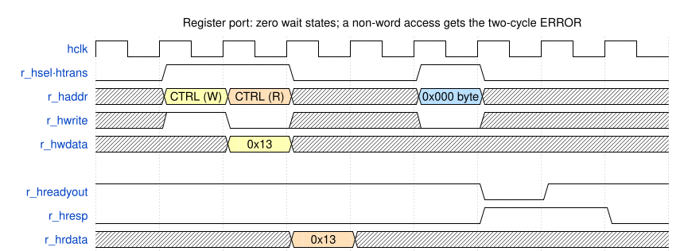
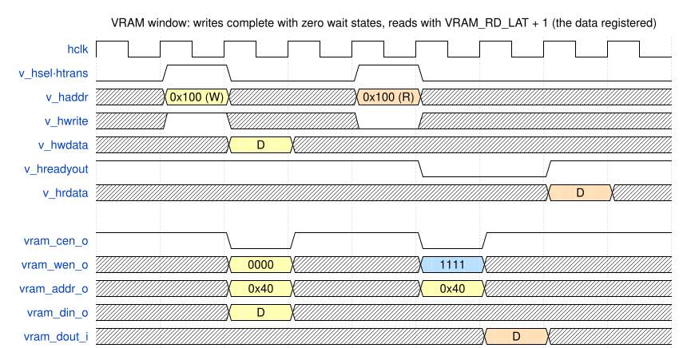
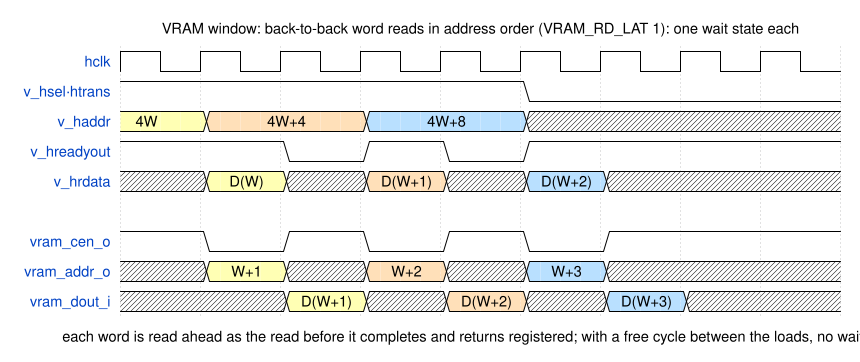

  

# Belenos memory interfaces and AHB-Lite ports

*For SoC integrators: the behaviour of the two AHB-Lite subordinate ports (the register
port and the VRAM window), the VRAM bandwidth, and the interfaces of the VRAM, LUT and
DPI line-buffer macros. The port list is in the
[integration guide](integration_guide.md#5-ports-and-tie-offs); what firmware sees of
the same ports is in the [register map](register_map.md#2-access-rules) and the
[programming model](programming_model.md#5-drawing-through-the-vram-window).*

---

## Table of Contents

1. [Register port](#1-register-port)
2. [VRAM window](#2-vram-window)
3. [VRAM macro](#3-vram-macro)
4. [Bandwidth](#4-bandwidth)
5. [LUT macro](#5-lut-macro)
6. [DPI line-buffer macro](#6-dpi-line-buffer-macro)
- [See Also](#see-also)

---

## 1. Register port

A 4 KB AHB-Lite subordinate. Only **word** accesses are legal.

- Registers answer in the cycle after the address phase (zero wait states); the
  exceptions (the LUT, an external driver's `bdi_reg_ready_i` in `0x180`–`0x27C`) hold
  `hreadyout_o` low. `hreadyout_o` is a flop.
- A transfer does not start while a VRAM-window write is posted (below): it waits for
  that write to reach the VRAM, so every register effect (a GPU command, a refresh
  start, a frame selection) follows the window writes before it on the bus.
- An access that is not a word (`hsize` ≠ 2), or a user-mode one (`hprot[1]` = 0) with
  `PRIV_CHECK_EN = 1`, gets the AHB **two-cycle ERROR** response; an unmapped offset an
  OKAY.
- What firmware sees (wait states, errors, side effects):
  [access rules](register_map.md#2-access-rules).

---

## 2. VRAM window

The window maps word `n` of the VRAM at byte offset `4n`; pixels are packed LSB first,
so at 16 bpp pixel `p` of a frame at pixel address 0 is the half-word at byte offset
`2p`, at 8 bpp the byte at offset `p`.

- `hreadyout_o`, `hresp_o` and `hrdata_o` come from flops: no path from the VRAM
  arbiter's grants, the other requesters or the macro output reaches the bus in the
  same cycle.
- **Writes** (byte, half-word, word) use the macro's byte enables, no read-modify-write.
  A write completes with no wait state: it is made in its data phase when the window
  wins the VRAM, otherwise it is **posted** in a one-word entry that takes the next
  cycle the urgent refresh or the GPU's aged cycle leaves. While the entry is full the
  next window transfer waits (a write, or a read the read-ahead buffer misses), and so
  does the next register-port transfer.
- **Reads** take `VRAM_RD_LAT` + 1 wait states: the macro is read in the data phase,
  its data returns `VRAM_RD_LAT` cycles later and is registered, by the arbiter
  (`VRAM_RD_REG_EN = 1`) or by the window. A one-word read-ahead buffer, filled in
  cycles no other requester wants the VRAM, serves runs of reads in address order:
  `VRAM_RD_LAT` − 1 wait states per word when the loads leave a free cycle between them
  (none by default), `VRAM_RD_LAT` back to back (figure below).
- Contention with the refresh and the GPU adds wait states (see the
  arbitration order in [Block structure](integration_guide.md#12-block-structure)).
- An access to a word index ≥ `VRAM_WORDS`, an access wider than a word, and a user-mode
  access with `PRIV_CHECK_EN = 1` get the two-cycle ERROR.
- What firmware sees (the read-ahead rules, alignment, wait states):
  [drawing through the VRAM window](programming_model.md#5-drawing-through-the-vram-window).

The window ignores the frame pointers: it addresses the VRAM directly.

---

## 3. VRAM macro

A single-port synchronous RAM, 32 bits wide, `VRAM_WORDS` deep, with:

| Signal | Behaviour |
|---|---|
| `vram_cen_o` | chip enable, active low; one access per cycle |
| `vram_wen_o[3:0]` | write enable per byte lane, active low; all ones = read |
| `vram_addr_o` | word address |
| `vram_din_o` | write data |
| `vram_dout_i` | read data, valid in the cycle `VRAM_RD_LAT` cycles after the read (the next cycle by default); Belenos samples it in that cycle only, so no hold is needed (a banked macro whose output changes after a write to another bank is fine) |

Belenos never addresses a word at or beyond `VRAM_WORDS` from the window (ERROR) or for
its read-ahead; the refresh wraps its addresses modulo 2^VRAM_AW, so with a
non-power-of-two depth software keeps the displayed frames inside the populated range; the GPU checks its accesses
against `VRAM_WORDS` and stops with an error instead. The read data path from
`vram_dout_i` reaches the AHB read data and the backend through a few gates of logic,
and the GPU's pixel pipeline through more: budget the macro's clock-to-output
accordingly, or register it, in the macro (its output register, `VRAM_RD_LAT` = 2) or
in Belenos (`VRAM_RD_REG_EN = 1`, a 32-bit register in the arbiter). A VRAM read then
takes `VRAM_RD_LAT` + `VRAM_RD_REG_EN` cycles, the read latency, and every requester
follows it: the arbiter tracks each read it grants in one shift register of that depth
(requester, and for the GPU whether a command list read it) and raises that
requester's read valid as the data arrives; the refresh pushes a fetched pixel with
its word's read valid. A window read that misses waits `VRAM_RD_LAT` + 1 states (its
data registered, by the arbiter or by the window). At a latency of 2 the refresh and the GPU's read ahead hide most of it: the
GPU reads a copy's source two words ahead along the run (the next line's first word at
a line end), so its best-case speeds stay those of the [performance table](gpu_commands.md#24-performance),
except textured spans (1.5 instead of 1 cycle per pixel). Beyond 2, the GPU, which has
one read in flight, reads at most a word every latency cycles: a 16 bpp copy takes 1.5
cycles per pixel at a latency of 3, 2 at 4 (an 8 bpp copy 0.75 and 1).

**Another memory behind the macro port.** Belenos expects exactly the macro above. The
macro port has **no stall input**: the memory must accept an access in every cycle. An
adapter to another memory (a slower RAM, a DRAM controller, a shared system memory) that
cannot needs a change to `blns_vram_arb`: a ready input ANDed into the grants. That change,
and the adapter, must keep three properties the design relies on:

- *No same-cycle stall.* The arbiter's grants reach the GPU's next fetch decisions and
  the window's next state (its registered `HREADYOUT`, its posted write) within the
  cycle, so the ready must not depend combinationally on the address or the enable of
  the same cycle: it must come from a flop (for example the registered not-full of a
  request FIFO).
- *Writes effective at their grant, in grant order, Belenos the only writer.* Belenos
  snoops the GPU's VRAM writes in the cycle they are granted, and the window's own when
  they complete on the bus (the window posts at most one, before its grant), to keep the
  window's read-ahead word current (a write to the word being read ahead drops it). A
  posted write queue in the adapter must therefore be searched by the reads behind it,
  or drained before them; a controller that reorders accesses must keep their order per
  address; and a memory written by another bus manager (system memory with a cache in
  front) gives the window stale read-ahead data.
- *A fixed read latency.* Read data must return in grant order exactly `VRAM_RD_LAT`
  cycles after the access (set it to the memory's latency, up to 3). The requesters
  follow the arbiter's read valid, not a cycle count, but the arbiter's shift register
  and the refresh's token line (as deep as the latency) assume it is fixed: a memory
  whose latency varies needs both made FIFOs, popped by the memory's own read valid.

---

## 4. Bandwidth

The refresh reads a VRAM word once for all the pixels it holds when it
scans in row order (any X / Y swap): 1/ppw words per pixel, ppw being the pixels per word
(2 at 16 bpp, 4 at 8 bpp, 32 at 1 bpp). With the CL swap it scans columns and reads one
word per pixel. While a frame is being sent, its share of the VRAM cycles is the
display's pixel rate times the words per pixel:

| Walk | 8080, `CLK_DIV` = 0 (one pixel per 2 cycles) | 8080, `CLK_DIV` = 1 (per 4 cycles) | SPI, `CLK_DIV` = 0 (per 32 cycles) | exported BDI, one pixel per cycle |
|---|---:|---:|---:|---:|
| 16 bpp, row order | 25 % | 12.5 % | 1.6 % | 50 % |
| 8 bpp, row order | 12.5 % | 6.3 % | 0.8 % | 25 % |
| 1 bpp, row order | 1.6 % | 0.8 % | 0.1 % | 3.1 % |
| any depth, CL swap | 50 % | 25 % | 3.1 % | 100 % |

The [hardware cursor](programming_model.md#44-hardware-cursor), when shown, adds the two
shape words of each scan line that crosses it, read on the refresh's own requester: 64
words a frame at most, 128 with `PIX_DOUBLE` (a doubled line reads them again), 0.17 % of
a 320 × 240 frame at 16 bpp, so the figures above do not change. Each word is read just
after a pixel read, while the next pixels come from the word just read, or while the
walk waits: in row order at up to a pixel per cycle the stream loses no cycle to them,
with the CL swap at a pixel per cycle they cost two cycles per cursor line. A cursor
pixel is not sent before its line's words are read; a late read only slows the stream,
and turns urgent like the pixel reads.

With the **DPI driver** the refresh reads the source frame (`DISP_SIZE`), not the panel's:
a scaled image costs no more VRAM cycles. It fills a line buffer at one pixel per cycle
(a line burst takes 25 % of the VRAM cycles at 8 bpp, 50 % at 16 bpp, while it lasts),
then waits for a free buffer; averaged over a frame its share is
W·H·fps·bpp / (32·`hclk`): 5.8 % for the Tang Console's 480 × 272 frames at 8 bpp, 60 Hz
and 33.85 MHz. One constraint comes first: a source line must fit in one panel line time
at a pixel per `hclk` cycle (a 1280-pixel line, native 720p, needs `hclk` ≥ 58 MHz), and
the frames must fit in `VRAM_WORDS` (one 640 × 480 frame at 8 bpp is 76 800 words).
The first line of a frame starts with the frame start, at the first blanking line: with a
one-line vertical blanking and the image at the top, it must fit in that line with
`DIM_W` + 5 cycles to spare at a read latency of 1 (15 by default; plus the latency beyond
1, 2 more with the hardware cursor, and the crossing to a separate pixel clock).

The window and the GPU share the rest. Between frames the refresh reads
nothing, so averaged over a refresh period the share is lower in proportion. The panel
bus, not the VRAM, bounds the frame rate of the built-in drivers: a frame takes
2·(`CLK_DIV` + 1) cycles per pixel on the 8080 bus and 32·(`CLK_DIV` + 1) over SPI. With
an exported BDI driver taking a pixel per cycle, prefer row order: a DBI panel turns the
image itself (MADCTL) at no VRAM cost, where the CL swap takes every VRAM cycle while the
frame is sent.

---

## 5. LUT macro

With `LUT_EN = 1`: a synchronous RAM of 512 × 24 bits (RGB888), same conventions as the
VRAM macro with a single write enable `lut_wen_o`. Address bit 8 is the bank; with
`LUT_BANKS = 1` it is always 0 and a 256-entry macro is enough. With `LUT_EN = 0` the
outputs are inactive and `lut_dout_i` ties to 0.

The refresh has priority on the macro (in indexed modes with the programmable LUT it
reads an entry for every pixel it sends), with a bounded wait for the register port:
[programmable LUT](programming_model.md#42-programmable-lut).

---

## 6. DPI line-buffer macro

`NB` simple dual-port RAMs of 2^`DPI_LB_AW` × 24 bits, one write
port and one read port each, read latency one clock. The write port runs on `hclk_i`,
the read port on the pixel-domain clock: with `DPI_PCLK_SEP = 1` they are dual-clock
RAMs. Their contents need no initialisation.

**Sizing.** A bank holds one source line (`DISP_SIZE` width, before scaling) of up to
2^`DPI_LB_AW` pixels: choose `DPI_LB_AW` for the widest source line the product shows
(10 up to 1023 pixels; 11 for 1280 or 1920, with `DIM_W` ≥ 11 too, since `DIM_W = 10`
limits `DISP_SIZE` to 1023). The pixels of a longer line are not written:
on the panel they show the border colour, and every frame raises `UNDERFLOW` (with the
bilinear filter the last kept pixel too, its right neighbour being missing). The
width is a build choice, not checked at run time.

---

## See Also

- [integration_guide.md](integration_guide.md) — ports, parameters, clocks, constraints and reset
- [register_map.md](register_map.md) — the register port's access rules as firmware sees them
- [programming_model.md](programming_model.md) — drawing through the VRAM window, the programmable LUT
- `rtl/verilog/blns_ahb_reg.v`, `blns_ahb_vram.v`, `blns_vram_arb.v` — the two ports and the VRAM arbiter
