<p align="center">
  
</p>

# Belenos programming model (registers)

*The register-level programming model of the Belenos graphic controller, for firmware
developers: identification, pixel formats, frame buffers, refresh, colour, the hardware
cursor, the VRAM window, interrupts, debug freeze and the built-in display drivers (DBI, DPI, HDMI). The
register map and its access rules are in [register_map.md](register_map.md), the GPU in
[gpu_commands.md](gpu_commands.md), integration and hardware details in
[integration_guide.md](integration_guide.md), the C driver in
[driver_guide.md](driver_guide.md).*

---

## Table of Contents

1. [Identification](#1-identification)
2. [Pixels and the frame buffer](#2-pixels-and-the-frame-buffer)
    - [2.1 Pixel formats and packing](#21-pixel-formats-and-packing)
    - [2.2 Pixel addresses](#22-pixel-addresses)
    - [2.3 Display size and frame pointers](#23-display-size-and-frame-pointers)
    - [2.4 Orientation](#24-orientation)
    - [2.5 Pixel doubling](#25-pixel-doubling)
3. [Refresh](#3-refresh)
4. [Colour](#4-colour)
    - [4.1 Hardware tables](#41-hardware-tables)
    - [4.2 Programmable LUT](#42-programmable-lut)
    - [4.3 Palette rotation](#43-palette-rotation)
    - [4.4 Hardware cursor](#44-hardware-cursor)
5. [Drawing through the VRAM window](#5-drawing-through-the-vram-window)
6. [Interrupts](#6-interrupts)
7. [Debug freeze](#7-debug-freeze)
8. [GPU](#8-gpu)
9. [The built-in DBI driver](#9-the-built-in-dbi-driver)
    - [9.1 DBI registers](#91-dbi-registers)
    - [9.2 Commands and parameters](#92-commands-and-parameters)
    - [9.3 DBI refresh](#93-dbi-refresh)
    - [9.4 Full-screen fill](#94-full-screen-fill)
    - [9.5 Synchronisation](#95-synchronisation)
    - [9.6 Driver interrupts](#96-driver-interrupts)
    - [9.7 8080 PHY](#97-8080-phy)
    - [9.8 SPI PHY](#98-spi-phy)
10. [The built-in DPI driver](#10-the-built-in-dpi-driver)
    - [10.1 DPI registers](#101-dpi-registers)
    - [10.2 Configuration updates](#102-configuration-updates)
    - [10.3 Panel timing](#103-panel-timing)
    - [10.4 Frames](#104-frames)
    - [10.5 Image placement and scaling](#105-image-placement-and-scaling)
    - [10.6 Status and interrupts](#106-status-and-interrupts)
    - [10.7 Separate pixel clock](#107-separate-pixel-clock)
    - [10.8 Panel detection](#108-panel-detection)
    - [10.9 Throughput](#109-throughput)
11. [HDMI](#11-hdmi)
    - [11.1 HDMI registers](#111-hdmi-registers)
    - [11.2 HDMI mode](#112-hdmi-mode)
    - [11.3 HDMI audio](#113-hdmi-audio)
    - [11.4 DDC](#114-ddc)
- [See Also](#see-also)

---

## 1. Identification

`BLNS_ID` holds the IP version; `BLNS_CFG` (the core) and `BLNS_CFG2` (the GPU) describe
the build, so that one driver can adapt to every configuration. They hold only what
varies between builds and software can act on, packed from bit 0; the bits above read 0
and are where a later minor version adds fields.

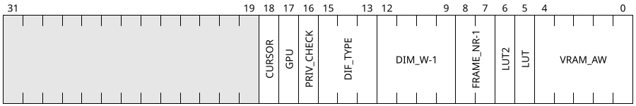

| `BLNS_CFG` field | Meaning |
|---|---|
| [4:0] `VRAM_AW` | VRAM word-address width, 1 to 24 (VRAM window size = 4 · 2^VRAM_AW bytes) |
| [5] `LUT` | programmable LUT present (`LUT_EN`) |
| [6] `LUT2` | second LUT bank (`LUT_BANKS = 2`; only with [5]) |
| [8:7] `FRAME_NR` | `FRAME_NR` − 1 (0, 1 or 3: one, two or four frame pointers) |
| [12:9] `DIM_W` | `DIM_W` − 1 (`DIM_W` is 4 to 16: display sizes up to 2^`DIM_W` − 1) |
| [15:13] `DIF_TYPE` | the built-in display driver: 0 none (`BDI`, an external driver), 1 `DBI_SPI`, 2 `DBI_PAR`, 3 `DBI_PAR_SPI`, 4 `DPI`, 5 `HDMI` (the DPI driver with its TMDS encoder) ([display interface](display_interface.md#1-overview)) |
| [16] `PRIV_CHECK` | user-mode accesses refused (`PRIV_CHECK_EN`) |
| [17] `GPU` | GPU present (`GPU_EN`); `BLNS_CFG2` is then non-zero |
| [18] `CURSOR` | [hardware cursor](#44-hardware-cursor) present (`CURSOR_EN`, independent of the GPU) |
| [31:19] | 0 |

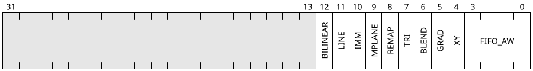

| `BLNS_CFG2` field | Meaning |
|---|---|
| [3:0] `FIFO_AW` | log2 of the GPU command FIFO depth, `GPU_FIFO_AW`: 3 to 6 (8 to 64 words; 3, 8 words, by default) |
| [4] `XY` | [x/y coordinates, clip window](gpu_commands.md#10-coordinates-and-clipping) and [affine blits](gpu_commands.md#13-affine-blits) (`GPU_XY_EN`) |
| [5] `GRAD` | [gradient fills](gpu_commands.md#14-gradient-fills), the per-channel `SET_GRAD_RGB` included (`GPU_GRAD_EN`) |
| [6] `BLEND` | [blending](gpu_commands.md#16-blending) at 16 bpp, `EXPAND` masks, [RGB565A8 sources](gpu_commands.md#26-alpha-planes-rgb565a8) and the `MIX5` blend rule (`GPU_BLEND_EN`) |
| [7] `TRI` | [triangles](gpu_commands.md#15-triangles) (`GPU_TRI_EN`; only with [4]) |
| [8] `REMAP` | [palette remap](gpu_commands.md#17-palette-remap) (`GPU_REMAP_EN`) |
| [9] `MPLANE` | [mask plane](gpu_commands.md#18-mask-plane) (`GPU_MPLANE_EN`) |
| [10] `IMM` | [immediate source](gpu_commands.md#19-immediate-source) (`GPU_IMM_EN`) |
| [11] `LINE` | [lines](gpu_commands.md#25-lines), dashed too; anti-aliased with [6] (`GPU_LINE_EN`; only with [4]) |
| [12] `BILINEAR` | [bilinear texture sampling](gpu_commands.md#27-bilinear-sampling); the transparent border, RGB565A8 and keyed taps with [6] (`GPU_BILINEAR_EN`; only with [4]) |
| [31:13] | 0 |

`BLNS_CFG2` reads 0 without a GPU. Everything else of the GPU (fences, the error record,
`WAIT_REFR_DONE`, `RESET_STATE`, the source formats 0–4; 5 with [6]) is present in every build with a
GPU. Build options that change only timing (run-ahead, the VRAM read latency) or the
integration (the reset style) are not reported.

`VRAM_WORDS` gives the VRAM depth in words (`BLNS_CFG.VRAM_AW` only bounds it): the
window, the GPU's bounds check and the command lists stop there. The refresh does not
check it: keep every frame (pointer + (height − 1) · pitch + width pixels) inside
`VRAM_WORDS`, or it reads unpopulated macro addresses.

The driver reads these registers once, into `blns_t.caps`
([driver_guide.md](driver_guide.md#21-platform-header-optional)).

---

## 2. Pixels and the frame buffer

### 2.1 Pixel formats and packing

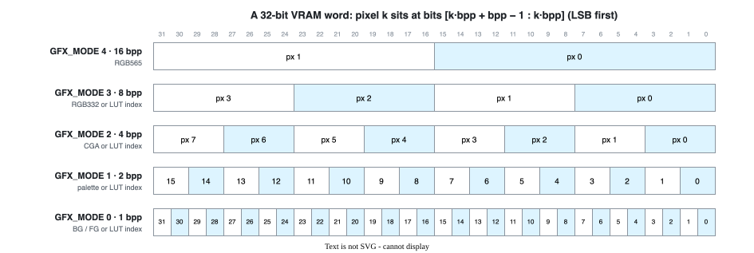

A 32-bit VRAM word holds `32 / bpp` pixels, **least significant first**: pixel *k* of a
word occupies bits [k·bpp + bpp − 1 : k·bpp]. In little-endian memory this means that at
8 and 16 bpp the pixels follow each other in byte order, exactly like a C array of
`uint8_t` or `uint16_t`.

| `GFX_MODE` | bpp | Pixels per word | Pixel value |
|---|---|---|---|
| 4 | 16 | 2 | RGB565 (R [15:11], G [10:5], B [4:0]) |
| 3 | 8 | 4 | RGB332, or a LUT index |
| 2 | 4 | 8 | CGA colour index, or a LUT index |
| 1 | 2 | 16 | palette entry (0 = background), or a LUT index |
| 0 | 1 | 32 | background / foreground, or a LUT index |

### 2.2 Pixel addresses

Frame pointers and GPU surfaces are **pixel addresses**: the index of a
pixel in the VRAM counted in pixels of the current depth. For a pixel address `pa` at
`bpp = 2^b` bits:

- VRAM word = `pa >> (5 − b)`
- bit position in the word = `(pa & (32/bpp − 1)) · bpp`

A pixel at column `x`, row `y` of a frame that starts at pixel address `base` with a line
pitch of `pitch` pixels is at `base + y · pitch + x`. Pixel addresses are `VRAM_AW + 5`
bits wide (the size of a 1-bpp address); at 2^b bpp their upper b bits are ignored, so an
address past the VRAM wraps.

### 2.3 Display size and frame pointers

`DISP_SIZE` sets the frame width and height in pixels: the size of the frame the refresh
sends. Each field keeps its low `DIM_W` bits (sizes up to 2^`DIM_W` − 1); a value whose
low bits are 0 is stored as 1.

The frame width (`DISP_SIZE` width, or ⌈width/2⌉ with [pixel doubling](#25-pixel-doubling))
is also the GPU's line pitch 0. It does not follow `REFR_PITCH`: to draw in a surface
wider than the frame, give the GPU its pitch explicitly (the driver does: its pitch 0 is
`REFR_PITCH` when set, see [driver_guide.md](driver_guide.md#4-conventions)).

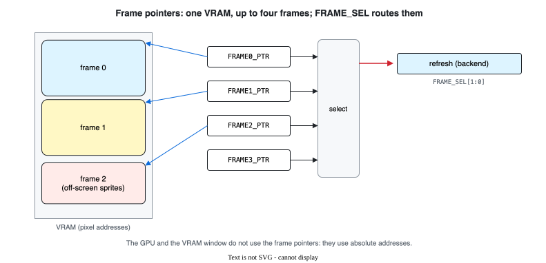

One, two or four frame pointers (`FRAME_NR`) hold pixel addresses of frames in the VRAM.
`FRAME_SEL` chooses which one the refresh reads:

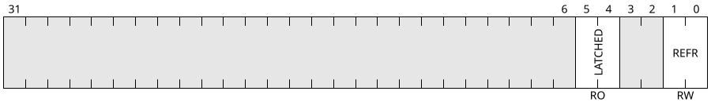

With two frame pointers, double buffering is: draw in frame 1 (with the GPU or through
the VRAM window) while the refresh shows frame 0, then select frame 1 in `FRAME_SEL`
between frames (wait for `REFR_DONE`). `REFR_PITCH` sets the distance between the lines the refresh reads (0 =
the frame width): with a pitch wider than `DISP_SIZE`, the displayed frame is a window
into a larger surface, and moving the frame pointer by a pixel or a line scrolls it with
no copy (it is taken at the next frame start, like the frame pointer). Moving a frame
pointer by whole lines also scrolls a frame of the display's own width; a
frame pointer pointing past the visible area makes an off-screen buffer for sprites that
the GPU copies from. `FRAME_SEL` stores only the index bits `FRAME_NR` needs (none,
one or two): with one or two pointers a higher index wraps onto pointer 0 or 1.

`FRAME_SEL` [5:4] `LATCHED` (read only) is the index the
refresh took for the frame in progress: it follows [1:0] between frames and holds
during a frame (it is loaded when the refresh latches its frame pointer). A flip is
complete — no frame reads the buffer shown before — as soon as `LATCHED` equals the new
index: at once when the flip lands between two frames, at the end of the frame in
progress otherwise.

The VRAM window and the GPU do **not** use the frame pointers: they work in absolute
VRAM addresses.

### 2.4 Orientation

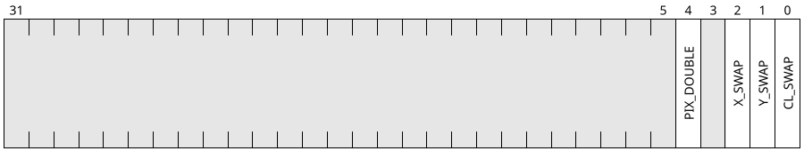

`DISP_CFG` sets the order in which the refresh reads the frame:

- **X swap** — each line is read right to left;
- **Y swap** — lines are read bottom to top;
- **CL swap** — the frame is read column by column instead of line by line.

The panel receives the pixels in this order and fills its window line by line, so the
three bits rotate and mirror the picture without touching the frame buffer. CL swap is
how a landscape frame buffer (say 320 × 240) feeds a portrait panel (240 × 320). It reads
one VRAM word per pixel instead of one per word's worth of pixels
([bandwidth](memory_and_ahb.md#4-bandwidth)); a DBI panel can also turn the picture itself
(MADCTL row/column exchange), which costs nothing on the VRAM side.


The refresh takes `DISP_CFG`, `GFX_MODE`, `DISP_SIZE`, `REFR_PITCH`, `LUT_CFG`,
`LUT_ROT`, `FRAME_SEL`, the frame pointer it selects and the cursor's `CURSOR_CTRL`,
`CURSOR_POS` and `CURSOR_ADDR` at the start of each frame and keeps them until it ends,
so changing them never tears a frame (the LUT entries and the cursor colours are not
taken: [programmable LUT](#42-programmable-lut), [hardware cursor](#44-hardware-cursor)). With the DBI driver (`DIF_TYPE` 1–3),
`DISP_SIZE` is taken earlier, when the driver starts the refresh, because it sends the
panel window from it before the frame starts: right after the request, or, for a request
queued behind a frame or a command, when that one ends. A change written after that point
applies from the next frame. With CL swap the panel window must be the transposed
size (see [HW_WINDOW_EN](#93-dbi-refresh)).

### 2.5 Pixel doubling

With `DISP_CFG.PIX_DOUBLE = 1` the refresh still sends `DISP_SIZE` (W × H) pixels, but
reads a frame of ⌈W/2⌉ × ⌈H/2⌉ pixels (pitch ⌈W/2⌉) at the refresh frame pointer: every
pixel is sent twice in a row and every scan line twice, in any scan order. A 160 × 120
picture fills a 320 × 240 panel with a quarter of the memory and a quarter of the
drawing; at 8 bpp four such frames fit where two full-size ones did.

Precisely, with the half-size frame walked under the same swaps: pixel k of panel scan
line j is pixel ⌊k/2⌋ of source scan line ⌊j/2⌋. With an odd dimension the last pixel
(or line) visited in that direction is sent once: the right column or bottom row
normally, column 0 or row 0 with an X or Y swap.

While `PIX_DOUBLE = 1` the GPU's pitch 0 is ⌈W/2⌉. The GPU's default pitch follows
`DISP_CFG.PIX_DOUBLE` and `DISP_SIZE` live, not at a frame start: change them between
drawings.

The driver: `blns_set_pix_double()` ([example](driver_guide.md#9-examples)).

---

## 3. Refresh

A refresh sends one whole frame (`DISP_SIZE` pixels) to the display driver.

**Which driver decides when.** With the DBI driver (`DIF_TYPE` 1–3) or an external BDI
driver (`DIF_TYPE = 0`), frames are sent on request: the `REFRESH` timer or a manual
start, below. The DPI driver (`DIF_TYPE` 4 and 5) ignores the requests: it takes one frame
per panel frame on its own timing ([frames](#104-frames)). `REFRESH` then sends nothing
(a manual `START` still clears once the next frame has been taken), while `FRAME_CNT`,
`FRAME_NUM`, `STATUS.REFR_ABANDONED` and the `REFR_START` / `REFR_DONE` flags count the
frames the DPI driver takes.

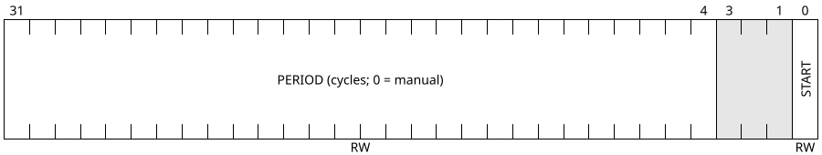

| `PERIOD` | Mode | Behaviour |
|---|---|---|
| 0 | manual | each write with `START = 1` requests one frame; `START` stays set until every requested frame has been sent (one request is queued behind the frame on its way; requests written while one is already queued wait together and are served by one more frame), so `START` = 0 means the panel has received everything requested. A write with `START = 0` (`blns_refresh_stop()`, a switch to the timer) clears `START` at once but cancels nothing: the requests already made are still sent, and `START` no longer tracks them |
| ≥ 1 | timer | with `START = 1` a frame is requested every `PERIOD` cycles; `START = 0` stops the requests (one already queued in the driver is still served) |

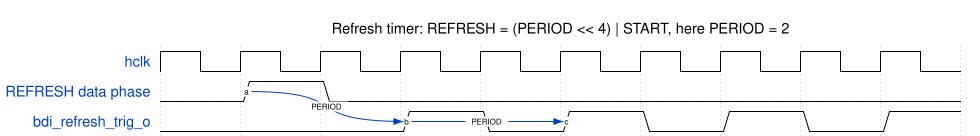

The first request comes `PERIOD` cycles after the REFRESH write, then one every `PERIOD`
cycles; writing `REFRESH` restarts the count. The DBI driver remembers one
request that arrives while a frame is being sent, so a `PERIOD` shorter than the frame
time simply refreshes back to back; `PERIOD = 1` requests continuously.

`FRAME_CNT` counts frames down: each finished frame decrements it while it is not zero,
and the step from 1 to 0 raises `FRAME_CNT_DONE`. It does not count during a
[debug freeze](#7-debug-freeze) with `FREEZE_REFRESH`; a `FRAME_CNT` write in the cycle a
frame ends wins (no decrement, no event), and writing 0 raises nothing. Software uses it
to pace an animation:

```c
blns.regs->FRAME_CNT = 3;              // FRAME_CNT_DONE once 3 frames have ended
                                       // (blns_wait_frames(&blns, 3) counts FRAME_NUM instead
                                       // and leaves FRAME_CNT to the application)
```

`FRAME_NUM` (`0x038`, read only) counts the frames sent:
+1 at each `REFR_DONE` (an abandoned frame and the frames sent during a debug freeze
included), wrapping at 16 bits, 0 out of reset. Unlike `FRAME_CNT` it is never written:
any number of waits read it side by side (`(uint16_t) (FRAME_NUM − n0) ≥ k`), next to a
`FRAME_CNT` countdown, and a wait polling it cannot miss a short gap between two frames.

The driver: `blns_frame_num()` ([example](driver_guide.md#9-examples)).

`STATUS.REFRESH_ACTIVE` is high while a frame is being sent; `REFR_START` and `REFR_DONE`
flag its two edges. `STATUS.REFR_ABANDONED` tells, from the end of a frame to the end of
the next, whether that frame ended before its last pixel: a DPI driver abandons the frame
it is still taking when the next panel frame starts (the refresh too slow for the
panel), and an exported BDI driver may end one early. `REFR_DONE` is raised for such a
frame too (the refresh has stopped reading the buffer) and it counts in `FRAME_CNT`.

---

## 4. Colour

The refresh converts every pixel to RGB888 before it reaches the display driver. At
16 bpp the conversion is fixed (RGB565 widened to RGB888 by repeating the top bits of each
field); in the other modes it
uses the hardware tables or the programmable LUT.

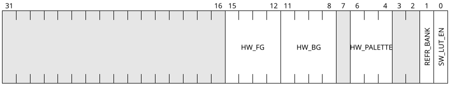

| Field | Meaning |
|---|---|
| `SW_LUT_EN` | 1: indexed modes (1–8 bpp) look up the programmable LUT; 0: hardware tables; reads 0 with `LUT_EN = 0` |
| `REFR_BANK` | LUT bank used by the refresh (double-buffered palettes); reads 0 with one bank |
| `HW_PALETTE` | 2 bpp hardware palette (0–5; 6 and 7 behave as 5) |
| `HW_BG` | CGA colour of value 0 at 2 bpp and 1 bpp |
| `HW_FG` | CGA colour of value 1 at 1 bpp |

### 4.1 Hardware tables

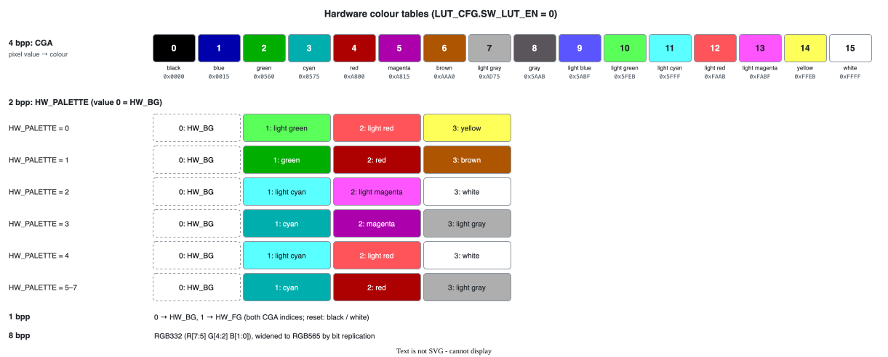

At 8 bpp a pixel is RGB332 (red [7:5], green [4:2], blue [1:0]), widened to RGB565 by
repeating the top bits of each field (red 001 → 00100, green 101 → 101101, blue 01 →
01010, 10 → 10101), then to RGB888 as at 16 bpp:

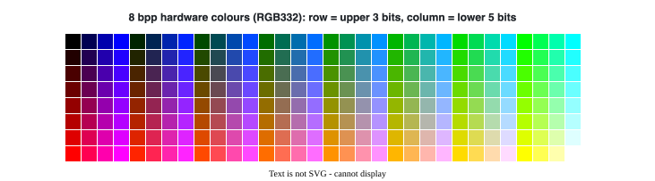

### 4.2 Programmable LUT

With `LUT_EN = 1`, the LUT holds `LUT_BANKS` × 256 RGB888 entries, one per word of the
register window:

| Address | Entry |
|---|---|
| `0x800 + 4·i` | bank 0, index `i` |
| `0xC00 + 4·i` | bank 1, index `i` |

Data: [23:16] red, [15:8] green, [7:0] blue; [31:24] read 0. A pixel of value `v` (1 to 8
bits) selects entry `v` of bank `REFR_BANK`. With two banks, software fills the hidden
bank and flips `REFR_BANK`; the change takes effect at the next frame. The entries
themselves are not taken at a frame start: a write to the bank being shown applies to
the next pixel that looks it up, mid-frame.

The driver: `blns_lut_load()`, `blns_lut_select()` ([example](driver_guide.md#9-examples)).

LUT reads take one wait state and writes none, plus the cycles in which the refresh is
reading the LUT: it has priority, but **at most 4** in a row: an access that has lost 4
cycles takes the next one (the refresh stalls for that cycle, which its pixel FIFO
absorbs). The bound matters with a driver that takes a pixel in every cycle (the DPI
driver filling a line buffer, an exported BDI sink), where the refresh can read the LUT
for thousands of cycles in a row.
Bank 1 is read-as-zero / write-ignored with one bank.

### 4.3 Palette rotation

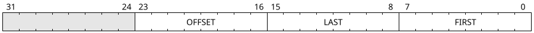

`LUT_ROT` rotates a range of LUT indices in the refresh. A pixel value `v` with
`FIRST ≤ v ≤ LAST` looks up entry

```
s = v + OFFSET
e = (s > LAST) ? s − (LAST − FIRST + 1) : s        (8 bits)
```

instead of entry `v`. With `OFFSET` below the range length this turns the range by
`OFFSET` entries: stepping `OFFSET` once per frame cycles colours (fire, water, flowing
light) with one register write and no palette reload. Values outside the range, and every
value when `FIRST > LAST`, are not changed. The reset value (all 0) is the identity.

Rotation applies only to the programmable LUT (`SW_LUT_EN = 1`, 1 to 8 bpp), in the bank
`REFR_BANK` selects; the refresh takes `LUT_ROT` at a frame start. Register-port accesses
to the LUT are not rotated.

The driver: `blns_lut_rotate()` ([example](driver_guide.md#9-examples)).

### 4.4 Hardware cursor

With `CURSOR_EN` (`BLNS_CFG.CURSOR`) the refresh lays a 32 × 32 pointer over the frame it
sends. Its pixels have 2 bits: 0 is transparent, 1–3 are the colours `CURSOR_COL1`–`3`
(RGB888, sent as they are: no LUT, no `GFX_MODE` conversion; the DBI driver truncates
them to RGB565 like every pixel). The registers ([register map](register_map.md#4-global-registers)):

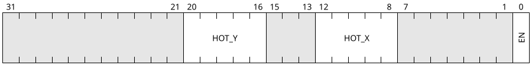

| Register | Field | Meaning |
|---|---|---|
| `CURSOR_CTRL` | [0] `EN` | the cursor is shown |
| | [12:8] `HOT_X`, [20:16] `HOT_Y` | the hotspot: the shape pixel that points |
| `CURSOR_POS` | [15:0] `X`, [31:16] `Y` | the hotspot's pixel in the frame, signed (read back as written) |
| `CURSOR_ADDR` | [`VRAM_AW`−1:7] | word address of the shape block (128 words) |
| `CURSOR_COL1`–`3` | [23:0] | R [23:16], G [15:8], B [7:0] |

**Shape.** The block holds the shape twice, 128 words in all:

- words 0–63, by rows: row *j* at words 2*j* (pixels 0–15) and 2*j* + 1 (pixels 16–31);
- words 64–127, by columns: column *i* at words 64 + 2*i* and 65 + 2*i*, its pixel *k*
  being row *k*.

Pixel *k* of a word is at bits [2*k* + 1 : 2*k*], the 2-bpp packing
([pixel formats](#21-pixel-formats-and-packing)). The copy by columns is read only with
`CL_SWAP`: a program that never sets it may leave it out (the block stays 128-aligned).

**Position.** The cursor is placed in the **source frame**, the frame the refresh reads
(`DISP_SIZE`, or ⌈W/2⌉ × ⌈H/2⌉ with [pixel doubling](#25-pixel-doubling)), at the latched
frame pointer. The shape's top-left corner lands on frame pixel (`X` − `HOT_X`,
`Y` − `HOT_Y`): shape pixel (*i*, *j*) covers frame pixel (`X` − `HOT_X` + *i*,
`Y` − `HOT_Y` + *j*) when that pixel is in the frame and its code is not 0. The cursor may
lie partly or wholly off the frame on any side, at negative positions too.

- **Orientation and doubling.** The cursor belongs to the frame, as a sprite drawn into
  it: it turns and mirrors with `DISP_CFG` and is doubled with `PIX_DOUBLE`.
- **Colour.** Any `GFX_MODE`, hardware table, LUT and `LUT_ROT`: the pixel under a cursor
  pixel is converted as usual, then replaced.
- **Scrolling.** The frame pointer and `REFR_PITCH` move the image under the cursor; a flip
  does not move it.
- **DPI scaler.** The cursor is scaled with the image (blocky with nearest neighbour, its
  edges blended with bilinear), moves with `DPI_IMG_POS`, never shows on the border, and
  not over the `DPI_CTRL.TEST` bars. A pointer in panel pixels maps back to frame pixels
  through the image placement and steps (the driver: `blns_cursor_move_panel()`).

**Latch.** `EN`, `HOT_X` / `HOT_Y`, `CURSOR_POS` and `CURSOR_ADDR` are taken at the start of
each frame and held for it: a move never tears. The shape itself is read during the frame:
to change it without a torn frame, write a second block and switch `CURSOR_ADDR`. The
colours are not latched (like the LUT entries): a colour write applies from the next
cursor pixel sent.

**DBI.** The panel keeps the image, so the cursor moves when a frame is sent: with the
`REFRESH` timer that is at once, with manual refreshes a move needs one. A windowed refresh
(`HW_WINDOW_EN = 0`, CASET / PASET sent by software, the frame pointer, `DISP_SIZE` and
`REFR_PITCH` on a sub-rectangle) sends a sub-frame and the cursor is relative to it:
subtract the sub-rectangle's corner from the position (the driver: `blns_cursor_origin()`),
or hide the cursor for that refresh.

**Reads.** Each scan line that crosses the cursor reads its two shape words
([bandwidth](memory_and_ahb.md#4-bandwidth)). There is no interrupt; the
[debug freeze](#7-debug-freeze) leaves the cursor alone (`FREEZE_REFRESH` does not stop a
frame).

The driver: `blns_cursor_shape()`, `blns_cursor_move()` ([API](driver_guide.md#7-api-summary)).

---

## 5. Drawing through the VRAM window

The VRAM window maps the video memory directly: word `n` at byte offset `4n`. It is the
simplest way to draw and the fastest for bulk transfers from the CPU (a word write moves
2 to 32 pixels). Byte and half-word writes use the macro's byte enables, so at 8 and
16 bpp single pixels are written without a read (the driver: `blns_vram16()`,
`blns_pixel_addr()`, [example](driver_guide.md#9-examples)).

Writes complete with zero wait states: a write that finds the VRAM taken (by a refresh
running short of pixels, or by the GPU's one cycle in eight) is posted and made in the
next free cycle; only the window transfer after it, or a register access, waits for that.
Reads that the buffer below misses take L = `VRAM_RD_LAT` + 1 wait states (two by
default: the data is registered before it reaches the bus, by the window or, with
`VRAM_RD_REG_EN`, by the arbiter; a macro with output registers has more). Reads wait
longer while the refresh or the GPU is using the VRAM
([arbitration](integration_guide.md#12-block-structure)).

Ordering is that of the bus: a read returns the latest window write, and anything a
register write starts (a GPU command, a list `CALL`, a refresh, a frame selection) sees
every window write made before it.

A one-word **read-ahead buffer** serves reads with **no** wait state:

- A read that ends before a word's last byte keeps that word: another byte or half-word
  of it reads with no wait state.
- A read that ends on a word's last byte (every word read, a half-word at offset 2, a
  byte at offset 3) moves the buffer to the **next** word, read ahead in a cycle no other
  requester wants the VRAM: reading on in address order costs no wait state when the
  loads leave a free cycle between them (a load / modify / store loop), L − 1 per word
  back to back (each load's address phase in the previous one's data phase: one wait
  state by default), L − 2 per word with a free cycle once L is above two; reading the
  same word again costs a miss.
- Any VRAM write to the buffered word, by any requester, drops it: a read always returns
  the current data.

Reading a frame region in address order is therefore cheaper than reading it column by
column. An access to a word at or beyond `VRAM_WORDS`, an access wider than a word, and,
with `PRIV_CHECK`, a user-mode access get the AHB ERROR and have no effect
([access rules](register_map.md#2-access-rules)). Alignment is not checked: a half-word or word access uses
the aligned address (`haddr[0]`, or `haddr[1:0]`, ignored). Below 8 bpp, writing a single
pixel means a read-modify-write of its byte in software (or a one-pixel GPU `FILL`).

---

## 6. Interrupts

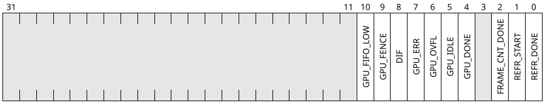

| Bit | Flag | Set when |
|---|---|---|
| 0 | `REFR_DONE` | a frame has been sent (falling edge of the refresh activity) |
| 1 | `REFR_START` | a frame starts |
| 2 | `FRAME_CNT_DONE` | `FRAME_CNT` steps from 1 to 0 |
| 3 | — | reserved: `IRQ_EN[3]` and `IRQ_FLAG[3]` read 0 |
| 4 | `GPU_DONE` | an `EXEC` completes |
| 5 | `GPU_IDLE` | the GPU becomes idle (`BUSY` falls after a word pushed; not for a `DISCARD` marker alone) |
| 6 | `GPU_OVFL` | a command word was dropped (FIFO full or GPU disabled) |
| 7 | `GPU_ERR` | the GPU stopped on an error |
| 8 | `DIF` | the display driver's interrupt (a level, cleared in the driver) |
| 9 | `GPU_FENCE` | a `FENCE` with `IRQ` is reached ([fences](gpu_commands.md#21-fences)) |
| 10 | `GPU_FIFO_LOW` | the GPU FIFO's `FREE` rises above `GPU_FIFO_LOW.THRESH` (half the depth by default; [command stream](gpu_commands.md#31-pushing)) |

Flags 0–2, 4–7, 9 and 10 are write-1-to-clear (`BLNS_IRQ_W1C_Msk`); a new event in the
same cycle as the clear wins. The GPU flags (4–7, 9, 10) read 0 without a GPU. `DIF`
mirrors the display driver's interrupt line and is cleared in `DIF_IRQ_FLAG`, so
`IRQ_FLAG` reads 0 after reset only while that line is low. `irq_o` is a level, the OR
of the flags enabled in `IRQ_EN`: it stays high until software clears them. A typical
handler reads `IRQ_FLAG`, writes the same value back to clear what it read, and handles
each bit. When `irq_o` reaches an aRVern core on a platform-interrupt line (not through
a PLIC), the core latches the pending bit `mip[16+n]`: clear the Belenos flag first, then
that `mip` bit ([interrupt wiring](integration_guide.md#9-interrupt)).

---

## 7. Debug freeze

`DBG_CTRL` decides what happens while the hart is halted by a debugger that has set
`dcsr.stoptime` (the integration connects the core's stop-time signal,
[debug freeze](integration_guide.md#10-debugger-accesses-and-debug-freeze)). The freeze is
registered: it takes effect one cycle after the halt and ends one cycle after the
resume. Both bits are 0 after reset: the display and the GPU then go on while the hart
is halted.

- `FREEZE_REFRESH` = 1: the refresh timer and `FRAME_CNT` stop counting; a frame that has
  started completes. Manual `START` requests are still served, and so is a request
  already queued in the DBI driver; `FRAME_NUM` and the `REFR_*` flags keep counting the
  frames sent. With the DPI driver, which takes frames on its own timing, the panel keeps
  being refreshed: only `FRAME_CNT` stops.
- `FREEZE_GPU` = 1: the GPU completes the pixel in flight and holds; it resumes with an
  identical result. A command list is held too (no word read). `GPU_STAT.HELD` = 1 means
  the freeze has taken effect: the GPU is between two pixels or idle and changes nothing
  (also with no work at all, or with words waiting in the FIFO). Without a GPU the bit
  reads back and has no effect.

**Debugger accesses.** Belenos does not tell a debugger's accesses (the aRVern Debug
Module's system-bus accesses) from the hart's: they follow the same
[access rules](register_map.md#2-access-rules). No register has a read side effect, so a debugger memory
view does not disturb the program being debugged.

---

## 8. GPU

The GPU registers (`0x100`–`0x118`), its commands and its features are described in
[gpu_commands.md](gpu_commands.md).

---

## 9. The built-in DBI driver

`blns_dbi` speaks the MIPI DBI command set of ILI9341-class panel controllers, over a
4-wire SPI bus with a D/C line (DBI type C, option 3, `DIF_TYPE = 1`), an 8080-16
parallel bus (DBI type B, `DIF_TYPE = 2`), or both (`DIF_TYPE = 3`). It sends commands and parameters for software,
refreshes the panel from the BDI stream on each [refresh](#3-refresh) request (it is the
built-in driver that takes its frames from `REFRESH`), fills the screen with one colour,
and can synchronise a refresh to the panel's scanline or tearing-effect (TE) signal.

### 9.1 DBI registers

Offsets from the start of the register port:

| Offset | Name | Access | Reset | Fields |
|---|---|---|---|---|
| `0x180` | `DIF_CFG` | RW | 0 (`0x4` with `DIF_TYPE = 1`) | [0] `LCD_ON`, [1] `LCD_RESET`, [2] `PHY_SEL`, [7:4] `RD_DIV`, [11:8] `CLK_DIV`, [12] `HW_WINDOW_EN` |
| `0x184` | `DIF_SYNC` | RW | 0 | [9:0] `SCANLINE`, [15] `SCAN_SYNC_EN`, [16] `TE_SYNC_EN` |
| `0x188` | `DIF_CMD` | W (reads 0) | — | [7:0] command, [15:8] `NPARAM` |
| `0x18C` | `DIF_PARAM` | W (reads 0) | — | parameter: [15:0] on the 8080 bus, [7:0] on SPI |
| `0x190` | `DIF_DFILL` | W (reads 0) | — | [23:0] RGB888 fill colour |
| `0x194` | `DIF_STATUS` | RO, [7] W1C | 0 | see below |
| `0x198` | `DIF_IRQ_EN` | RW | 0 | [0] `CMD_DONE`, [1] `TE`, [2] `CMD_OVFL` |
| `0x19C` | `DIF_IRQ_FLAG` | R/W1C | 0 | same bits |
| other | — | — | — | read 0 |

The page from `0x200` reads 0 and ignores writes. In `belenos_regs.h` these are
`regs->DIF.CFG` … `regs->DIF.IRQ_FLAG`, with fields `BLNS_DIF_<REG>_<FIELD>_Msk`; five
fields have shorter names there: `PHY_SEL` is `BLNS_DIF_CFG_PHY_SPI_Msk` (1 = SPI),
`HW_WINDOW_EN` `BLNS_DIF_CFG_HW_WINDOW_Msk`, `SCAN_SYNC_EN` and `TE_SYNC_EN`
`BLNS_DIF_SYNC_SCAN_EN_Msk` and `BLNS_DIF_SYNC_TE_EN_Msk`, `DFILL_PENDING`
`BLNS_DIF_STATUS_DFILL_PEND_Msk`.

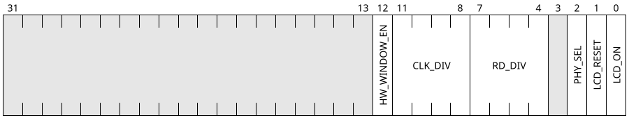

| `DIF_CFG` field | Meaning |
|---|---|
| `LCD_ON` | drives `lcd_on_o` (panel power or backlight enable) |
| `LCD_RESET` | 1 drives the panel reset low (`lcd_reset_n_o = 0`) |
| `PHY_SEL` | 0 = 8080, 1 = SPI; writable with `DIF_TYPE = 3`, otherwise reads the fixed PHY; taken at the start of each operation, the unselected PHY never asserts its chip select |
| `RD_DIV` | 8080 read strobe timing, see the [8080 PHY](#97-8080-phy); 0 = the read strobe follows `CLK_DIV`; RAZ/WI without the 8080 PHY (`DIF_TYPE = 1`); taken like `CLK_DIV` |
| `CLK_DIV` | bus timing, see the [8080](#97-8080-phy) and [SPI](#98-spi-phy) PHYs (on the 8080 bus, the write strobe, and the read strobe when `RD_DIV` = 0); taken at the start of each operation (command, fill or refresh): a write during an operation applies from the next one |
| `HW_WINDOW_EN` | send CASET/PASET before each refresh and fill; taken at the start of each operation, like `CLK_DIV` |

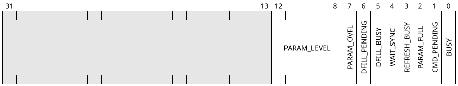

| `DIF_STATUS` bit | Meaning |
|---|---|
| [0] `BUSY` | an operation is in progress, or a command or fill is queued (a queued refresh request is not reported) |
| [1] `CMD_PENDING` | the command slot is occupied |
| [2] `PARAM_FULL` | the parameter FIFO (16 entries) is full |
| [3] `REFRESH_BUSY` | a refresh is in progress |
| [4] `WAIT_SYNC` | a refresh waits for its scanline or TE |
| [5] `DFILL_BUSY`, [6] `DFILL_PENDING` | a fill is running / queued |
| [7] `PARAM_OVFL` | a `DIF_PARAM` write to a full FIFO was dropped (sticky, write 1 to clear) |
| [12:8] `PARAM_LEVEL` | number of parameters in the FIFO |

### 9.2 Commands and parameters

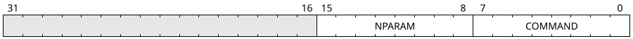

Software writes the parameters to `DIF_PARAM` (a 16-entry FIFO), then the command and
its parameter count to `DIF_CMD`. The driver sends the command byte (D/C low) followed by
`NPARAM` parameters (D/C high) taken from the FIFO; if the FIFO runs dry it waits, chip
select held, for software to write the rest. A command takes up to **255** parameters
(`NPARAM` is 8 bits), more than the FIFO holds: software writes the rest as the FIFO
drains. Parameters written beyond `NPARAM` stay in the FIFO and become the first
parameters of the next command; only a reset empties the FIFO. To drop stray
parameters (a command abandoned after its parameters were written), send a NOP
(`0x00`) with `NPARAM` = `PARAM_LEVEL`: an ILI9341-class panel ignores the data after a NOP.

The driver: `blns_dbi_cmd()` ([driver_guide.md](driver_guide.md#81-dbi-panel-ili9341)).

- The command slot and the fill slot are each one deep, and separate. Writing `DIF_CMD`
  while `CMD_PENDING` = 1, or `DIF_DFILL` while `DFILL_PENDING` = 1, **drops the write**
  with no wait state and sets `CMD_OVFL`: check the matching bit first. A queued fill
  does not block a command write, nor a queued command a fill.
- A `DIF_PARAM` write to a full FIFO (`PARAM_FULL` = 1) **is dropped** with no wait
  state, whatever the driver is doing, and sets `PARAM_OVFL` and `CMD_OVFL`. Write a
  parameter only while `PARAM_FULL` reads 0 (or `PARAM_LEVEL` < 16), as `blns_dbi_cmd()`
  does: a command with more parameters than the FIFO holds then takes the rest as it
  drains the FIFO. A dropped parameter leaves its command short: the driver waits for
  it, chip select held, so write it again.
- `CMD_DONE` is set when a command (or a fill) has been sent and chip select released.
- With nothing else to do, the driver serves a fill first, then a refresh, then a
  command, except that a queued command goes before a refresh requested while the
  previous refresh was running. With the refresh timer at a `PERIOD` not longer than
  a frame (`PERIOD = 1`, or a slow bus) every frame ends with the next request
  queued: a command written meanwhile is then sent right after the current frame
  (after a queued fill), and the frames go on after it; a second command waits for
  one more frame. A command therefore waits one frame at most (plus a fill), with
  the timer running.

### 9.3 DBI refresh

On a refresh request from the BDI (`REFRESH` timer or manual start), the driver:

1. waits for the synchronisation, if one is enabled ([below](#95-synchronisation));
2. with `HW_WINDOW_EN = 1`, sends CASET (`0x2A`, columns 0 to width − 1) and PASET
   (`0x2B`, rows 0 to height − 1);
3. raises `refresh_active` (as the PHY takes the last PASET parameter, or at once
   without the window) and sends RAMWR (`0x2C`); the backend fetches meanwhile, its
   first pixel ready `DIM_W` + 4 cycles plus the VRAM read latency later (the 8080 PHY
   at a small `CLK_DIV` waits for it, once per frame);
4. sends the `width × height` pixels as RGB565 (truncated from RGB888);
5. drops `refresh_active` after the last pixel has left the PHY.

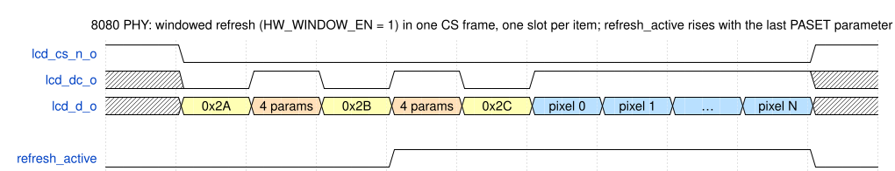

A refresh request that arrives while the driver is busy is remembered (one deep). With
`DISP_CFG.CL_SWAP` the panel's window is the transposed size: either set the panel's
row/column exchange (MADCTL MV) or keep `HW_WINDOW_EN = 0` and send CASET/PASET once
yourself with the panel's own dimensions.

### 9.4 Full-screen fill

Writing an RGB888 colour to `DIF_DFILL` fills the panel memory with it: CASET/PASET when
`HW_WINDOW_EN = 1`, then RAMWR and `width × height` pixels, without touching the VRAM.
Use it to clear the panel at start-up. `CMD_DONE` flags the end.

### 9.5 Synchronisation

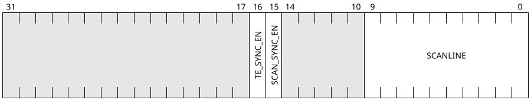

- **Scanline** (`SCAN_SYNC_EN`, 8080 only): before a refresh the driver polls the
  panel's Get_Scanline (`0x45`) and starts when the scanline crosses `SCANLINE` between
  two polls (`previous < SCANLINE ≤ current`, with wrap at the end of the frame), never on
  the first poll. Writing the frame behind the panel's own scan avoids tearing.
- **TE** (`TE_SYNC_EN`): the refresh starts on the next rising edge of `lcd_te_i`
  (synchronised inside Belenos). A TE edge seen while idle is not remembered. Chip select
  stays high during the TE wait, whereas a scanline poll is part of the refresh's CS frame.
- On the 8080 PHY scanline wins if both are enabled, also when `SCAN_SYNC_EN` is set
  while a refresh waits for TE (it then polls the scanline); the SPI PHY ignores
  `SCAN_SYNC_EN` (it has no read path).
- Clearing the enable bit releases a waiting refresh.

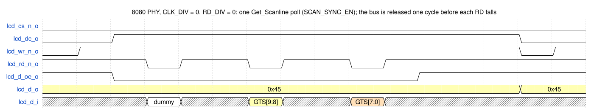

### 9.6 Driver interrupts

| Bit | Flag | Set when |
|---|---|---|
| 0 | `CMD_DONE` | a command or a fill has been sent (not a refresh) |
| 1 | `TE` | rising edge of the synchronised `lcd_te_i` |
| 2 | `CMD_OVFL` | a `DIF_CMD`, `DIF_DFILL` or `DIF_PARAM` write was dropped (the last one also sets `DIF_STATUS.PARAM_OVFL`) |

`DIF_IRQ_FLAG` is write-1-to-clear; the driver's interrupt line is the OR of the enabled
flags and appears in Belenos' `IRQ_FLAG.DIF`. Arming the TE interrupt keeps the clock
running (`bdi_busy`) so that TE edges are seen. Without it the `TE` flag is only
meaningful while the clock runs: a TE edge while the clock is stopped is missed, and
the first cycles after a reset or after the clock restarts can set the flag once
for a TE level that rose while the edge detector was not clocked.

### 9.7 8080 PHY

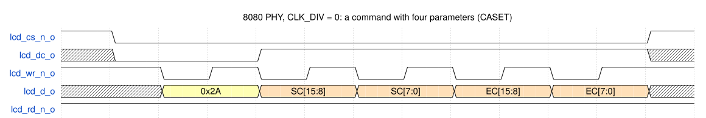

| Item | Timing |
|---|---|
| Write strobe | `WR` low for `CLK_DIV + 1` cycles, high for `CLK_DIV + 1`; data and D/C change on the `hclk` edge on which `WR` falls and stay stable to the end of the strobe: their setup is to the rising edge of `WR` (`CLK_DIV + 1` cycles), with no setup before `WR` falls (a panel that needs one, t_AS > 0, is not served) |
| Read strobe (Get_Scanline) | `RD` low for `2·D + 1` cycles, high for `2·D + 1`, with D = `RD_DIV`, or `CLK_DIV` when `RD_DIV` = 0. Each read starts with one turnaround cycle: the data bus is released (`lcd_d_oe_o = 0`) one cycle before `RD` falls and stays released to the end of the read's high phase, so `RD` is high for `2·D + 2` cycles between two reads |
| Chip select | low for a whole operation (a command with its parameters, or a whole refresh: poll, window, pixels), to the end of the last strobe. It leads the first strobe by one write phase: `CS` falls `CLK_DIV + 1` cycles before the first `WR` falls (every operation starts with a command byte), `2·(CLK_DIV + 1)` cycles before it rises |
| Data | a command on D[7:0] with D[15:8] = 0; a parameter drives D[15:0] with the value written to `DIF_PARAM` (write 0 in [15:8] for 8-bit parameters); one RGB565 pixel per strobe on D[15:0] |
| Throughput | at `CLK_DIV = 0`, one pixel every 2 cycles |

`lcd_d_i` and `lcd_te_i` are synchronised inside Belenos. Choose `CLK_DIV` so that the
write strobe meets the panel's write pulse widths and write cycle time at your `hclk`
frequency, and `RD_DIV` so that the read strobe meets its read pulse widths and read
cycle time; with `RD_DIV` = 0 the reads use `CLK_DIV`, which must then meet both.
On a read the bus is sampled at the edge that raises `RD`, through a synchroniser per
bit: the panel's read access time, plus the round trip through the pads and the board,
plus one `hclk` cycle must fit in the `RD` low time (`2·D + 1` cycles, so D ≥ 1),
and the panel must hold its data while `RD` is low (a bit that changes in the last cycle
may be taken one edge late, after `RD` has risen). After a read strobe Belenos drives
the data bus again `2·D + 1` cycles after `RD` rises at the earliest: that delay must
also cover the panel's output disable time (t_ROD).

| Panel minimum (ILI9341, register read and write) | Belenos strobe | Rule |
|---|---|---|
| t_WRL, t_WRH ≥ 15 ns | `WR` low, high: `CLK_DIV + 1` cycles each | (`CLK_DIV` + 1) · T ≥ 15 ns |
| t_WC ≥ 66 ns | write cycle: 2·(`CLK_DIV` + 1) cycles | 2·(`CLK_DIV` + 1) · T ≥ 66 ns |
| t_RDL ≥ 45 ns, t_RAT ≤ 40 ns | `RD` low: 2·D + 1 cycles | (2·D + 1) · T ≥ max(45 ns, t_RAT + t_IO + T) |
| t_RDH ≥ 90 ns | `RD` high: 2·D + 1 cycles | (2·D + 1) · T ≥ 90 ns |
| t_RC ≥ 160 ns | read cycle: 2·(2·D + 1) + 1 cycles | met with t_RDH |
| t_ROD ≤ 80 ns | bus driven again 2·D + 1 cycles after `RD` rises | (2·D + 1) · T ≥ t_ROD: met with t_RDH |
| t_CS ≥ 15 ns, t_RCS ≥ 45 ns | `CS` falling to the first `WR` falling: `CLK_DIV + 1` cycles (to its rising edge, 2·(`CLK_DIV` + 1)); a read always follows a command in the same `CS` period | met with t_WRL and t_RDL (the data sheet measures to the rising edge; a panel that measures to the falling edge also needs (`CLK_DIV` + 1) · T ≥ t_CS) |

T is the `hclk` period and t_IO the read round trip outside the panel: the `RD` output
pad, the board both ways, the input pad and the route to the synchroniser's first stage
(the [timing constraints](integration_guide.md#7-timing-constraints) bound that route to one `hclk` period).
Worked example, an ILI9341 at `hclk` = 111 MHz (T = 9 ns) with the scanline sync:
`CLK_DIV` = 3 gives `WR` 36 ns low and high and a 72 ns write cycle (≥ 66 ns), one
pixel every 8 cycles; `RD_DIV` = 5 gives `RD` 99 ns low and high (≥ 90 ns, read cycle
198 ns), which leaves 99 − 40 − 9 = 50 ns for t_IO. With `RD_DIV` = 0 the reads would
need `CLK_DIV` = 5 (`RD` 99 ns), and every pixel would take 12 cycles instead of 8;
`CLK_DIV` = 4 gives `RD` 81 ns high, which violates t_RDH. `blns_dbi_config()` derives
`RD_DIV` from the clock this way when its `rd_div` is 0.

At the board level the bus is bidirectional: `lcd_d_o` / `lcd_d_i` with `lcd_d_oe_o` as
the output enable.

### 9.8 SPI PHY

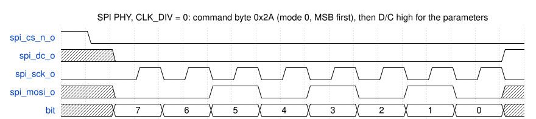

| Item | Timing |
|---|---|
| Clock | `SCK = hclk / (2·(CLK_DIV + 1))`, mode 0 (idle low, sample on the rising edge), MSB first |
| Command | one byte with D/C low |
| Parameter | one byte each, D/C high (`DIF_PARAM[7:0]`) |
| Pixel | RGB565 as two bytes, high byte first |
| Chip select | one CS frame per command item: a windowed refresh is three frames (CASET + 4 parameters, PASET + 4 parameters, RAMWR + pixels); CS stays high at least one SCK period between frames |
| Throughput | `16·(CLK_DIV + 1)` cycles per byte, `32·(CLK_DIV + 1)` per pixel |

`spi_miso_i` is not used: the SPI PHY does not read the panel.

---

## 10. The built-in DPI driver

`blns_dpi` (`DIF_TYPE = 4`, and `DIF_TYPE = 5` with the [TMDS encoder](#11-hdmi)) drives a parallel RGB panel (MIPI DPI): a pixel clock,
horizontal and vertical syncs, a data enable and 24 bits of colour, streamed without a
break, because the panel keeps no picture of its own. The driver owns the panel timing
and **pulls** one Belenos frame per panel frame through the BDI; it ignores the refresh
request (`REFRESH` timer, manual `START`). Two or three line buffers, outside the IP
like the VRAM and the LUT, decouple the BDI stream from the panel scan. The frame is
shown at a programmable position, 1:1 or scaled (nearest neighbour or bilinear), on a
border colour. The same signals feed an HDMI transmitter chip or a VGA DAC.

The driver is off at reset: firmware programs the panel timing, then sets `DPI_EN`.

### 10.1 DPI registers

Offsets from the start of the register port; the shared registers keep the offsets and,
where they mean the same, the bits of the DBI driver. Unlisted offsets and bits read 0.

| Offset | Name | Access | Reset | Fields |
|---|---|---|---|---|
| `0x180` | `DIF_CFG` | RW | 0 | [0] `LCD_ON`, [1] `LCD_RESET`, [3] `DPI_EN`, [11:8] `CLK_DIV`, [16] `PCLK_EDGE`, [17] `HS_POL`, [18] `VS_POL`, [19] `DE_POL`, [20] `BGR`, [21] `FILTER` |
| `0x184` | `DIF_SYNC` | RW | 0 | [12:0] `SCANLINE` (`BLNS_DPI_SYNC_SCANLINE_Msk`) |
| `0x194` | `DIF_STATUS` | RO | — | [0] `BUSY`, [3] `REFRESH_BUSY`, [7] `VBLANK`, [8] `PRESENT`, [28:16] `LINE` |
| `0x198` | `DIF_IRQ_EN` | RW | 0 | [3] `VBLANK`, [4] `LINE`, [5] `UNDERFLOW`, [6] `DETECT` |
| `0x19C` | `DIF_IRQ_FLAG` | R/W1C | 0 | same bits |
| `0x1A0` | `DPI_H_ACT` | RW | 0 | [11:0] active pixels per line |
| `0x1A4` | `DPI_H_BLANK` | RW | 0 | [9:0] front porch, [19:10] HSYNC width, [29:20] back porch |
| `0x1A8` | `DPI_V_ACT` | RW | 0 | [11:0] active lines |
| `0x1AC` | `DPI_V_BLANK` | RW | 0 | [9:0] front porch, [19:10] VSYNC width, [29:20] back porch |
| `0x1B0` | `DPI_IMG_SIZE` | RW | 0 | [11:0] image width, [27:16] image height on the panel; 0 = the frame size; reads 0 with `DPI_SCALER = 0` |
| `0x1B4` | `DPI_IMG_POS` | RW | `0x8000_0000` | [11:0] X, [27:16] Y of the image's top-left pixel; [31] `CENTRE` |
| `0x1B8` | `DPI_SCALE` | RW | 0 | [15:0] X step, [31:16] Y step: source pixels per panel pixel, 4.12 fixed point, 0 = 1.0 (0x0001 to 0xFFFF: an enlargement up to 4096 times, a reduction down to about 1/16); reads 0 with `DPI_SCALER = 0` |
| `0x1BC` | `DPI_BORDER` | RW | 0 | [23:0] RGB888 colour around the image |
| `0x1C0` | `DPI_CTRL` | RW | 0 | [0] `UPDATE` (write 1; reads 1 until taken, and from setting `DPI_EN` until the driver runs; 0 once the driver has stopped with `DPI_EN` = 0), [1] `TEST` (staged by every `DPI_CTRL` write: [configuration updates](#102-configuration-updates)) |
| `0x1C4` | `DPI_FRAMES` | RO | 0 | panel frames since `DPI_EN` was set |
| `0x1FC` | `DPI_CAPS` | RO | build | [3:0] `DPI_LB_AW`, [5:4] `DPI_SCALER`, [6] `DPI_PCLK_SEP`, [7] TMDS encoder (`DIF_TYPE = 5`), [8] DDC register, [9] HDMI mode, [10] HDMI audio |

`0x1C8`–`0x1F8` read 0; the HDMI registers (`DIF_TYPE = 5`) are on the driver's second
page, from `0x200` ([HDMI registers](#111-hdmi-registers)). In `belenos_regs.h` these are
`regs->DPI.*` and `regs->HDMI.*`, with fields `BLNS_DPI_<REG>_<FIELD>_Msk`.

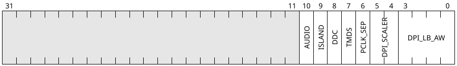

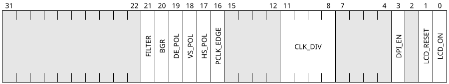

| `DIF_CFG` field | Meaning |
|---|---|
| `LCD_ON`, `LCD_RESET` | drive `lcd_on_o` and `lcd_reset_n_o` (1 = reset asserted), at once |
| `DPI_EN` | 1 runs the panel timing; 0 stops it at once: the outputs go to their idle levels (data enable and syncs inactive, colour 0, clock low; the inactive levels are those of the `DE_POL`, `HS_POL`, `VS_POL` the last run took, of the reset values after a reset, and change to the staged ones when `DPI_EN` starts the driver) and a frame being taken is abandoned |
| `CLK_DIV` | pixel-domain clock cycles per pixel, minus one (1 … 16) |
| `PCLK_EDGE` | 0: the panel samples on the rising clock edge, the data changes on the falling one; 1: the reverse |
| `HS_POL`, `VS_POL` | 0 active low, 1 active high |
| `DE_POL` | 0 active high, 1 active low |
| `BGR` | 1 swaps red and blue on `dpi_rgb_o` |
| `FILTER` | 0 nearest neighbour, 1 bilinear (writable with `DPI_SCALER = 2`, otherwise reads 0) |

### 10.2 Configuration updates

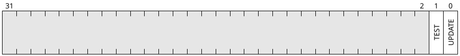

The fields that shape the panel signal are **staged**: `DIF_CFG` [31:8], `DIF_SYNC`, the
timing registers `0x1A0`–`0x1AC`, the image registers `0x1B0`–`0x1BC` and `DPI_CTRL.TEST`.
A write goes to a staging copy, and reads return it. `LCD_ON`, `LCD_RESET` and
`DPI_EN` act at once.

- Setting `DPI_EN` takes the staged values and starts the scan at the first line of the
  vertical blanking, so that the first frame is taken before the first active line.
- While the driver runs, writing 1 to `UPDATE` asks for the staged values; the driver
  takes them at its next frame start (the end of the last active line, where the
  vertical blanking starts), and `UPDATE` then reads 0. One panel frame never mixes old
  and new values.
- Every `DPI_CTRL` write that staging accepts also stages `TEST` from bit 1, the `UPDATE`
  write included: write `UPDATE` together with the `TEST` value wanted
  (`DPI_CTRL = (DPI_CTRL & TEST) | UPDATE`, as the C driver does). Writing `1` alone turns
  the test bars off from that frame.
- A new `CLK_DIV` changes the pixel clock rate at that frame start: the panel sees one
  irregular clock period there, at the end of the line that ends the frame (that line
  then counts one panel clock less).
- Staging writes while `UPDATE` is pending are ignored (the pixel domain reads the staged
  registers themselves): wait for `UPDATE` to read 0 before staging the next change, as
  the C driver does. Writing `UPDATE` again while it is pending has no effect. The same
  holds from setting `DPI_EN` until the driver runs, and `UPDATE` reads 1 then too (a
  `DPI_CTRL` write in that window stages no `TEST` and requests nothing);
  `LCD_ON`, `LCD_RESET` and `DPI_EN` are always written. A start in progress completes
  even when `DPI_EN` is cleared before the driver runs: the driver then runs and stops.
- Clearing `DPI_EN` stops the panel timing; `BUSY` stays 1 until the pixel domain has
  stopped (a few clocks of both domains). Setting `DPI_EN` again before that restarts the
  timing once the stop is complete. With a separate pixel clock that is not running,
  `BUSY` stays 1 until it runs, and so does a pending `UPDATE`.
- Clearing `DPI_EN` abandons a pending update: until the pixel domain has stopped it may
  still take it at a frame start, so `UPDATE` reads 1 and staging writes (and the
  `DPI_HDMI` fields) are ignored until then; from the stop `UPDATE` reads 0, staging
  writes are accepted and writing `UPDATE` has no effect. The next setting of `DPI_EN`
  takes the staged values, abandoned update included, and `UPDATE` reads 1 until the
  driver runs. `UPDATE` reads 1 exactly while staging writes are ignored, so a loop that
  waits for it to read 0 always ends.

### 10.3 Panel timing

A line is `H_ACT` active pixels, then the front porch, the sync and the back porch; a
frame is `V_ACT` active lines, then the vertical front porch, sync and back porch, all in
pixel clocks and lines:

```
line:  | H_ACT pixels (DE) | H front porch | HSYNC | H back porch |
frame: | V_ACT lines       | V front porch | VSYNC | V back porch |
```

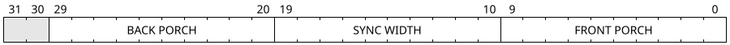

- The sync widths must be at least 1 and the vertical blanking at least one line; the
  porches may be 0 (a panel driven in DE mode ignores the syncs). The horizontal blanking
  must be at least 4 pixels for a configuration change to never mix old and new values
  within a frame: an update is taken at the end of the last active line, while that
  line's last 4 pixels are still in the output pipeline (with standard modes they are
  blanking).
- With `V_ACT = 0` (no active line) the driver still runs whole frames of blanking lines:
  `VBLANK` reads 1, the frame events come once per frame and an `UPDATE` is taken at the
  frame start, after the last line of the frame.
- VSYNC rises and falls with the leading edge of HSYNC (CTA-861): a line keeps the
  previous line's VSYNC level until its HSYNC starts. With a vertical back porch of 0,
  VSYNC ends at the first pixel of the first active line instead, so it never overlaps
  active pixels.
- Pixel rate: the pixel-domain clock divided by `CLK_DIV + 1`. Frame rate: the pixel
  rate divided by (H_ACT + H blanking) × (V_ACT + V blanking).
- With `CLK_DIV` ≥ 1 the panel clock is low for the first ⌈(`CLK_DIV`+1)/2⌉ pixel-domain
  cycles of a pixel and high for the rest (inverted with `PCLK_EDGE = 1`); the data,
  syncs and data enable change with its falling edge (`PCLK_EDGE = 0`).
- Standard modes give the numbers directly: 640 × 480 at 60 Hz is a 25.175 MHz pixel
  clock with H 640 / 16 / 96 / 48 and V 480 / 10 / 2 / 33, both syncs active low.

### 10.4 Frames

- At the first blanking line after the active lines, the driver starts taking the next
  frame (raises `refresh_active`) and Belenos samples the frame configuration
  ([orientation](#24-orientation): the frame pointer, `FRAME_SEL`, `GFX_MODE`, `DISP_CFG`,
  `DISP_SIZE`, `REFR_PITCH`, `LUT_CFG`, `LUT_ROT`). The BDI stream
  fills the line buffers a line or two ahead of the panel scan; a line is free again once
  the panel has shown it for the last time.
- The stream's lines are frame lines of `DISP_SIZE` width pixels. With
  `DISP_CFG.CL_SWAP = 1` they are frame columns: the driver takes lines of `DISP_SIZE`
  height pixels, `DISP_SIZE` width of them, and the picture appears transposed; with
  `X_SWAP` / `Y_SWAP` that gives the 90° rotations, for a panel mounted on its side.
  `PIX_DOUBLE` works as with any driver (the stream is `DISP_SIZE`, doubled by the
  backend).
- A stream line longer than the line buffer (2^`DPI_LB_AW` pixels, `DPI_CAPS.DPI_LB_AW`)
  is cut: the panel shows the border colour past that point, and every frame sets
  `UNDERFLOW` (with bilinear, the last pixel kept too, its right neighbour missing).
  Keep the stream line (`DISP_SIZE` width, or height with `CL_SWAP`) within it.
- Once the panel scan needs no later line of the frame (at the first line past the image,
  or at the frame start when the image reaches the bottom of the active area, as with an
  image larger than the active area), the rest of the frame is taken and dropped at the
  stream's rate: the frame ends whole (no `UNDERFLOW`, no `REFR_ABANDONED`) and the next
  frame is taken right after it. A long dropped tail delays the next frame: when it is
  not taken by the time the next image's first line is shown, that line underflows, and
  a frame still being taken at the following frame start is abandoned. To
  show part of a much taller picture, point the frame pointer and `DISP_SIZE` (with
  `REFR_PITCH`) at the part instead.
- **Underflow.** If the frame is still being taken at the next frame start, the driver
  abandons it (drops `refresh_active` for two cycles, which the BDI allows) and starts the
  new one. A pixel whose source line is not in the line buffer yet shows the border
  colour. Both set `UNDERFLOW`; the frame goes on. An abandoned frame still ends with
  `REFR_DONE`, and `STATUS.REFR_ABANDONED` then reads 1 until the end of the next frame
  ([refresh](#3-refresh)): a program that paces its double buffering on `REFR_DONE` checks
  it (`UNDERFLOW` gives the cause).
- With `DPI_CTRL.TEST = 1` the driver shows eight vertical colour bars across the active
  area (white, yellow, cyan, green, magenta, red, blue, black) instead of the image: a
  panel can be brought up before anything is drawn. The frames are still taken and
  dropped: the VRAM reads, `REFRESH_BUSY`, `REFR_START` / `REFR_DONE` and `FRAME_NUM` go
  on, so `REFR_DONE` keeps pacing. In test mode a late pixel does not set `UNDERFLOW`; an
  abandoned frame does.

### 10.5 Image placement and scaling

The **image** is the frame as shown on the panel: `DPI_IMG_SIZE` wide and high (0 in a
field: the frame's size in that direction), at `DPI_IMG_POS`, or centred in the active
area with `CENTRE = 1`. Every active pixel outside the image shows `DPI_BORDER`. The
image is cropped to the active area. An image larger than the active area is first cut
to its size, from the image's top-left corner: with `CENTRE` it then starts at the
active area's corner and shows the image's top-left part, not a centred crop (scale it
to fit instead).

- **Source pixel.** Panel pixel *i* of the image (counted from its left edge) shows
  source pixel ⌊*i* · `STEP_X` / 4096⌋ of its line, clamped to the last pixel of the
  line; image line *j* shows source line ⌊*j* · `STEP_Y` / 4096⌋, clamped to the last
  line. A step of 0x1000 is 1:1, 0x0800 doubles, 0x0AAB is × 1.5.
- **Fitting a frame to a panel.** The firmware chooses the size and the steps, for
  instance the largest image of the frame's shape: a 320 × 240 frame on a 480 × 272
  panel is 362 × 272 with both steps ⌊240 · 4096 / 272⌋. The C driver computes them
  (`blns_dpi_fit()`).
- **Bilinear** (`FILTER = 1`, `DPI_SCALER = 2`): each colour channel blends the four
  source pixels around the position, with 4-bit weights from the position's fraction
  (bits [11:8]): `h0 = A·(16 − wx) + B·wx`, `h1 = C·(16 − wx) + D·wx`,
  `out = (h0·(16 − wy) + h1·wy + 128) >> 8`, where A, B are pixels *x*, *x* + 1 of
  line *y* and C, D the same of line *y* + 1, clamped at the last pixel and line. It
  applies in a direction whose step is at most 1.0; a larger step (reduction) uses the
  nearest pixel in that direction. Bilinear gives even lines and smooth motion at
  non-integer factors; nearest keeps pixel art and small text sharp and is exact at
  integer factors.
- Without a scaler (`DPI_SCALER = 0`) the image is the frame 1:1, still positioned.
- The placement uses the frame size (`DISP_SIZE`, transposed with `CL_SWAP`) the driver
  knew at the frame start: after a change of size the image is placed for the new size
  from the next frame or the one after.

### 10.6 Status and interrupts

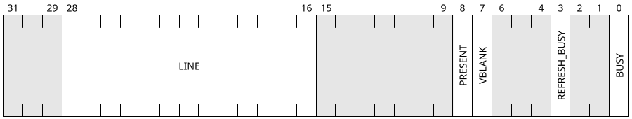

| `DIF_STATUS` bit | Meaning |
|---|---|
| [0] `BUSY` | the panel timing runs (`DPI_EN`), or is stopping |
| [3] `REFRESH_BUSY` | a frame is being taken |
| [7] `VBLANK` | the panel scan is in the vertical blanking |
| [8] `PRESENT` | `panel_detect_i`, synchronised and filtered; 0 after reset ([panel detection](#108-panel-detection)) |
| [28:16] `LINE` | the line being sent, 0 = the first active line (lines ≥ `V_ACT` are the blanking) |

| `DIF_IRQ_FLAG` bit | Set when |
|---|---|
| [3] `VBLANK` | the vertical blanking starts |
| [4] `LINE` | line `SCANLINE` starts |
| [5] `UNDERFLOW` | a frame was abandoned or a pixel shown before its line arrived |
| [6] `DETECT` | `PRESENT` changes |

The flags are write-1-to-clear; the driver interrupt is the OR of the enabled flags and
appears in Belenos' `IRQ_FLAG.DIF`. `LINE`, `VBLANK` and their flags follow the driver's
scan, which leads the panel pins by its output pipeline (a few pixels: about 6 at
`CLK_DIV` 1). `LINE` and `VBLANK` let a single-buffered program draw behind the panel
scan; `REFR_START` / `REFR_DONE` of Belenos mark the frames as
with any driver. `bdi_busy` (and so `hclk_en_o`) follows `DPI_EN` and an armed `DETECT`
interrupt.

### 10.7 Separate pixel clock

With `DPI_PCLK_SEP = 1` the panel timing, the scaler and the outputs run on `dpi_pclk_i`:
the crossings, the pixel-domain reset and the constraints are described in the
[integration guide](integration_guide.md#62-separate-pixel-clock).

### 10.8 Panel detection

A DPI panel cannot be read back: presence comes from outside the pixel bus, through
`panel_detect_i` — the hot-plug detect of an HDMI transmitter or connector, a connector
sense pin, or a board-level probe. The input is synchronised and filtered: `PRESENT`
follows it once it has been stable for 2^16 `hclk_i` cycles, so a bouncing connector
gives one `DETECT` event.

- `PRESENT` is 0 after reset. With the input high from the start (a panel attached, or
  the pin tied to 1 on a board without detection) it rises 2^16 cycles later, with a
  `DETECT` event: expect that event at start-up.
- The filter counts only while `hclk_i` runs: with clock gating, while `DPI_EN` = 1, the
  `DETECT` interrupt is armed, or the bus accesses Belenos. Arm `DETECT` or set `DPI_EN`
  before trusting `PRESENT`.
- A monitor's supported modes (EDID) are read by firmware over the [DDC](#114-ddc) in an
  HDMI build, otherwise over an I2C bus outside Belenos.

### 10.9 Throughput

The BDI delivers up to one pixel per `hclk_i` cycle, shared with the GPU and the VRAM
window for VRAM bandwidth. The driver needs each source line before the panel shows it:
in the time of one panel line, Belenos must deliver the source line the next panel line
needs. At 1:1 that is `DISP_SIZE` width pixels per (H_ACT + H blanking) · (`CLK_DIV` + 1)
pixel-domain cycles, a margin of several times in usual set-ups. A vertical reduction
by *s* takes about *s* source lines per panel line, the skipped ones included. A
shortfall shows as `UNDERFLOW`.

---

## 11. HDMI

`DIF_TYPE = 5` is the DPI driver followed by a TMDS encoder: the same registers and
behaviour, the DPI pins kept, and on `tmds_o` the three 10-bit TMDS symbols of each
pixel-domain clock, for a serialiser outside the IP (an FPGA's 10:1 output serialisers
and differential buffers, or a chip-level PHY). The link starts as DVI signalling, which
every HDMI sink accepts; [HDMI mode](#112-hdmi-mode) adds the HDMI structure and an
InfoFrame.

- **Channels.** Channel 0 carries blue and, in blanking, the syncs (C0 = HSYNC, C1 =
  VSYNC, at the levels driven on `dpi_hs_o` / `dpi_vs_o`); channels 1 and 2 carry green
  and red, with control bits 00. The encoding is DVI 1.0: transition minimisation, DC
  balance by running disparity during the data enable, the four control symbols in
  blanking. Program the mode's sync polarities with `HS_POL` / `VS_POL`, keep `DE_POL`
  and `BGR` at 0.

- **Pixel rate.** TMDS sinks need a pixel clock of at least 25 MHz: 640 × 480 at 60 Hz
  (25.175 MHz) is the smallest common mode. A 320 × 240 frame fills it exactly doubled
  (`DPI_SCALE` steps 0x0800). Exact standard rates come from `DPI_PCLK_SEP = 1`, or
  from running `hclk_i` at the pixel rate.
- **Hot plug.** The connector's hot-plug detect goes to `panel_detect_i` (`PRESENT`,
  the `DETECT` interrupt). The monitor's EDID is read over the [DDC](#114-ddc).

- The symbols' timing and the serialiser: [TMDS serialiser](integration_guide.md#54-tmds-serialiser).

### 11.1 HDMI registers

The HDMI registers (`DIF_TYPE = 5`) are on the driver's second page, from `0x200`:

| Offset | Name | Access | Reset | Fields |
|---|---|---|---|---|
| `0x200` | `DPI_DDC` | RW | `0x0000_0300` | [0] `SCL_LOW`, [1] `SDA_LOW`: 1 pulls the line low; [8] `SCL`, [9] `SDA`: the line levels (RO); RAZ/WI without the [DDC register](#114-ddc) |
| `0x204` | `DPI_HDMI` | RW | 0 | [0] `HDMI` HDMI signalling instead of DVI, [1] `AVI` the AVI InfoFrame once per frame (both taken at the next start of vertical blanking); its fields: [5:4] `PICTURE` aspect ratio, [7:6] `QUANT` RGB quantization range, [11:8] `ACTIVE` format aspect ratio, [22:16] `VIC`; [2] `AUD` [HDMI audio](#113-hdmi-audio), [3] `GP` the generic packet once per frame (with `DPI_AUDIO_EN`, else RAZ/WI); RAZ/WI without [HDMI mode](#112-hdmi-mode) |
| `0x208` | `DPI_AUD` | RW | 0 | [19:0] `N` of the clock regeneration packet (a multiple of 128, see [clock regeneration](#113-hdmi-audio): [6:0] read 0, writes to them ignored), [27:24] `FS` channel-status sampling frequency (bits 24–27), [31:28] `WL` channel-status word length (bits 32–35); read by the pixel domain while audio is on there; writes ignored while `AUD` is set and until the pixel domain has seen it clear (see [Changes](#113-hdmi-audio)); RAZ/WI without `DPI_AUDIO_EN` |
| `0x20C` | `DPI_AUD_STAT` | RO | 0 | [19:0] `CTS` the last measured (kept when audio stops; it may read 0 after a reset of the pixel domain), [24] `LOST` an audio frame was lost since audio started, [25] `ACTIVE` audio on in the pixel domain (`AUD` set, HDMI mode on, `CLK_DIV = 0`), a few clocks of both domains after `AUD` changes; `LOST` reads 0 whenever `ACTIVE` reads 0 (it clears while audio is off); RAZ/WI without `DPI_AUDIO_EN` |
| `0x210` | `DPI_PKT0` | RW | 0 | the generic packet's header: [7:0] HB0, [15:8] HB1, [23:16] HB2; read-only while `GP` is set (writes ignored); RAZ/WI without `DPI_AUDIO_EN` |
| `0x214`–`0x22C` | `DPI_PKT1`–`DPI_PKT7` | RW | 0 | the generic packet's bytes PB0–PB27, four per register, the lowest in [7:0]; written as `DPI_PKT0`; RAZ/WI without `DPI_AUDIO_EN` |

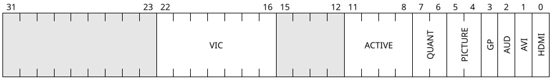

### 11.2 HDMI mode

With `DIF_TYPE = 5` and `DPI_ISLAND_EN = 1`, `DPI_HDMI.HDMI` switches the link from DVI to
HDMI signalling, and `DPI_HDMI.AVI` adds the AVI InfoFrame once per frame: the packet that
tells the sink the picture's aspect ratio, the shape of its useful part and the video
format.

- **Video.** Every active line is preceded by an 8-character video preamble (control
  characters with CTL0 = 1) and a 2-character video guard band, in the last 10 pixels of
  the blanking before the line (the scan marks them).
- **Data island.** One placement rule in every build: an island's control period starts
  at the first pixel of a horizontal blanking, and its preamble at the 6th. Without
  audio there is one island per frame, in the horizontal blanking of the first line of
  the vertical blanking; with [HDMI audio](#113-hdmi-audio) islands may come in every line
  (the same transmitter serves both builds). An island is an 8-character preamble
  (CTL0 = CTL2 = 1), a 2-character guard band, the packets as 32 TERC4 characters each,
  and a 2-character guard band. Channel 0 carries
  HSYNC and VSYNC in every island character, and its bit 3 is 0 on the island's first
  data character only. Subpacket bits go two per character on channels 1 and 2, the header
  one per character on channel 0, each block with its BCH parity byte
  (x^8 + x^7 + x^6 + 1, the HDMI ECC).
- **InfoFrame.** Belenos builds it from the fields of `DPI_HDMI`: type 0x82, version 2,
  13 bytes; RGB with the active format present, no bars, no scan information; `PICTURE`
  (1 4:3, 2 16:9), `ACTIVE` (8 as the picture, 9 4:3, 10 16:9, 11 14:9, centred) and
  `VIC` (the CTA-861 video code: 1 for 640 × 480 at 60 Hz), `QUANT` (data byte 3 bits 3:2,
  Q1:Q0: 0 the default range of the format, 1 limited 16–235, 2 full 0–255; 3 is
  reserved); the checksum. To change the fields while
  the InfoFrame is sent, write them with `AVI` set and then `DPI_CTRL.UPDATE`: they are
  taken at the next frame start, with the rest of the staged configuration; writes to
  the fields while that `UPDATE` is pending are ignored (after `DPI_EN` is cleared,
  which abandons it, until the driver has stopped). Another sequence also works:
  clear `AVI`, wait for a frame start, write the fields with `AVI` clear, then set `AVI`
  in a separate write (they are taken when `AVI` rises). The rise reaches the pixel
  domain a few clocks of both domains after the write and nothing protects the fields
  then: do not change them in the write that sets `AVI`, nor within a few clocks after
  setting or clearing `AVI` (a write that clears `AVI` keeps the fields). The fields are
  also taken when setting `DPI_EN` starts the driver: writes to them are ignored from the
  `DPI_EN` write until the driver runs (while `DPI_CTRL.UPDATE` reads 1), as for the
  staged configuration.
- **Quantization range.** The default range of the CTA-861 CE formats (a `VIC` other
  than 0 and 1) is limited (16–235), that of 640 × 480 (VIC 1) and of the IT formats
  (VIC 0) full. A PC-style
  framebuffer uses the whole 0–255 range: on a CE timing (720 × 480, 1280 × 720, ...)
  set `QUANT` = 2 (full), or the sink stretches 16–235 to 0–255, crushing the darks and
  clipping the highlights. The sink honours full range only when its EDID allows it
  (video capability data block, `QS` = 1); otherwise send limited-range pixels (a 16–235
  palette or LUT) with `QUANT` = 0 or 1.
- **Timing.** Both enables are taken at the next start of vertical blanking. HDMI mode
  needs `CLK_DIV = 0` (one pixel per pixel-domain clock; with a divider the link stays
  DVI) and a horizontal blanking of at least 63 pixels for the island (every standard
  mode has more: 138 for 720 × 480, 160 for 640 × 480, 370 for 1280 × 720). With a
  shorter blanking the link is in HDMI mode with no island, so with no InfoFrame,
  silently.

A 640 × 480 picture (VIC 1, 4:3) whose active part is a 16:9 frame in its centre lets a
sink that follows the active format show that frame without the bars; whether the sink
scales by the InfoFrame or by its own setting is the sink's choice.

### 11.3 HDMI audio

With `DPI_AUDIO_EN = 1`, Belenos carries a stereo audio stream to the sink, taken from an
I2S input, and a packet that software writes (a Source Product Description InfoFrame, for
instance, which some sinks show as the source's name).

- **Conditions.** Audio and the generic packet are sent only in HDMI mode
  (`DPI_HDMI.HDMI`) with `CLK_DIV = 0`, in a horizontal blanking of at least 63 pixels,
  at an audio frame rate within the [rates](#113-hdmi-audio) below; `DPI_AUD_STAT.ACTIVE`
  tells when audio is on.
- **Input.** I2S with Belenos the clock slave: `LRCK` low for the left channel, the most
  significant bit one `BCLK` after the `LRCK` edge, data launched on falling edges, slots
  of up to 63 bits: the 24 most significant bits are kept, a shorter slot zero-filled. The
  three lines are sampled through synchronisers in the pixel domain, and SD and `LRCK`
  are taken in the clock that sees the `BCLK` rising edge: `BCLK` must stay high and low
  for at least 2 pixel clocks each (a pixel clock at least 4 times `BCLK` at a 50 % duty
  cycle), with the skew of SD and `LRCK` against `BCLK` well under a pixel clock. No audio
  clock enters the design.
- **Start and stalls.** The receiver starts at the first `LRCK` edge after audio is
  switched on, so the first frame sent is whole. `BCLK` stopping for 1023 pixel clocks
  counts as a stall, and so does `LRCK` stopping while `BCLK` runs (a slot reaching 64
  bits): the receiver drops the slot in progress, waits for an `LRCK` edge again and the
  CTS measurement restarts.
- **Islands.** With audio, a data island may start in every line, at the first pixel of
  its horizontal blanking: up to two packets when the blanking is at least 95 pixels long,
  one when it is at least 63 (no island in a shorter blanking). The packets go in this
  order: an audio sample packet (up to 4 stereo frames held), the clock regeneration
  packet after each CTS measurement, then once per frame the AVI InfoFrame (`AVI`), the
  audio InfoFrame (`AUD`) and the generic packet (`GP`); in a one-packet island the
  audio sample packet gives way to a due packet while fewer than 3 frames wait. A null
  packet completes an island planned for two.
- **Rates.** An audio sample packet carries at most 4 frames and one goes per line, so
  the audio frame rate must stay under 4 times the line rate (192 kHz needs more than
  48 000 lines per second), and under twice the line rate with one-packet islands. A
  frame completed while a sample packet is sent waits for the end of that packet and
  is lost if the next slot ends first: an I2S slot must last at least 28 pixel clocks
  (7 bits at the fastest `BCLK`).
- **Samples.** Each frame is sent as a 2-channel subpacket, valid, with no user data and
  the IEC 60958 channel status: consumer, linear PCM, no copyright asserted, channel
  numbers 1 and 2, the sampling frequency and word length of `DPI_AUD`; a block start
  every 192 frames. A frame arriving while 4 are waiting is lost (`DPI_AUD_STAT.LOST`).
- **Clock regeneration.** Belenos counts pixel clocks over `N` / 128 frames of the
  stream: that is the CTS the sink needs to rebuild the audio clock, sent with `N` and
  readable in `DPI_AUD_STAT`. Because the CTS is measured, any `N` that is a multiple of
  128 works; the usual values are 4096 at 32 kHz, 6272 at 44.1 kHz and 6144 at 48 kHz.
  The low 7 bits of `N` read 0 and ignore writes (the measurement spans `N[19:7]` frames,
  and the packet sends that `N`), `N` = 0 measures nothing, and `N` / 128 frames must last
  fewer than 2^20 pixel clocks. The first measurement after audio starts or after a
  stall, a measurement that reaches 2^20 − 1 together with the one after it, and one
  that ends while the clock regeneration packet of the one before is sent, are
  dropped. After a reset of the pixel domain `DPI_AUD_STAT.CTS` may read 0
  until the next measurement.
- **Audio InfoFrame.** Two channels, coding and rate as in the stream.
- **Generic packet.** `DPI_PKT0`–`DPI_PKT7` as written: header and PB0–PB27, the checksum
  of an InfoFrame included.
- **Changes.** A packet that is due when its enable clears is not sent. The generic
  packet changes with `GP` clear (writes while it is set are ignored): clear `GP`, wait
  for the next frame (`DPI_FRAMES`) so that the pixel domain has seen it, write
  `DPI_PKT0`–`DPI_PKT7` and set `GP` again (`blns_dpi_hdmi_packet()`). `DPI_AUD` is read while audio is on in the pixel domain: `N` paces
  the clock-regeneration measurement, so it changes only with audio off. Writes to
  `DPI_AUD` are ignored while `AUD` is set and until the pixel domain has seen it clear
  (a few clocks of both domains; `AUD` reaches the pixel domain whole however briefly it
  is set): software clears `AUD`, writes `DPI_AUD` until it reads back the value written,
  and sets `AUD` again (`blns_dpi_hdmi_audio()`). With `DPI_PCLK_SEP = 1` the pixel clock
  must run for the clear to be seen.

### 11.4 DDC

With `DIF_TYPE = 5` and `DPI_DDC_EN = 1`, `DPI_DDC` gives software the two lines of the
HDMI DDC, the I2C bus on which the monitor offers its EDID (address 0x50: its preferred
mode, its screen size, the modes it accepts). The I2C master runs in software:

- `SCL_LOW` / `SDA_LOW` drive `ddc_scl_pd_o` / `ddc_sda_pd_o`, the output enables of two
  open-drain pads (data 0) with pull-ups on the board, as I2C requires. Both reset to 0,
  the lines released.
- `SCL` / `SDA` read the line levels through a two-stage synchroniser: a level reads back
  two `hclk_i` cycles after it changes on the pin, so a master samples SDA once SCL reads
  high, and waits for SCL to read high after releasing it (a monitor may stretch the
  clock).
- HDMI connectors carry the DDC at 5 V: the board level-shifts it to the pads.

The driver: `blns_dpi_ddc_read()`, `blns_dpi_edid_read()`, `blns_dpi_edid_parse()` and
`blns_dpi_picture()` ([driver_guide.md](driver_guide.md#edid-over-the-ddc)).

---

## See Also

- [register_map.md](register_map.md) — address windows, access rules, versions and the global registers
- [gpu_commands.md](gpu_commands.md) — the GPU registers and command set
- [driver_guide.md](driver_guide.md) — the C driver: each call names the register it writes
- [integration_guide.md](integration_guide.md) — the hardware side of the same features
- `sw/include/belenos_regs.h` — every register and field as `BLNS_<REG>_<FIELD>_Pos` / `_Msk`
