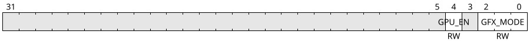
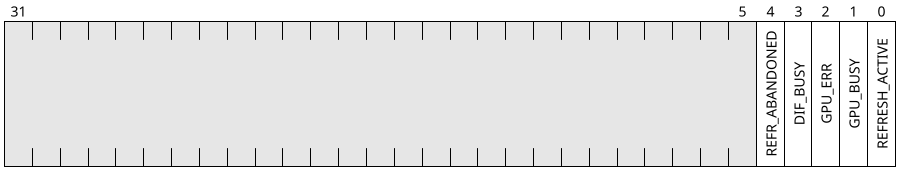
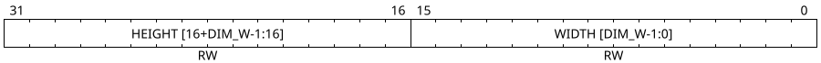
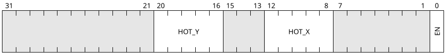
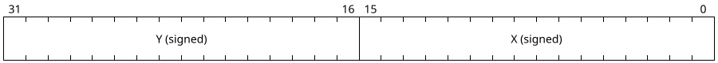
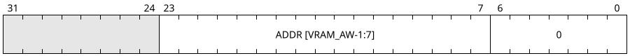

  

# Belenos register map

*The register port of the Belenos graphic controller: its address windows, the access
rules, the version policy and the global registers. The registers of each block are
described with the block: the GPU in [gpu_commands.md](gpu_commands.md#2-gpu-registers),
the display drivers in the [programming model](programming_model.md), the LUT in
[colour](programming_model.md#42-programmable-lut).*

---

## Table of Contents

1. [Address windows](#1-address-windows)
2. [Access rules](#2-access-rules)
3. [Versions](#3-versions)
4. [Global registers](#4-global-registers)
- [See Also](#see-also)

---

## 1. Address windows

The register port is 4 KB. Every register is 32 bits and only **word** accesses are
legal ([access rules](#2-access-rules)).

| Offset | Size | Block | Present when |
|---|---|---|---|
| `0x000`–`0x054` | 22 regs | [global registers](#4-global-registers) | always |
| `0x058`–`0x06C` | 6 regs | [hardware cursor](#4-global-registers) (global registers) | `BLNS_CFG.CURSOR` = 1 (`CURSOR_EN`) |
| `0x070`–`0x07C` | 4 regs | reserved for global registers | — |
| `0x080`–`0x0FC` | 32 regs | reserved for new blocks | — |
| `0x100`–`0x118` | 7 regs | [GPU](gpu_commands.md#2-gpu-registers) | `BLNS_CFG.GPU` = 1 (`GPU_EN`) |
| `0x11C`–`0x17C` | 25 regs | reserved for GPU growth | — |
| `0x180`–`0x1FC` | 32 regs | display driver ([DBI](programming_model.md#91-dbi-registers) or [DPI](programming_model.md#101-dpi-registers) registers) | always (an external driver with `DIF_TYPE = 0`) |
| `0x200`–`0x27C` | 32 regs | display driver, second page ([HDMI registers](programming_model.md#111-hdmi-registers) of the DPI driver) | always (an external driver with `DIF_TYPE = 0`; reads 0 with the DBI driver) |
| `0x280`–`0x7FC` | 352 regs | reserved | — |
| `0x800`–`0xBFC` | 256 entries | [LUT](programming_model.md#42-programmable-lut) bank 0 | `BLNS_CFG.LUT` = 1 (`LUT_EN`) |
| `0xC00`–`0xFFC` | 256 entries | LUT bank 1 | `BLNS_CFG.LUT2` = 1 (`LUT_BANKS = 2`) |

Every reserved offset reads 0 and ignores writes. A block grows only inside its own
range or into a reserved range named for it; a new block takes a reserved range, so no
register ever moves.

---

## 2. Access rules

- Only **word** accesses are legal. Any other size (a byte, a half-word, or wider than a
  word) gets the AHB two-cycle ERROR response and has no effect: a write is dropped, a
  read returns no valid data. Address bits [1:0] are ignored: an unaligned word access
  goes to the aligned word, with no error.
- With `BLNS_CFG.PRIV_CHECK` = 1 (`PRIV_CHECK_EN`) a user-mode access (`hprot[1]` = 0)
  gets the same ERROR, on this port and on the
  [VRAM window](programming_model.md#5-drawing-through-the-vram-window). Supervisor and machine mode are not
  told apart: PMP protects Belenos from supervisor software if needed
  ([privilege check](integration_guide.md#11-privilege-check)).
- On an aRVern hart an ERROR on a data access is a resumable NMI
  (`mncause = 0x80000003`), not a load or store access fault.
- Unmapped and reserved offsets read 0 and ignore writes, with an OKAY response.
- Every register answers with **zero wait states**, except:
  - the [LUT](programming_model.md#42-programmable-lut): one wait state on a read, none on a write, and up to
    4 more while the refresh reads it;
  - with `DIF_TYPE = 0`, the window `0x180`–`0x27C`, which answers with the external
    driver's own timing (`bdi_reg_ready_i`);
  - any access made while a [VRAM-window](programming_model.md#5-drawing-through-the-vram-window)
    write is still posted: it waits until that write reaches the VRAM (usually none,
    at most the cycles the window write itself would have waited), so everything a
    register write starts sees the window writes made before it.
- No register has a read side effect: a debugger's memory view, or a stray read,
  changes nothing.

In `belenos_regs.h` the port is a `BLNS_TypeDef`: the registers below are `regs->ID`,
`regs->CFG`, `regs->CFG2`, `regs->FRAME_PTR[n]` and, for the others, their names
(`regs->CTRL`, `regs->LUT_CFG`, …); the GPU, display-driver and LUT registers are
`regs->GPU.*`, `regs->DIF.*` (DBI), `regs->DPI.*`, `regs->HDMI.*` and
`regs->LUT[bank][i]`. The fields are `BLNS_<REG>_<FIELD>_Pos` / `_Msk`.

---

## 3. Versions

`BLNS_ID` holds the major, minor and patch version. The register map, the command
encoding, the parameters and the ports are frozen within a major version: an
incompatible change is a new major version, an addition (a register in a reserved range,
a field in bits that read 0, a command in a free encoding, a parameter whose default keeps
the old build) a new minor version, a correction a new patch. Version 0 is a
preview: any of these may still change between 0.x releases. The current value,
`0x0001_0000`, is version 0.1.0. The driver accepts major version 0 only, and refuses an
ID of 0 (no Belenos at that address) as well (`BLNS_ERR_ID`).

---

## 4. Global registers

| Offset | Name | Access | Reset | Fields |
|---|---|---|---|---|
| `0x000` | `BLNS_ID` | RO | `0x0001_0000` | [31:24] major, [23:16] minor, [15:8] patch ([versions](#3-versions)) |
| `0x004` | `BLNS_CFG` | RO | build | [configuration](programming_model.md#1-identification) |
| `0x008` | `BLNS_CFG2` | RO | build | [GPU configuration](programming_model.md#1-identification): [3:0] `FIFO_AW`, [12:4] one bit per optional feature, up to [12] `BILINEAR` (0 without a GPU) |
| `0x00C` | `VRAM_WORDS` | RO | build | [24:0] VRAM depth in 32-bit words ([identification](programming_model.md#1-identification)) |
| `0x010` | `CTRL` | RW | 0 | [2:0] `GFX_MODE`, [4] `GPU_EN` |
| `0x014` | `STATUS` | RO | — | [0] `REFRESH_ACTIVE`, [1] `GPU_BUSY`, [2] `GPU_ERR`, [3] `DIF_BUSY`, [4] `REFR_ABANDONED` |
| `0x018` | `IRQ_EN` | RW | 0 | one enable per `IRQ_FLAG` bit; bit 3 reserved (reads 0) ([interrupts](programming_model.md#6-interrupts)) |
| `0x01C` | `IRQ_FLAG` | R/W1C | 0 | [interrupts](programming_model.md#6-interrupts) |
| `0x020` | `DISP_SIZE` | RW | 1 × 1 | [`DIM_W`−1:0] width, [16+`DIM_W`−1:16] height ([display size](programming_model.md#23-display-size-and-frame-pointers)) |
| `0x024` | `DISP_CFG` | RW | 0 | [0] `CL_SWAP`, [1] `Y_SWAP`, [2] `X_SWAP`, [4] `PIX_DOUBLE` ([orientation](programming_model.md#24-orientation), [pixel doubling](programming_model.md#25-pixel-doubling)) |
| `0x028` | `FRAME_CNT` | RW | 0 | [15:0] frame countdown ([refresh](programming_model.md#3-refresh)) |
| `0x02C` | `REFRESH` | RW | 0 | [0] `START`, [31:4] `PERIOD` ([refresh](programming_model.md#3-refresh)) |
| `0x030` | `FRAME_SEL` | RW | 0 | [1:0] refresh frame; [5:4] `LATCHED` (RO): the index the refresh took for the frame in progress ([frame pointers](programming_model.md#23-display-size-and-frame-pointers)) |
| `0x034` | `DBG_CTRL` | RW | 0 | [0] `FREEZE_REFRESH`, [1] `FREEZE_GPU` ([debug freeze](programming_model.md#7-debug-freeze)) |
| `0x038` | `FRAME_NUM` | RO | 0 | [15:0] frames sent, wrapping ([refresh](programming_model.md#3-refresh)) |
| `0x03C` | `REFR_PITCH` | RW | 0 | [15:0] line pitch of the refresh in source pixels; 0 = the frame width ([display size and frame pointers](programming_model.md#23-display-size-and-frame-pointers)) |
| `0x040`–`0x04C` | `FRAME0_PTR`–`FRAME3_PTR` | RW | 0 | [`VRAM_AW`+4:0] pixel address of each frame; the pointers beyond `FRAME_NR` read 0 and ignore writes ([frame pointers](programming_model.md#23-display-size-and-frame-pointers)) |
| `0x050` | `LUT_CFG` | RW | `0x0000_F000` | [0] `SW_LUT_EN`, [1] `REFR_BANK`, [6:4] `HW_PALETTE`, [11:8] `HW_BG`, [15:12] `HW_FG` ([colour](programming_model.md#4-colour)) |
| `0x054` | `LUT_ROT` | RW | 0 | [7:0] `FIRST`, [15:8] `LAST`, [23:16] `OFFSET` ([palette rotation](programming_model.md#43-palette-rotation)); reads 0 with `LUT_EN = 0` |
| `0x058` | `CURSOR_CTRL` | RW | 0 | [0] `EN`, [12:8] `HOT_X`, [20:16] `HOT_Y` ([hardware cursor](programming_model.md#44-hardware-cursor)) |
| `0x05C` | `CURSOR_POS` | RW | 0 | [15:0] `X`, [31:16] `Y`: the hotspot's source-frame pixel, signed, read back as written |
| `0x060` | `CURSOR_ADDR` | RW | 0 | [`VRAM_AW`−1:7] word address of the 128-word shape block; [6:0] read 0 |
| `0x064`–`0x06C` | `CURSOR_COL1`–`CURSOR_COL3` | RW | 0 | [23:0] RGB888 colours of the codes 1–3 (the LUT entry format) |

**CTRL**

`GFX_MODE` selects the colour depth: 0 = 1 bpp, 1 = 2 bpp, 2 = 4 bpp, 3 = 8 bpp,
4 = 16 bpp (5–7 behave as 16 bpp and read back as written). It applies to the refresh
and the GPU. `GPU_EN` = 0 flushes and stops the GPU (it reads 0 without a GPU).

**STATUS**

`REFRESH_ACTIVE` is high while a frame is being sent and `REFR_ABANDONED` tells whether the
last frame ended before its last pixel ([refresh](programming_model.md#3-refresh)). `GPU_BUSY` and `GPU_ERR`
mirror `GPU_STAT.BUSY` and `ERR` (0 without a GPU). `DIF_BUSY` is the display driver's
busy line (`bdi_busy`, which also keeps the clock on): with the DBI driver an operation in
progress or queued, a refresh request waiting, or the TE interrupt armed; with the DPI
driver `DPI_EN` (or a stop in progress), a frame being taken, or the `DETECT` interrupt
armed; with `DIF_TYPE = 0`, the external driver's `bdi_busy_i`.

**DISP_SIZE**

Only `DIM_W` bits of each field exist ([display size](programming_model.md#23-display-size-and-frame-pointers)).

**CURSOR_CTRL, CURSOR_POS, CURSOR_ADDR**

The cursor registers exist with `CURSOR_EN` (`BLNS_CFG.CURSOR`); without it the six read 0
and ignore writes. `CURSOR_ADDR` has no bits below `VRAM_AW` = 8 (the block is then at
word 0). All but the colours are taken at a frame start
([hardware cursor](programming_model.md#44-hardware-cursor)).

---

## See Also

- [programming_model.md](programming_model.md) — what each register does
- [gpu_commands.md](gpu_commands.md) — the GPU registers (`0x100`–`0x118`)
- [memory_and_ahb.md](memory_and_ahb.md#1-register-port) — the register port from the integrator's side
- `sw/include/belenos_regs.h` — the register map as a C overlay (`BLNS_TypeDef`)
